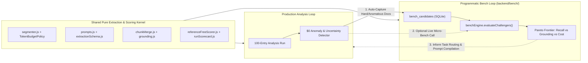

# Architectural Review & Tracked Changes: `docs/road-to-100-entries-plan.md`

**Reviewed Document:** [road-to-100-entries-plan.md](file:///home/oxioxi/proj/our_chattie/docs/road-to-100-entries-plan.md)  
**Review Date:** 2026-11-24  
**Scope:** Line-by-line verification against production code, PDF-Engine Bench, Analysis Lab, SQLite schema design, context management / RLM architecture, task routing, OpenRouter provider resilience, and test suite hardening.

---

## Part 1: Tracked-Changes Audit of `docs/road-to-100-entries-plan.md` (Line-by-Line Findings)

Every file path, line number, and architectural claim in [road-to-100-entries-plan.md](file:///home/oxioxi/proj/our_chattie/docs/road-to-100-entries-plan.md) was cross-checked directly against the codebase. Core diagnoses in the plan—the 427 MB `experiments.json` root-case collapse, `CHUNKING_TRIGGER_TEXT_LENGTH = 25000`, `16×` tabular JSON expansion on `19:Diobeni popis.pdf`, 4× disk reads in `analysis-agent.js`, and the `synthesisInputBuilder.js` chunk-eviction bug—are confirmed.

The **12 concrete discrepancies, hidden bugs, and requirement conflicts** below must be folded into the master plan before generating the ticket breakdown:

### 1. `[Lines 7–13]` Broken Reference at Top of File + Duplicate Mirror Drift
- **Current Text (`L10`):** References `backend/data/pdf-engine-bench/STAGE0-PRE-MIGRATION-TICKET-BREAKDOWN.md`.
- **Finding:** `STAGE0-PRE-MIGRATION-TICKET-BREAKDOWN.md` does not exist anywhere in the working tree or git history. Its content was folded into [FINAL-BENCH-SYNTHESIS-AND-MIGRATION-REPORT.md](file:///home/oxioxi/proj/our_chattie/backend/data/pdf-engine-bench/FINAL-BENCH-SYNTHESIS-AND-MIGRATION-REPORT.md#L207-L238) (Section 3.F) and [EPIC3-PRODUCTION-MIGRATION-TICKET-BREAKDOWN.md](file:///home/oxioxi/proj/our_chattie/backend/data/pdf-engine-bench/EPIC3-PRODUCTION-MIGRATION-TICKET-BREAKDOWN.md#L7).
- **Tracked Change:** Replace `L10` with a reference to Section 3.F of `FINAL-BENCH-SYNTHESIS-AND-MIGRATION-REPORT.md` (and [pdf-bench-ticket-breakdown.md](file:///home/oxioxi/proj/our_chattie/backend/scripts/pdf-bench-ticket-breakdown.md)). Keep the `L558` cleanup deleting the duplicate mirror at [backend/scripts/FINAL-BENCH-SYNTHESIS-AND-MIGRATION-REPORT.md](file:///home/oxioxi/proj/our_chattie/backend/scripts/FINAL-BENCH-SYNTHESIS-AND-MIGRATION-REPORT.md).

### 2. `[Lines 44, 114, 430, 437, 441, 673, 753]` Eliminate All `GOOGLE_API_KEY` Fallbacks & Direct Google SDKs (100% OpenRouter)
- **Current Text:** Retains `GOOGLE_API_KEY` for fallback and Stage-2 synthesis/verification (`google:gemini` pool at `L432`, split-role `assertProviderConfig()` checking both `OPENROUTER_API_KEY` and `GOOGLE_API_KEY` at `L441`, `L673`, `L753`).
- **Tracked Change (Zero `GOOGLE_API_KEY` Fallback):**
  - Route **100% of models and roles through OpenRouter (`OPENROUTER_API_KEY` only)** — including `google/gemini-2.5-flash`, `z-ai/glm-5.3-flash`, `google/gemma-4-31b-it`, and `mistral-ocr`.
  - Delete **both** Google SDKs from [backend/package.json](file:///home/oxioxi/proj/our_chattie/backend/package.json): `@google/genai` **and** `@langchain/google-genai`.
  - In [geminiConfig.js](file:///home/oxioxi/proj/our_chattie/backend/helpers/geminiConfig.js#L11-L21) and [server.js](file:///home/oxioxi/proj/our_chattie/backend/server.js#L9-L14), replace `assertGeminiConfig()` with `assertOpenRouterConfig()` validating `OPENROUTER_API_KEY` alone.
  - **Test Suite Impact:** **20 test files** in `backend/tests/` currently call `jest.mock('@langchain/google-genai', ...)`, and 16 of them (e.g., `pipeline.test.js`, `synthesizer.test.js`, `verifier.test.js`, `reportService.test.js`) rely on `ChatGoogleGenerativeAI.prototype.invoke` being invoked by `trackGeminiInvoke`. When replacing `ChatGoogleGenerativeAI` with the unified OpenRouter client (`backend/llm/openrouterClient.js`), update those test mocks in Phase 0 to mock the local factory instead of `@langchain/google-genai`.

### 3. `[Lines 77, 458, 697, 775]` The `194,100` DAG Link Explosion in `caseContextBuilder.js` Has a Second Root Cause in Tier 3
- **Current Text (`L77`, `L458`):** Blames Tier-1 `filingReference` equality in [caseContextBuilder.js](file:///home/oxioxi/proj/our_chattie/backend/court-analysis/reasoning/caseContextBuilder.js#L209-L222) for creating `194,100 trace.links` from 138 facts.
- **Finding:** Tier 1 (`L219–221`) runs `for (let i = 1; i < group.length; i += 1) linkFacts(group[0], group[i], basis)` — an $O(N)$ **star loop** that produces at most `137` links for 138 facts, never `194,100`.
  - The `194,100`-link explosion actually originates in **Tier 3 ([caseContextBuilder.js#L267–L274](file:///home/oxioxi/proj/our_chattie/backend/court-analysis/reasoning/caseContextBuilder.js#L267-L274))** combined with **`linkFacts` ([L196–L205](file:///home/oxioxi/proj/our_chattie/backend/court-analysis/reasoning/caseContextBuilder.js#L196-L205))**: when filings carry or cite the root case number (`st-2/2013`), `resolveEndpoint` queries `filingIndex.get('st-2/2013')` (138+ facts) and executes a **Cartesian product `for (a) for (b)` across every citation edge**. Inside `linkFacts` (`L198–200`), whenever `facts[a].kind !== facts[b].kind` (`amount` vs `property`), union-find skips uniting them and pushes `{ united: false }` to `traceLinks` on every pair.
- **Tracked Change (`L458`, `L775`):**
  1. Strip bare root case numbers from **both** Tier-1 `groups` **and** Tier-2/3 `filingIndex` (`L228–236`).
  2. Stop logging rejected cross-kind pairs into `traceLinks` inside `linkFacts` (`L198–200`), and never execute an all-pairs fact-to-fact Cartesian product across document-level citation edges (citation edges connect filings/documents, not every line-item fact in Document A to every line-item fact in Document B).

### 4. `[Lines 322–346, 411–412]` `factLedger.js` Never Assigns `row.id` & Throws Away Page Provenance
- **Finding 1 (`row.id` missing):** [caseContextBuilder.js](file:///home/oxioxi/proj/our_chattie/backend/court-analysis/reasoning/caseContextBuilder.js#L58-L65) checks `if (!row || typeof row !== 'object' || !row.id) continue;`, yet neither `buildFactLedger` ([factLedger.js#L57–L138](file:///home/oxioxi/proj/our_chattie/backend/court-analysis/reasoning/factLedger.js#L57-L138)) nor `dedupeLedgerRows` ([L210–L235](file:///home/oxioxi/proj/our_chattie/backend/court-analysis/reasoning/factLedger.js#L210-L235)) ever assigns `row.id`. `indexLedgerRows` has been a silent no-op returning an empty `Map()`.
- **Finding 2 (`page: null` hardcoded):** [factLedger.js](file:///home/oxioxi/proj/our_chattie/backend/court-analysis/reasoning/factLedger.js#L94) hardcodes `page: null` with a stale comment (`L11–13`) claiming no page map exists, even though [analysis-agent.js](file:///home/oxioxi/proj/our_chattie/backend/court-analysis/agents/analysis-agent.js#L359) already attaches `sourcePages`, `sourceChunkId`, `sourceStartIndex`, and `sourceEndIndex` during chunk merge.
- **Tracked Change:** Assign deterministic content-hashed `row.id`s in `buildFactLedger` / `dedupeLedgerRows`, and preserve `sourcePages`, `sourceChunkId`, `sourceStartIndex`, `sourceEndIndex`, and `amountHrk`.

### 5. `[Lines 412, 733]` Do NOT Blindly Delete `propertyFlow.js` in Phase 0
- **Current Text (`L412`):** Instructs deleting `moneyFlow.js` and the legacy `prop-N` shims in `propertyFlow.js`, while `L551` retains `propertyFlow.js` in `reasoning/ledger/`.
- **Finding:** [moneyFlow.js](file:///home/oxioxi/proj/our_chattie/backend/court-analysis/reasoning/moneyFlow.js) is a 44-line legacy wrapper and can be deleted cleanly. However, [propertyFlow.js](file:///home/oxioxi/proj/our_chattie/backend/court-analysis/reasoning/propertyFlow.js#L58-L391) (`438` lines) houses the active implementations of **`reconcileTrazbinaLifecycle`**, **`resolveSupersedesTargetWithBasis`**, **`sharesLifecycleIdentifiers`**, and **`buildValueChangeTimeline`**, imported directly by [reconciliation.js](file:///home/oxioxi/proj/our_chattie/backend/court-analysis/reasoning/reconciliation.js#L26). Only `collectPropertyFlows` (`L50–53`) and `reconcilePropertyFlows` (`L406–415`) are legacy wrappers.
- **Tracked Change:** Delete `moneyFlow.js` and the two legacy wrappers in `propertyFlow.js`, while keeping (or renaming to `lifecycleReconciliation.js`) the active lifecycle engine.

### 6. `[Lines 462, 638–640, 777]` `decisionOutcome` Is Dropped in `evidencePackage.js`, Not Just `synthesizer.js`
- **Current Text (`L638–640`):** Blames `createReasoningEvidenceFromPackage` in [synthesizer.js](file:///home/oxioxi/proj/our_chattie/backend/court-analysis/reasoning/synthesizer.js#L442-L584) for omitting `proceduralFlow`, `decisionOutcome`, and `documentParties`.
- **Finding:** Earlier in the chain, `attachAnalysesToEvidencePackage` ([evidencePackage.js#L319–L346](file:///home/oxioxi/proj/our_chattie/backend/court-analysis/reasoning/evidencePackage.js#L319-L346)) copies `caseNumber`, `decisionDate`, `summary`, `parties`, `documentParties`, `amounts`, `proceduralEvents`, `propertyFlow`, and `citedFilingReferences` from `item.aiResult`, **omitting `decisionOutcome: item.aiResult.decisionOutcome || null` completely**.
- **Tracked Change:** Thread `decisionOutcome` in `evidencePackage.js#L333` first, then expose it in `synthesizer.js`.

### 7. `[Lines 130, 409, 674, 742]` Missing `scanDepth` Is Broken in Three Places, Not Just `pipeline.js#L1398`
- **Finding:** Besides [pipeline.js#L1398–L1404](file:///home/oxioxi/proj/our_chattie/backend/court-analysis/pipeline.js#L1398-L1404) (and the redundant `runCourtAnalysisWithExistingAutomator` at `L1487`), [server.js#L150–L155](file:///home/oxioxi/proj/our_chattie/backend/server.js#L150-L155) calls `analysisStore.createAnalysisRun({ oib, queryType, queryValue, resultFormat })` without passing `scanDepth: parsedRequest.options.scanDepth`, and [localStore.js#L103–L125](file:///home/oxioxi/proj/our_chattie/backend/services/localStore.js#L103-L125) / [runSummary.js](file:///home/oxioxi/proj/our_chattie/backend/court-analysis/utils/runSummary.js) never persist or project `scanDepth`.
- **Tracked Change:** Thread `scanDepth` through `server.js` → `sqliteStore.createAnalysisRun` (`runs.scan_depth`) → `processScrapedCases` → `runSummary.js`.

### 8. `[Lines 157–171, 184]` Hidden `'full'` (`Sve`) Bug in `csvExportClient.js#L248–262`
- **Finding:** In [csvExportClient.js#L219–L262](file:///home/oxioxi/proj/our_chattie/backend/scraper/csvExportClient.js#L219-L262), primary-case filtering (`if (tailSample)`) only executes when `tailSample === true` (`balanced`). Under `scanDepth === 'full'`, `tailSample` is `false`, so `csvExportClient.js` skips primary-case selection, applies `applyBounding` (`L248`) **globally across all cases** up to 400 rows, and sets `analysisBudget: 400` (`L255`), triggering `stratifyClusterEntries` in [pipeline.js#L1174–L1185](file:///home/oxioxi/proj/our_chattie/backend/court-analysis/pipeline.js#L1174-L1185).
- **Tracked Change:** Decouple primary-case pool selection from `tailSample` in `csvExportClient.js`, and ensure `allocation: 'all'` (`full` mode) skips stratified pruning in `pipeline.js` while still building `coverageLedger`.

### 9. `[Lines 573, 593]` Unclosed `pdf.js` Document Handle Memory Leak in `extractTextViaOCR`
- **Finding:** In [analysis-agent.js#L859–L1073](file:///home/oxioxi/proj/our_chattie/backend/court-analysis/agents/analysis-agent.js#L859-L1073), unlike `extractTextFromFile` (`L484`) and `extractTextViaNativePdf` (`L763`), `extractTextViaOCR` never calls `await pdf.destroy()`. Across 30–50 scanned PDFs in a 100-entry run, `pdf.js` document state leaks in memory.
- **Tracked Change:** Ensure `Stage T0` (`pdfPreflight.js`) and `ocrRouter.js` always wrap `pdf.destroy()` in `finally`.

### 10. `[Lines 113, 696, 766]` Two Subtle Bugs in `mergeAnalysisChunkResults` Overlap Deduplication (`analysis-agent.js#L338–352`)
- **Finding:**
  1. `String(sourceText || '').indexOf(quote)` (`L342`) searches from index `0` of the full document rather than `[Math.max(0, segment.startIndex - ANALYSIS_CHUNK_OVERLAP), segment.endIndex]`. Repeated boilerplate lines or table entries earlier in the document resolve to a Page-1 index `< overlapStart`, causing `duplicateFromOverlap` to return `false`.
  2. `identity` (`L340`) serializes **every key** on `fact` including free-text `description`. A 1-word description variation across overlapping chunks prevents deduplication and double-counts amounts.
- **Tracked Change:** Anchor overlap quote matching to the segment's character span and deduplicate overlap facts by `(kind, amount/value, currency, normalizedQuoteSpan || claimRegistryNumber)`.

### 11. `[Line 615]` Prompt Syntax Typo in `buildAnalysisPrompt` (`analysis-agent.js#L1124`)
- **Finding:** [analysis-agent.js#L1124](file:///home/oxioxi/proj/our_chattie/backend/court-analysis/agents/analysis-agent.js#L1124) currently reads: `extract key information as a JSON object with the following keys: "caseNumber", "decisionDate", "summary", and "decisionOutcome" (a medium-sized paragraph summary in Croatian).` — attaching the summary prose instruction to `"decisionOutcome"` before `L1127` contradicts it with an enum.
- **Tracked Change:** Fix the phrasing while replacing the per-chunk summary paragraph with concise `keyClaims[]` bullets.

### 12. `[Lines 663–664]` Sequential ZIP Clobbering Corrupts `factLedger` Provenance & Strips Parent Metadata
- **Finding:** In [pipeline.js#L1694–L1708](file:///home/oxioxi/proj/our_chattie/backend/court-analysis/pipeline.js#L1694-L1708), `for (const file of downloadedFiles)` extracts all ZIP archives into shared `backend/uploads/` *before* `AnalyzeDocumentsTool` runs at `L1767`. When 15 ZIPs each contain `Podnesak.pdf`, the 15th overwrites the first 14 on disk, so `filesForAnalysis` points 15 different `sourceEntryIndex` records to the exact same bytes—causing `factLedger.js` to falsely merge 14 unrelated court entries as byte-duplicates. Additionally, `extract-tool.js` returns bare `{ text: safeName, filePath: targetPath }`, stripping `sourceEntryIndex` and `sourceDocumentLinkId` from every unzipped child file.
- **Tracked Change:** Isolate every archive into `uploads/extracted/<archiveId>/` **and** propagate the parent `.zip` file's `sourceEntryIndex`, `sourceDocumentLinkId`, and `entryDate` onto every extracted child record.

---

## Part 2: Deep-Dive Architectural Reviews & Design Responses

### 1. The "Smoking Gun" Convergence: Section 2.1 (`b109f471` Lab Failures) vs. PDF-Engine Bench
In Section 2.1 (`L80`), Analysis Lab `b109f471` failed completely on **6 vital documents**: `Diobeni popis.pdf`, `Završni račun.pdf`, `Prijedlog stečajnog upravitelja.pdf` (×2), and `Ugovor o ustupu tražbina.pdf` (×2). It is not a coincidence that **those exact documents** were the core failure archetypes surfaced independently by the PDF-Engine Bench:

1. **`Diobeni popis.pdf` (The `25,000`-Char Cliff + `16×` JSON Expansion):** At `24,788` chars, `19:Diobeni popis.pdf` sat 212 characters below production's `CHUNKING_TRIGGER_TEXT_LENGTH = 25000`, forcing one unchunked request that requires `~45,000–55,000` output tokens (`~16×` row expansion) and blows past `maxOutputTokens` (`16,384`).
2. **`Završni račun.pdf` (39 Pages, ~12k Prose Bloat + All-or-Nothing Timeouts):** Long multi-page financial statements hit compounding failure probability ($1 - (1 - p)^N$), request 39 redundant chunk summaries (`~12k` chars), and truncate/timeout without recursive bisection or idle-stream recovery.
3. **`Ugovor o ustupu tražbina.pdf` (`5.38 MB` Scans / Hybrids):** Heavy scanned/hybrid cession contracts hit OpenRouter Cloudflare Worker AI's ~5 MB cap (`HTTP 400`), fail Gemini raster OCR via `RECITATION` blocks (`5/8` new court scans), or bypass OCR entirely when pages 1–3 are digital text and pages 4–12 are scanned contracts.
4. **`Prijedlog stečajnog upravitelja.pdf` (Dense Tabular Annexes & Generic Names):** Trustee motions frequently embed multi-column claim/cost tables (`table_dense`) and arrive inside `.zip` archives with generic filenames that collide on disk.

**The Power-Law Lesson of Bankruptcy Dockets:** Losing 6 routine `Podnesak.pdf` hearing-notice entries costs ~0% of case truth; losing the 6 ledger, final account, trustee proposal, and cession filings costs **90%+ of financial and legal truth**—and no downstream DAG or synthesis architecture (`context-tree-v1`) can recover facts that never survived Stage T / Stage A.

---

### 2. The Puppeteer `80 + 20` Forward+Tail Audit (Why It Bugs Us)
Inspecting [courtSearchPuppeteer.js](file:///home/oxioxi/proj/our_chattie/backend/scraper/courtSearchPuppeteer.js) (`L43–44`, `L250–381`, `L981–1023`) and [pipeline.js](file:///home/oxioxi/proj/our_chattie/backend/court-analysis/pipeline.js#L148-L158) exposes **six concrete bugs** with Puppeteer `80 + 20`:

1. **Puppeteer Completely Bypasses `stratify.js` ([pipeline.js#L1174–L1185](file:///home/oxioxi/proj/our_chattie/backend/court-analysis/pipeline.js#L1174-L1185)):** `CsvExportClient` sets `discoveryMetadata.selection.analysisBudget`, triggering `stratifyClusterEntries`. `CourtSearchPuppeteer` never sets it—so Puppeteer runs blindly analyze pages `1..8` + `N-1..N` with zero `ledger` priority, zero `admin` cap, and zero middle-year `Diobeni popis` / `Završni račun` coverage (`coverageLedger: null`).
2. **"Global-Oldest" Tail Pollution (`courtSearchPuppeteer.js#L372`):** On an OIB or text query spanning multiple cases across 40 pages, `performTailSample` jumps to `page = totalPages` of the **ungrouped global search**. The oldest 2 pages often belong to an unrelated 2011 secondary lawsuit, which gets discarded when the primary cluster is selected—leaving the primary case with **zero origin entries**.
3. **Hardcoded `TAIL_SAMPLE_ENTRIES = 10` & `TAIL_SAMPLE_MAX_PAGES = 2` (`L43–44`):** `courtSearchPuppeteer.js` ignores `scanDepth.js` (`tailEntries: 20`). And if page `N` has 2 entries, 2 pages yield at most `12` entries, not `20` (guaranteeing 20 entries requires up to `Math.ceil(tailEntries / 10) + 1 = 3` pages).
4. **Intra-Page Reversal Bug (`L353–360`):** Each e-Oglasna page lists rows descending (newest first on that page). Walking backward (`page = N`, then `N-1`) with `accumulated.push(...pageResults)` and `.slice(0, limit)` keeps the **newest** entries of page `N-1` instead of the **oldest** entries adjacent to page `N`.
5. **`limit (100) + tail (20) = 120` Double-Count (`L1010–1015`):** `pipeline.js#L1282` passes `scrapeLimit = 100` as `limit`, and `courtSearchPuppeteer.js#L1010` slices forward rows to `limit` (`100`) and appends tail rows *on top*.
6. **Pre-Filter Starvation (`L269`, `L994`):** Puppeteer stops after 8 pages (80 raw rows) *before* filtering `r.documentDownloadLink`. If 25 rows lack PDFs, the run receives 55 entries.

**Clean Fix:** Puppeteer is already a rare CSV-export fallback, and each search results page is lightweight HTML (images/styles/fonts blocked). Instead of hardcoding `80 + 20`, fetch search result HTML pages (up to ~30–40 pages in batches of 4 via in-browser `fetch` or fast page navigation) to collect the primary-case pool, then feed it into the **exact same `stratifyClusterEntries(pool, { budget: 100 })` allocator** used by CSV.

---

### 3. Decoupling Analysis & Bench — While Letting Analysis "Call" & Drive the Bench Loop
Currently, `scripts/lib/arms.js` and `bounded-analysis.js` import internals directly from `analysis-agent.js`, while `benchmark-pdf-engines.js` is bound to `OIB_CASE_DOCS` and CLI child processes. Decouple them around a shared pure kernel while enabling a closed **Production → Bench** feedback loop:



1. **Zero-Cost Production Anomaly Harvesting (`bench_candidates`):** At the end of every document in Stage A, deterministic `$0` checks flag anomalies: `groundedClaims / totalClaims < 0.85`, bisection depth `>= 1` or `finish_reason === 'length'`, `total-vs-parts` arithmetic mismatch (`reconciliation.validationWarnings`), `assignmentCueGap != null`, `reasoningRatio > 0.65`, or partial/stray-char OCR. The pipeline writes `(contentHash, frozenTranscript, knownParties, prodAiResult, triggerReasons, runId)` to SQLite `bench_candidates` without ever risking the live run.
2. **Reference-Free Automatic Micro-Benching:** Using `metrics.js` regex anchor extractors (`extractOibs`, `extractAmounts`, `extractDates`, `extractFilingNumbers`), `grounding.js` containment, and `total-vs-parts` arithmetic closure, `backend/bench/` can score challenger models/prompts (`z-ai/glm-5.3-flash`, `google/gemma-4-31b-it`, `google/gemini-2.5-flash`) on newly captured production anomalies **without needing human gold files first**.
3. **Stage-2 Report Bench Mode:** Re-purpose the best half of Analysis Lab inside `backend/bench/`: evaluate Stage-2 synthesis models/prompts on frozen `ClusterEvidencePackage`s / SQLite `run_facts` using `runScorecard.js`.

---

### 4. How Can We Drive Down Costs Further?
Beyond the plan's baseline savings (`$1.10–$2.60` cold / `$0.16–$0.42` warm), six structural levers can drive cold 100-entry runs below **`$0.40–$0.75`**:

1. **Move `[PROD-205]` `tableRows[]` Compact Schema Into Phase 3 Main Path:** Output tokens cost 3×–4× more than input tokens, and `19:Diobeni popis.pdf` expanded `16×` (`4` objects + `4` repeated quotes per row). Emitting `tableRows[]` (1 object + 1 quote per row, expanded deterministically in JS) cuts dense-table output tokens by **~70%** (**-40% to -55% Stage A output cost**).
2. **Page-Level OCR Slicing + Blank-Page Skip (`Stage T0`):** `or-mistral-ocr` bills `$0.002/page`. Slicing only scanned pages via `pdf-lib` and skipping blank/low-entropy scan pages avoids paying to OCR digital or blank pages (**-50% to -70% Stage T spend**).
3. **`Stage T0.5` Deterministic Fast-Path for Routine Admin Notices:** Short notices (`< 800–1,000` chars) with zero currency regex matches (`!/\d+[.,]\d{2}/`) and zero cession keywords (`!/ustup|cesij|ugovor/i`) can be parsed deterministically or routed to a minimal no-reasoning micro-prompt (**-15% to -25% Stage A requests**).
4. **Static System-Prefix Prompt Ordering for Provider Prompt Caching:** Put 100% static schema instructions in `messages[0]: system` and put `knownParties` + `segmentText` in `messages[1]: user`. Providers on OpenRouter discount repeated cached system prefixes by **50%–75%** (**-30% to -45% Stage A input cost**).
5. **Deterministic Pre-Verification in `verifier.js`:** Findings backed directly by `grounded: true` ledger rows whose numeric value, OIB, and party match verbatim can be verified in code at `$0`, sending only narrative/multi-hop findings to the LLM verifier (**-50% to -75% Stage 2 Verifier cost**).
6. **Tiered Model Routing:** Route `verify`, `fieldRepair`, and light prose/raster tasks to `google/gemma-4-31b-it` (~7× cheaper output than Gemini 2.5 Flash) or `glm-5.3-flash` with `reasoning` disabled on simple chunks.

---

### 5. The Deterministic Core — Moving Parts, Iteration & Re-Envisioning
1. **Expand `factLedger.js` from 2 Kinds to 4 Kinds (`amount | property | party | procedural_outcome`):** The plan relies on "ledger-driven FTS5 queries" built from party OIBs, registry numbers, and procedural outcomes, yet `factLedger.js` only holds `amount` and `property` today. Expand `factLedger.js` (and SQLite `run_facts`) to cover all four canonical fact families, assign deterministic `row.id`s, and retain `sourcePages`, `sourceChunkId`, and offsets.
2. **Canonical Party Entity Resolution (`partyRegistry.js`):** Before `reconciliation.js` and `caseContextBuilder.js` run, resolve party name variants (`"B2 KAPITAL d.o.o."`, `"B2 Kapital Zagreb"`) across `documentParties`, `caseInfo.participants`, and `registry_cache` onto canonical `canonicalPartyId`s (`oib:<11-digit>` or normalized name key). This ensures cessions or schedules omitting an OIB still link to the right creditor thread.
3. **Extraction-Time Arithmetic Closure Check (`Stage A` → Self-Healing):** Run `reconciliation.js`'s `total-vs-parts` check immediately at the end of `documentAnalyzer.js`. When a document's stated `UKUPNO` disagrees with `sum(line_item)`, flag it immediately for bisection/row-recovery or `bench_candidates` capture.
4. **Pre-Aggregated Creditor & Procedural Digests:** Feed Stage 2 pre-aggregated creditor summaries (top creditors, recovery % by `isplatniRed`, cession chains, milestone rulings) rather than 600 raw flat rows.

---

### 6. Critique of the Section 4.3 SQLite Schema & Settings (`analysis.db`)
The `better-sqlite3` + FTS5 consolidation (`L239–395`) is the right architectural choice over monolithic JSON files and over Turbopuffer. However, auditing the proposed DDL line by line reveals **5 critical SQLite implementation traps and schema improvements**:

1. **CRITICAL: Missing `PRAGMA foreign_keys = ON;`:**
   - The schema declares `ON DELETE CASCADE` on `run_artifacts`, `run_events`, `run_facts`, and `run_chunks` (`L262`, `L270`, `L325`, `L352`).
   - In SQLite, **foreign key enforcement defaults to `OFF` on every connection!** Without `db.pragma('foreign_keys = ON')` executed at connection startup, `DELETE FROM runs WHERE id = ?` silently leaves orphaned rows across all child tables.
   - Standardize the startup pragma block in `sqliteStore.js`:
     ```sql
     PRAGMA journal_mode = WAL;
     PRAGMA synchronous = NORMAL;
     PRAGMA foreign_keys = ON;
     PRAGMA busy_timeout = 5000;
     PRAGMA temp_store = MEMORY;
     PRAGMA cache_size = -64000; -- 64 MB page cache
     ```
2. **CRITICAL: FTS5 External Content Table Sync Triggers Missing (`L365–370`):**
   - `run_chunks_fts` uses `content='run_chunks', content_rowid='rowid'`. In SQLite FTS5, external-content tables **do NOT automatically index `INSERT`s or remove rows on `DELETE` / `ON DELETE CASCADE`**! Without triggers, `run_chunks_fts` stays empty—or worse, deleting a run cascades `run_chunks` while leaving stale docids in `run_chunks_fts`, throwing `SQLITE_CORRUPT_VTAB` (`database disk image is malformed`) on queries!
   - Add mandatory sync triggers in the migration:
     ```sql
     CREATE TRIGGER run_chunks_ai AFTER INSERT ON run_chunks BEGIN
       INSERT INTO run_chunks_fts(rowid, normalized_text) VALUES (new.rowid, new.normalized_text);
     END;
     CREATE TRIGGER run_chunks_ad AFTER DELETE ON run_chunks BEGIN
       INSERT INTO run_chunks_fts(run_chunks_fts, rowid, normalized_text) VALUES ('delete', old.rowid, old.normalized_text);
     END;
     CREATE TRIGGER run_chunks_au AFTER UPDATE ON run_chunks BEGIN
       INSERT INTO run_chunks_fts(run_chunks_fts, rowid, normalized_text) VALUES ('delete', old.rowid, old.normalized_text);
       INSERT INTO run_chunks_fts(rowid, normalized_text) VALUES (new.rowid, new.normalized_text);
     END;
     ```
3. **Enrich `run_facts` Columns (`L323–345`):**
   - Add `value_hrk REAL`, `canonical_party_id TEXT`, `isplatni_red TEXT`, `supersedes TEXT`, `value_role TEXT`, `legal_effect TEXT`, `source_pages_json TEXT`, `source_chunk_id TEXT`, `source_start_index INTEGER`, `source_end_index INTEGER`, and index `(run_id, canonical_party_id)` and `(run_id, doc_hash)`. Also expand `kind` to `'amount' | 'property' | 'party' | 'procedural_outcome'`.
4. **Separate Reusable `segment_checkpoints` from Append-Only `llm_traces`:**
   - Keep `segment_checkpoints` strictly as the valid, cache-eligible Stage A fast-lookup table (`checkpoint_key -> parsed_json`), and move raw forensic capture (`raw_response`, `user_prompt`, `actual_provider`, `ttft_ms`, retries, repairs, Stage T OCR, Stage 2 synthesis/verify) into an append-only **`llm_traces`** flight recorder + **`prompt_registry`** + **`bench_candidates`** (see Section 15). Also add `task_type` and `provider_slug` to `ocr_transcripts`.
5. **Audit & Prune the `settings` Table (`L280–284`):**
   - Look at what currently lives in `settings.json` via [reasoningSettings.js](file:///home/oxioxi/proj/our_chattie/backend/helpers/reasoningSettings.js): `rerankMode`, `reasoningPlanner`, `reasoningFollowUp`, `reasoningClaimJudge`, `reasoningSignificance`, and `useSettings.js` toggles.
   - Once Phase 0 deletes those 5 obsolete LLM micro-passes (`L416`), almost every existing key in `settings` becomes dead! Keep `settings` minimal and explicit (e.g., `defaultScanDepth`, `activeTaskRoutingOverrides`, `uiPreferences`) and remove dead `reasoningSettings.js` keys during Phase 0 migration so `settings` doesn't remain a graveyard of obsolete flags.

---

### 7. Context Management, RLM (`alexzhang13/harness-cg`), Tavily RL Context Management & Context Folding
Researching [`alexzhang13/harness-cg`](https://github.com/alexzhang13/harness-cg) / [`alexzhang13/rlm`](https://github.com/alexzhang13/rlm), [Tavily's HF blog on Context Management in RL](https://huggingface.co/blog/Tavily/understanding-the-role-of-context-management-in-rl), and `Context-Folding` (`FoldAgent`) directly validates what our own experiments proved:
- **Context Rot & Compaction Loss:** Stuffing 100 filings or 500 claims into a single prompt causes attention rot, while naive upfront summarization (`contextNodeSummary.js`) loses exact figures (`0/4` valid in Lab `b109f471`).
- **The RLM + Shift Hand-Off Architecture:**
  1. Treat SQLite (`run_facts` + `run_chunks_fts`) as our **External RLM Symbolic Environment**, never an unbounded prompt string.
  2. Treat Stage A (`GLM 5.3 Flash` on `3,500`-char chunks) as **Context-Folding workers**: each worker branches over one narrow slice, folds extracted typed facts + verbatim quote offsets into `run_facts`, and discards the raw working tokens.
  3. In Stage 2 (`synthesizer.js`), replace 48k flat claim stuffing with an **RLM Symbolic Case Environment View**: compact case spine + chronological rulings table + aggregated creditor/asset thread rollups + pre-computed conflicts + top FTS5 BM25 ground-truth excerpts queried deterministically from the ledger. Optionally expose a single bounded `inspect_chunks` lookup if Stage 2 needs deeper context around an unresolved conflict `[K<n>]`.

---

### 8. Pipeline Steps as `<tasks>` & Declarative Task Routing
Elevate routing in `backend/llm/taskRouter.js` from module names (`analysis`, `synthesis`) to typed **`<Task>` envelopes** routed by `(taskType × inputProfile × policy)`:

| `<Task>` Type | Input Profile / Trigger | Primary Route (OpenRouter) | Escalation / Fallback Route (OpenRouter) |
|---|---|---|---|
| **`<Task:Preflight>`** | Any downloaded/unzipped file | **Local `worker_threads`** (`pdf.js` + magic bytes + `sha256`) | N/A (`$0`, zero LLM) |
| **`<Task:TranscribePage>`** | Scanned PDF or scanned pages of `hybrid_mixed` | **`or-mistral-ocr`** (`$0.002/page`, `15`-page windows) | **`google/gemma-4-31b-it`** vision raster → **`google/gemini-2.5-flash`** |
| **`<Task:ExtractTableChunk>`** | `docClass === 'table_dense'` (`~2,200–2,800` chars) | **`z-ai/glm-5.3-flash`** (`reasoning: low`, `tableRows[]`) | Recursive bisection → **`google/gemini-2.5-flash`** |
| **`<Task:ExtractProseChunk>`** | `docClass === 'prose'` (`~3,500` chars) | **`z-ai/glm-5.3-flash`** (`reasoning: low`) | **`google/gemini-2.5-flash`** (or **`google/gemma-4-31b-it`** challenger) |
| **`<Task:ExtractAdminNotice>`** | `< 1,000` chars, `0` currency matches, `role === 'admin'` | **Deterministic Regex Extractor** (or no-reasoning micro-prompt) | `<Task:ExtractProseChunk>` |
| **`<Task:SynthesizeCase>`** | Symbolic Ledger Tables + Conflicts + FTS5 Excerpts | **`google/gemini-2.5-flash`** (`json_object`) | **`z-ai/glm-5.3-flash`** |
| **`<Task:VerifyFindings>`** | Findings + Cited Snippets + Ledger Proof | **Deterministic Fact-Match ($0)** → **`google/gemma-4-31b-it`** or **`google/gemini-2.5-flash`** | Flag `verificationStatus: 'partial'` |

---

### 9. `google/gemma-4-31b-it` & `google-deepmind/gbench` Takeaways
1. **Where `google/gemma-4-31b-it` Fits on OpenRouter:**
   - **Specs & Pricing:** 30.7B dense multimodal (Text + Image), 256K context, `16,384` max output, structured JSON, 140+ languages. OpenRouter partner providers (DeepInfra, Parasail, Together) price it around **`~$0.06–$0.11/1M input` and `~$0.33–$0.37/1M output`** (~7× cheaper output than Gemini 2.5 Flash's `$2.50/1M`).
   - **No Google AI Studio `RECITATION` Filter:** Because Gemma 4 is open-weights hosted on independent OpenRouter inference providers, it will **not** trip Gemini's `RECITATION` refusal on scanned Croatian court rulings and newspaper auction notices (`5/8` failed scans in Phase 6). Make **`google/gemma-4-31b-it` the primary `local-raster` Stage T fallback** behind `or-mistral-ocr` (and benchmark it on scanned tables like `322:KERUM.pdf`).
   - **Additional Fits:** `<Task:VerifyFindings>` (`verifier.js`), `<Task:FieldRepair>`, and as a Stage A Bench challenger against `z-ai/glm-5.3-flash` on EUR amounts and Croatian dates.
2. **Three Patterns to Borrow from [`google-deepmind/gbench`](https://github.com/google-deepmind/gbench):**
   - **Pre-Bench Deterministic Capability Gate (`< $0.002`):** Upgrade `capabilities.js` from static metadata checks to a 1-chunk Croatian legal smoke test (`json_object` compliance, `čćžšđ` diacritic preservation, 1 known OIB + EUR figure) before launching a 25-doc bench run.
   - **Serving & Tail-Latency Profiling Under Concurrency:** Track `ttftMs`, `tokensPerSec`, p50/p95 latency, and `actualProvider` under `concurrency = 3` to spot slow/stalling OpenRouter partners.
   - **Dynamic Provider Metadata Sync:** Pull `/api/v1/models` pricing/context limits from OpenRouter dynamically into SQLite rather than maintaining stale hardcoded cost tables.

---

### 10. Section 4.8: Shedding LangChain / LangGraph Weight
- **Rip Out:** Remove `@langchain/core` (`AnalyzeDocumentsTool extends Tool`, `DownloadDocumentsTool extends Tool`, `new HumanMessage`), `@langchain/google-genai`, and `@google/genai` completely from `backend/package.json`. Replace tool classes with plain async functions (`downloadClusterAttachments`, `analyzeClusterDocuments`).
- **Keep & Formalize:** Keep the core LangGraph insight—**explicit `State -> StageReducer -> NextState` transitions** (`discoverAndStratify` → `acquireAndExtractArchives` → `preflightDocumentsStageT0` → `transcribeAndExtractStageTA` → `reconcileAndSynthesizeStage2`) with durable SQLite checkpoints and typed `runBus` progress events between stages.

---

### 11. Section 4.5: Multi-Provider Pinning on OpenRouter (2–3 Providers per Model)
Pinning a single provider (`order: ['Z.AI'], allow_fallbacks: false`) turned a 300s `Z.AI` gateway stall (`d114ea5e`) into a single point of failure. Upgrade OpenRouter routing to **two-tier resilience**:
1. **Intra-Model Provider Ordering (2–3 Vetted Providers + Quantization Guard):**
   - `z-ai/glm-5.3-flash`: `order: ['Z.AI', 'Parasail', 'Fireworks', 'Together']`, `allow_fallbacks: true`, `require_parameters: true`, `data_collection: 'deny'`, `quantizations: ['bf16', 'fp16', 'fp8']` (never silently degrade to `int4` on numeric/OIB extraction!). On retry after an idle-stream timeout or `5xx`, add the stalled provider to `ignore: [...]` so retry #2 actually hits a different host.
   - `google/gemini-2.5-flash`: `order: ['Google AI Studio', 'Google Vertex']`, `allow_fallbacks: true`, `require_parameters: true`, `data_collection: 'deny'`.
   - `google/gemma-4-31b-it`: `order: ['DeepInfra', 'Parasail', 'Together']`, `allow_fallbacks: true`, `require_parameters: true`, `data_collection: 'deny'`, `quantizations: ['bf16', 'fp16', 'fp8']`.
2. **Cross-Model Circuit Breaker:** Only after a model fails across its pinned provider pool does the per-run circuit breaker route remaining chunks to the backup model (`google/gemini-2.5-flash` on OpenRouter).

---

### 12. Replacing Soft Run-Level Cost Circuits with Pre-Flight Cost Estimation + Graceful `HTTP 402` Exhaustion Handling
- **Drop `MAX_RUN_COST_USD` / `MAX_RUN_OCR_PAGES` mid-run cutoffs from production runs** (keep hard `--max-cost` caps strictly inside Bench experiments).
- **Add `Stage T0` Pre-Flight Cost Ballpark Estimator:** Once `Stage T0` finishes local preflight (~2s), it knows exact `sha256` dedups, SQLite cache hits (`$0`), uncached OCR pages (`× $0.002`), and uncached Stage A segments (`× ~$0.0014`), emitting `{ estimatedMinUsd, estimatedExpectedUsd, cachedHits }` immediately via `runBus`.
- **Graceful OpenRouter `HTTP 402 (Insufficient Credits)` Latch:**
  1. Never retry `HTTP 402`. Immediately trip a run-scoped `CreditExhaustedLatch` and skip queued unstarted network calls (while still resolving `$0` SQLite cache hits!).
  2. Preserve 100% of committed `ocr_transcripts` and `segment_checkpoints`, merge partial chunk results, and record unstarted files with `reasonCode: 'provider-credits-exhausted'`.
  3. If Stage 2 synthesis also hits `HTTP 402`, generate a **`$0` Deterministic Fallback Report** directly from `factLedger`, `flows`, `reconciliation`, `timeline`, and `scopeContract` and mark the run `status: 'partial'`—never losing paid work. Top up credits + rerun = 100% `$0` replay of completed documents.

---

### 13. Where Node.js Will Hamstring Us at 100 Entries & Workarounds
1. **Main-Thread Event Loop Freezes (`pdf.js` + Canvas Rasterization + `adm-zip`):** In `analysis-agent.js` and `extract-tool.js`, PDF parsing, `page.render()` JPEG rasterization, and synchronous `adm-zip` decompression all block Node's single event loop—stalling SSE heartbeats and falsely triggering the 60s idle-stream watchdog on active OpenRouter fetches! **Fix:** Offload `Stage T0` (`pdfPreflight.js`), archive decompression, and JPEG rasterization into a bounded **`node:worker_threads` pool (2–4 workers)** so the main thread handles only HTTP, `runBus` SSE, OpenRouter streams, and SQLite writes.
2. **V8 Heap Spikes from Multi-MB PDF Buffers + Base64 Strings:** Bound in-flight `Stage T0` file buffers to the worker pool size (`<= 4` files in RAM simultaneously) and release binary buffers immediately after text/page extraction.
3. **`better-sqlite3` Transaction Batching:** Wrap per-document `run_chunks` + `run_facts` inserts inside `db.transaction(...)` so 1,500 inserts commit in `< 2 ms` rather than 1,500 separate `fsync`s.
4. **Python Ecosystem Boundary:** For offline DSPy prompt compilation or heavy analytics, run Python scripts via `uv run` against SQLite `analysis.db` rather than porting ML/optimization tooling to JS.

---

### 14. Simplifying Stage-2 Model Inputs Into LLM-Preferred Formats
Replace [synthesizer.js](file:///home/oxioxi/proj/our_chattie/backend/court-analysis/reasoning/synthesizer.js#L463-L565)'s verbose repetitive prose list (`Financijski iznos ... iz dokumenta ... (Confidence: medium)`) with high-density **Markdown Pipe Tables** for the procedural spine, creditor/asset threads, and conflicts, followed by **Tagged Source Excerpt Blocks** (`### [C80] Diobeni popis.pdf (str. 4)`). Every row/block keeps its `[C<N>]` handle so `resolveFindingCitations` works unchanged while packing **~3× more verified facts** per token with zero boilerplate noise.

---

### 15. Logging, Traceability & Trace Building ("Liquid Gold")
Upgrade Section 4.3 with an append-only **`llm_traces`** flight recorder and **`prompt_registry`** table capturing **every** LLM/OCR call (Stage T, Stage A, Repair, Synthesis, Verify, Bench) — including `prompt_hash` (linked to `prompt_registry`), exact `user_prompt`, `request_params_json`, `actual_model`, `actual_provider`, `finish_reason`, `raw_response` (written *before* `JSON.parse`), `validation_errors_json`, `grounding_stats_json`, `ttft_ms`, `latency_ms`, `cached_tokens`, `reasoning_tokens`, and `cost_usd`. This supports forensic debugging, exact offline replay generation, and one-query JSONL dataset exports for prompt optimization or fine-tuning.

---

### 16. First-Principles Replacement for `OCR_MAX_PAGES = 20`
`OCR_MAX_PAGES = 20` is a historical artifact from packing 20 JPEG page images into one `16,384`-token Gemini Vision call. Under `or-mistral-ocr`:
- Separate **transport batch window (`OCR_BATCH_WINDOW_PAGES = 15`)** from **per-document page coverage (`MAX_DOC_OCR_PAGES = 60`)**.
- Slice a 36-page scan (or the scanned subset of a hybrid PDF) via `pdf-lib` into `15 + 15 + 6`-page windows, transcribe all 3 via `or-mistral-ocr` (`$0.072` total), and merge into pages `1..36` so closing financial recapitulations and signature pages are never cut off at page 20.
- Only on extreme 100+ page annexes (`> MAX_DOC_OCR_PAGES`), transcribe **head (`40p`) + tail (`20p`)** and record the skipped middle span explicitly in `AnalysisCoverageBanner`.

---

### 17. Section 5: Prompt Inventory, Chunk Summary Bloat & DSPy Prompt Optimization
1. **Kill Per-Chunk Essay Summaries (`analysis-agent.js#L1124`):** Replace `"summary" (a medium-sized paragraph summary in Croatian)` with `"keyClaims": ["1–2 concise bullet points (<=160 chars) of core legal actions not already in amounts[] or propertyFlow[]; [] on pure table continuations"]`. Table continuation chunks emit `[]` (2 chars) instead of redundant multi-paragraph essays that `synthesisInputBuilder.js` currently truncates at 120 chars anyway.
2. **Pragmatic DSPy Adoption:**
   - **Production Node Runtime:** Compile `buildAnalysisPrompt`, `buildFieldRepairPrompt`, and `buildFullRepairPrompt` from one declarative versioned signature (`EXTRACTION_SIGNATURE_V5` — `@ax-llm/ax` style) so prompt/repair drift (`L1128` appellate rule missing from repair) is impossible by construction.
   - **Offline Bench Optimizer (`uv run` Python `dspy` or Node Bench Optimizer):** Use your existing 25-document verified Gold Set (`gold.js`) + `llm_traces` to run `MIPROv2` / `BootstrapFewShot` offline against failing gold segments (e.g., GLM's EUR amounts and scanned `line_item` tags), validating candidate prompt revisions on a held-out split before promoting them into `prompts.js`.

---

### 18. Confirmations on `runBus` Events, `Podnesak.pdf` Collisions & Test Suite Overhaul
- **Section 5.2.B.9 (`runBus` Events):** Replace 1.5s full-run DB polling and multi-MB POST streams with typed `runBus` SSE deltas (`run.preflight`, `stage.progress`, `document.status`, `usage.delta`, `run.terminal`) plus a single REST snapshot fetch on reconnect/completion (keeping bounded polling fallback per [AGENTS.md](file:///home/oxioxi/proj/our_chattie/AGENTS.md)).
- **Section 6 (`Podnesak.pdf` Collisions):** Fix all 3 collision points: `Date.now()` download temp names, shared `uploads/` ZIP extraction overwriting identical filenames before analysis, and `extract-tool.js` stripping `sourceEntryIndex`/`sourceDocumentLinkId` from extracted ZIP members (which forced `evidencePackage.js#L42–59` into generic filename date lookups).
- **Section 7 (Test Suite Overhaul):** Fold `evidenceIdentity.js` (`stableStringify`), `scorecard.js`, prompt–repair–schema–scorer lockstep guards, and the Section 6 offline chaos matrix (`backend/tests/resilience/`) directly into `npm run test:unit`.

---

## Part 3: Consolidated Checklist of Edits to Apply to `docs/road-to-100-entries-plan.md`

- [ ] Fix broken `STAGE0-PRE-MIGRATION-TICKET-BREAKDOWN.md` link (`L10`) → point to Section 3.F of `FINAL-BENCH-SYNTHESIS-AND-MIGRATION-REPORT.md`.
- [ ] Switch `assertProviderConfig()`, `ProviderPoolRegistry`, and fallbacks (`L44`, `L114`, `L430–441`, `L673`, `L753`) to **100% OpenRouter (`OPENROUTER_API_KEY` only)** with **2–3 pinned providers per model + quantization guard**, and drop `@langchain/google-genai` + `@langchain/core` alongside `@google/genai`.
- [ ] Replace `MAX_RUN_COST_USD` / `MAX_RUN_OCR_PAGES` mid-run circuits (`L439`, `L695`, `L767`) with **`Stage T0` Pre-Flight Cost Estimator + Graceful `HTTP 402` Credit-Exhaustion Latch + `$0` Deterministic Fallback Report**.
- [ ] Replace `OCR_MAX_PAGES = 20` cutoff (`L596`, `L689`) with **`15`-page `pdf-lib` windows across up to `60` pages (+ head/tail sampling beyond `60p`)**.
- [ ] Move `tableRows[]` (`[PROD-205]`), static system-prefix caching, `Stage T0.5` deterministic admin fast-path, and deterministic pre-verification in `verifier.js` into **Phase 3/4 main path**.
- [ ] Add `node:worker_threads` pool for `Stage T0` (`pdf.js`), `adm-zip`, and JPEG rasterization to Section 4.9 / Phase 3.
- [ ] Update Section 4.3 SQLite DDL: enable `PRAGMA foreign_keys = ON`, add `run_chunks_fts` `INSERT`/`DELETE`/`UPDATE` triggers, enrich `run_facts` (4 kinds + `row.id` + `source_pages_json` + `canonical_party_id`), add `llm_traces` + `prompt_registry` + `bench_candidates`, and prune dead `settings` keys.
- [ ] Update Section 4.4 / Phase 0: keep `propertyFlow.js` lifecycle engine (`L58–391`) while deleting `moneyFlow.js` and legacy wrappers; fix `evidencePackage.js` dropping `decisionOutcome`; fix `csvExportClient.js` `'full'` mode global-slice bug; fix `scanDepth` in `server.js` + `sqliteStore.js`; fix `extractTextViaOCR` missing `pdf.destroy()`.
- [ ] Update Section 4.1 / Phase 1: replace Puppeteer `80 + 20` magic window with full HTML pool harvest → unified `stratifyClusterEntries` allocator.
- [ ] Update Section 4.6 / Phase 4: fix Tier-3 Cartesian link explosion (`caseContextBuilder.js#L267–274`) alongside Tier 1, fix `mergeAnalysisChunkResults` `indexOf(quote)` + key-hash bugs, and adopt LLM-preferred Markdown pipe tables + tagged source excerpts in `synthesizer.js`.
- [ ] Update Section 4.7 / Phase 5: wire `bench_candidates` + reference-free automatic micro-benching (`google/gemma-4-31b-it`, `gbench` capability smoke gates) + Stage-2 Report Bench into `backend/bench/`.
