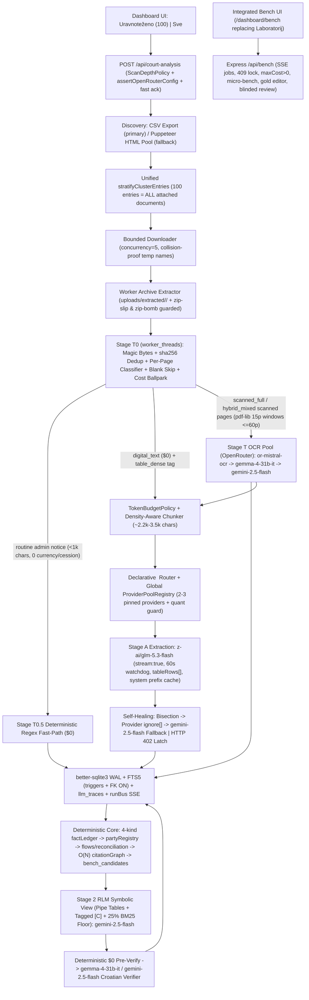
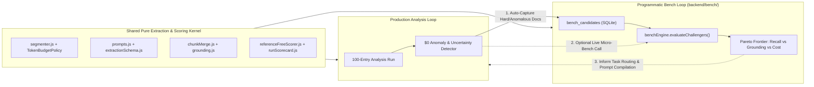

# Road to 100 Court Entries — Master Architecture, Hardening & Consolidation Plan

**Status:** Final Actionable Architecture Blueprint (Consolidated — Ready for Ticket Breakdown)  
**Date:** 2026-11-24  
**Target Scope:** Reliably process **100 court entries (`Uravnoteženo`)** with all attached documents (and full-docket **`Sve`**), migrate persistence to **`better-sqlite3` (+ FTS5 + `llm_traces`)**, standardize **100% on OpenRouter (`OPENROUTER_API_KEY` only — zero Google/LangChain SDKs)** across **`z-ai/glm-5.3-flash`**, **`or-mistral-ocr`**, **`google/gemma-4-31b-it`**, and **`google/gemini-2.5-flash`**, offload PDF/ZIP/raster CPU work to **`node:worker_threads`**, adopt an **RLM Symbolic Case Environment** for Stage-2 synthesis, integrate **`Bench`** directly into the app at `/dashboard/bench` (with a closed Production → Bench anomaly loop), and cleanly **sunset Analysis Lab**.

**Authoritative References:**
- [FINAL-BENCH-SYNTHESIS-AND-MIGRATION-REPORT.md](file:///home/oxioxi/proj/our_chattie/backend/data/pdf-engine-bench/FINAL-BENCH-SYNTHESIS-AND-MIGRATION-REPORT.md) (Phases 1–6.1 & Section 3.F, lines 207–238: Stage 0 sign-off & prompt/gold contract)
- [pdf-bench-ticket-breakdown.md](file:///home/oxioxi/proj/our_chattie/backend/scripts/pdf-bench-ticket-breakdown.md) (Bench reset & Stage 0 ticket contract)
- [EPIC3-PRODUCTION-MIGRATION-TICKET-BREAKDOWN.md](file:///home/oxioxi/proj/our_chattie/backend/data/pdf-engine-bench/EPIC3-PRODUCTION-MIGRATION-TICKET-BREAKDOWN.md) (Proposed `[PROD-201]`–`[PROD-205]` specs subsumed here)
- Linear Document: *PDF Engine Benchmark Synthesis & Production Migration Plan (Epics 1–3)* (`49cca207-d4d1-4436-96c4-3cd26228e830`, [Linear URL](https://linear.app/chattie/document/pdf-engine-benchmark-synthesis-and-production-migration-plan-epics-1-3-21f5b6283ae1))
- [road-to-100-entries-plan-review.md](file:///home/oxioxi/proj/our_chattie/docs/road-to-100-entries-plan-review.md) (Architectural review & tracked changes subsumed into this final blueprint)
- [AGENTS.md](file:///home/oxioxi/proj/our_chattie/AGENTS.md) (Repository invariants & conventions)

---

## Core Architectural Principles

Because `our_chattie` is a single-user internal tool with zero external backward-compatibility obligations toward legacy API payloads or old `runs.json` records, we do not have to carry migration shims forever. Every design decision in this plan follows six engineering rules:

1. **Delete Complexity Before Scaling:** Never build 100-entry hardening on top of 1,997-line orchestrators, triple-round-trip compatibility adapters, 8 sequential LLM micro-passes, or 3 redundant SDK layers (`@google/genai`, `@langchain/google-genai`, `@langchain/core`). Rip out dead weight first (Phase 0).
2. **"Never Fail a Run" via Graceful Degradation:** A 100-entry run expands to ~150–300+ files and ~300–600+ LLM calls. Under compounding failure probability ($1 - (1 - p)^N$), all-or-nothing aborts guarantee failure. Every stage must degrade per-item, persist partial outputs, and expose explicit coverage gaps rather than discarding already-paid work.
3. **Decouple Ingestion (ETL) from Inference (Reasoning):** Offload `pdf.js`, `adm-zip`, and JPEG rasterization to `node:worker_threads`. Digital text extracts locally at `\$0` in milliseconds; scanned/broken-font PDFs transcribe once through `Stage T` OCR into SQLite `ocr_transcripts`; `Stage A` extraction consumes bounded UTF-8 text only.
4. **Crime Scene Observability ("Liquid Gold"):** Never discard raw model responses inside a `catch` block before inspecting them. Persist raw completions *before* `JSON.parse` into append-only `llm_traces`, separate parse errors from truncation from provider hangs, and record `ttft_ms`, `actual_provider`, `cached_tokens`, and `reasoning_tokens`.
5. **Deterministic Code Before Model Calls:** Identity checks (`currencyConversion.js`, `grounding.js`, `partyRegistry.js`), numeric/lifecycle reconciliation (`reconciliation.js`), strict-ID threading (`caseContextBuilder.js`), extraction-time arithmetic closure, routine admin-notice extraction (`Stage T0.5`), direct ledger pre-verification, and full-text ranking (`FTS5 BM25`) belong in deterministic code — never spend LLM calls guessing what code can compute cleanly.
6. **Bound Concurrency & Latency Explicitly — Estimate Cost Upfront & Degrade Gracefully on `HTTP 402`:** Bound entry depth (`ScanDepthPolicy`), chunk output expansion (`TokenBudgetPolicy`), total provider concurrency (global `ProviderPoolRegistry` + circuit breaker), and stream idle stalls (`60s` SSE watchdog). Production runs drop arbitrary mid-run cost/page cutoffs in favor of a **`Stage T0` pre-flight cost ballpark estimator** + **graceful OpenRouter `HTTP 402` credit-exhaustion latch** (with a `\$0` deterministic fallback report if synthesis hits `402`), while **Bench** experiments retain strict hard `--max-cost` caps and explicit operator approval.

---

## 1. Target End-to-End Architecture



### How Responsibilities Separate Cleanly

- **Acquisition & Preflight (`scraper/`, `acquisition/`, `enricher.js`, `Stage T0`):** Discovers court entries (`objave`), selects the primary-case pool (or full catalog), downloads & extracts every attachment inside `node:worker_threads` into **isolated per-archive subdirectories** (propagating parent `sourceEntryIndex`, `sourceDocumentLinkId`, and `entryDate`, preventing `Podnesak.pdf` collisions), caches Sudski registar participant lookups (`registry_cache`, 24h TTL), and runs **one fast `Stage T0` preflight** in `worker_threads` (magic-byte validation, upfront `sha256` intra-run dedup + SQLite cache lookup before parsing, single-pass per-page `pdf.js` classification into `digital_text` / `scanned_full` / `hybrid_mixed` / `empty_or_corrupt`, blank-page skip, `table_dense` tagging, and upfront cost ballpark manifest). Zero LLM calls happen here.
- **Stage T0.5, Stage T OCR & Stage A Extraction (`extraction/`, `llm/`):** Routine short administrative notices (`< 1,000` chars, `0` currency/cession cues) resolve deterministically in `Stage T0.5` (`\$0`). Digital documents bypass OCR at `\$0` and stream immediately into `Stage A` without waiting behind slow scans. `scanned_full` and `pdf-lib`-sliced scanned pages from `hybrid_mixed` PDFs transcribe in `15`-page batch windows (covering up to `60` pages, or `40p` head + `20p` tail beyond `60p`) via **`or-mistral-ocr`** (with **`google/gemma-4-31b-it`** vision raster → **`google/gemini-2.5-flash`** fallback, 100% via OpenRouter) and merge back in exact page order into SQLite `ocr_transcripts`. `Stage A` routes typed `<Task>` envelopes through `ProviderPoolRegistry` using static system-prefix caching, `TokenBudgetPolicy`, `tableRows[]` compact extraction, Page-1 party roster carry-over, compiled `EXTRACTION_SIGNATURE_V5` prompts, extraction-time `total-vs-parts` arithmetic closure, and SHA-256 `segment_checkpoints` + append-only `llm_traces`.
- **Deterministic Core (`factLedger.js`, `partyRegistry.js`, `flows`, `reconciliation.js`, `citationGraph.js`, `caseContextBuilder.js`, `scopeContract.js`):** Deduplicates byte-identical attachments, stores 4 canonical fact kinds (`amount | property | party | procedural_outcome`) with deterministic `row.id`s and page/chunk provenance, resolves canonical party identities (`partyRegistry.js`), normalizes HRK/EUR at `7.53450`, resolves explicit lifecycle chains (`prijava -> ustup -> namirenje`), reconciles amounts by **identity-scoped `flowGroupKey`**, builds `O(N)` normalized citation graphs and root-case-safe strict-ID threads, derives **ledger-driven FTS5 BM25 queries**, computes `scopeContract` + `runScorecard`, and harvests `$0` anomalies into `bench_candidates`.
- **Stage-2 RLM Symbolic Case Environment & Delivery (`synthesisInputBuilder.js`, `synthesizer.js`, `verifier.js`, `runBus` SSE):** Treats SQLite (`run_facts` + `run_chunks_fts`) as an external RLM symbolic environment. Feeds Stage 2 (`google/gemini-2.5-flash`) pre-aggregated digests as high-density **Markdown Pipe Tables** + **Tagged Source Excerpt Blocks (`[C<N>]`)** + a **25% protected FTS5 BM25 chunk floor**, verifies ledger-backed findings deterministically at `\$0` first before routing remaining findings to `google/gemma-4-31b-it` / `google/gemini-2.5-flash` (`{"verdicts": [...]}` `json_object`, never silently deleting `unverified` findings), falls back to a `\$0` deterministic report if `HTTP 402` hits Stage 2, and streams lightweight `runBus` SSE deltas on `GET /api/analysis/runs/:id/stream`.
- **Integrated Bench (`backend/bench/` + `/dashboard/bench`):** Replaces standalone `serve-pdf-bench-lab.js` and Analysis Lab as a first-class engineering workspace inside Express + React, sharing the pure extraction/scoring kernel while enabling `bench_candidates` capture, reference-free automatic micro-benching, `gbench` capability/tail-latency gates, and Stage-2 Report Bench behind explicit `approved: true` + `maxCost > 0` caps.

---

## 2. Empirical Evidence Base (What Experiments Actually Proved)

Before locking in any production design, we audited every persisted experiment in **Analysis Lab** and every run/scorecard in **PDF-Engine Bench (Phases 1–6.1 & Stage 0)**. Several assumptions that sounded good on paper failed in live data.

### 2.1 Analysis Lab Empirical Audit (`b109f471` & `0e1c4641` on `ST-2/2013`)

Two persisted three-profile experiments against a 30-entry / 57-document / 375-claim `ST-2/2013` corpus in `backend/data/analysis/experiments/` reveal exact numbers:

| Variant (Run `b109f471`) | Input Tokens | Output Tokens | Calls | Latency | Valid Findings | Verifier Errors | Observed Behavior |
|---|---:|---:|---:|---:|---:|---:|---|
| `baseline-flat-v1` | 71,175 | 2,842 | 3 | 98.5s | 12/12 | **4** | Cleanest overall run of the three |
| `context-tree-v1` | 74,622 | 2,982 | 3 | 58.8s | 11/12 (1 unsupported) | **8** | Appended 24 branch claims *on top of* all 462 flat claims; crashed in `0e1c4641` with `Synthesizer returned invalid JSON` after 10,552 output tokens |
| `context-tree-summarized-v1` | 92,628 | 3,070 | 7 | 102.7s | 12/12 | **8** | **`0/4` valid node summaries** (`"response is not a JSON object"` on every attempt → `derivedClaims: 0`); spent +4 LLM calls and +21,453 input tokens for zero benefit |

**Four concrete root causes uncovered by inspecting the saved JSON records and source code:**
1. **Tier-2/3 Cartesian DAG Link Explosion (Why `experiments.json` hit 427 MB):** In [caseContextBuilder.js](file:///home/oxioxi/proj/our_chattie/backend/court-analysis/reasoning/caseContextBuilder.js#L209-L274), Tier 1 (`L219–221`) is actually an $O(N)$ star loop (`linkFacts(group[0], group[i], basis)` — at most `137` links for 138 facts). The **`194,100` `trace.links` explosion** originates in **Tier 2/3 ([caseContextBuilder.js#L228–274](file:///home/oxioxi/proj/our_chattie/backend/court-analysis/reasoning/caseContextBuilder.js#L228-L274))** combined with **`linkFacts` ([L196–205](file:///home/oxioxi/proj/our_chattie/backend/court-analysis/reasoning/caseContextBuilder.js#L196-L205))**: when filings carry or cite the bare root case number (`st-2/2013`), `resolveEndpoint` queries `filingIndex.get('st-2/2013')` (138+ facts) and executes a **Cartesian product `for (a) for (b)` across every citation edge**, while `linkFacts` (`L198–200`) pushes `{ united: false }` into `traceLinks` for every cross-kind (`amount` vs `property`) pair (`responseBounds` kept 200 of 194,100). Persisting raw traces across runs ballooned `experiments.json` to **`427,268,394` bytes (427 MB)**.
2. **`contextReportAdapter.js` Added Bloat Instead of Compressing:** [contextReportAdapter.js](file:///home/oxioxi/proj/our_chattie/backend/court-analysis/reasoning/contextReportAdapter.js#L284-L360) ran `buildSynthesisInput` unchanged (`462` flat claims) and *appended* 24 branch claims on top, increasing prompt noise and doubling verifier errors (`4 → 8`) instead of replacing redundant rows with thread summaries.
3. **LLM Node Summaries (`contextNodeSummary.js`) Failed 100% Live:** All 4 `nodeSummary` attempts in `b109f471` and `0e1c4641` failed JSON validation (`invalid-summary`), while derived claims had `supportsFinding: false` by design — meaning they could never legally support a report finding anyway.
4. **Upstream Extraction Failure Was the True Bottleneck:** Across *all* variants in `b109f471`, **6 of the most vital case documents failed extraction completely**: `Diobeni popis.pdf`, `Završni račun.pdf`, `Prijedlog stečajnog upravitelja.pdf` (×2), and `Ugovor o ustupu tražbina.pdf` (×2).

### 2.2 PDF-Engine Bench Empirical Audit (Phases 1–6.1 & Stage 0)

Results from [FINAL-BENCH-SYNTHESIS-AND-MIGRATION-REPORT.md](file:///home/oxioxi/proj/our_chattie/backend/data/pdf-engine-bench/FINAL-BENCH-SYNTHESIS-AND-MIGRATION-REPORT.md) and the Linear stakeholder plan (`49cca207-d4d1-4436-96c4-3cd26228e830`):

1. **Role-Split Verdict (`GLM 5.3 Flash` Extract + `Gemini 2.5 Flash` Synthesize):**
   - Across the 25-document / 130-page human-verified pilot (`St-2/2013`, `St-357/2013`, `Stpn-7/2017`, `St-794/2018`):
     - **Coverage & JSON reliability:** GLM `25/25` full (`0` truncations, `100/100` valid JSON) vs. Gemini `24/25` (`2/8` chunks truncated on `19:Diobeni popis.pdf`, `98/100` valid JSON).
     - **Recall & Grounding:** GLM led **All-Party OIB micro recall (`80.3%` vs. `58.8%`, +21.5 pp)**, **HRK micro recall (`80.8%` vs. `67.4%`, +13.4 pp)**, and **own quote grounding (`99.1%` vs. `98.2%`)**. Gemini led **EUR micro recall (`69.1%` vs. `58.9%`)**, **filing numbers (`91.8%` vs. `81.2%`)**, and **dates (`74.4%` vs. `67.2%`)**.
     - **Cost:** GLM was **~5.7×–6.0× cheaper** (`\$0.0452` across 34 fresh calls = `\$0.00133/req` vs. `\$0.2729` across 36 calls = `\$0.00758/req`; Phase 5 `\$0.16/100p` vs. `\$0.94/100p`, **83% cost reduction**).
   - **Stage 0 Exit Gate (`cc751d18` + `e93bc94c`, Signed Off):** `8/8` (`100%`) composite `decisionOutcome` on GLM (`7/8` = `87.5%` Gemini; `0/4` false positives on non-rulings), `18/19` (`94.7%`) amount recall on `26:` after source-PDF gold audit, `2/2` (`100%`) OIB on `6:`, `15/25` (`60.0%`) `line_item` on `322:KERUM.pdf`, and `25/35` (`71.4%`) on `layer_image`.
2. **Phase 6.1 Chunking Ablation (`ac12c9d0`, `\$0.1042`):**
   - Running 7 multi-chunk rulings (`5k–20k` chars, 38 pages) unchunked (`--analysis-mode=single`) produced zero truncations yet **collapsed recall across every axis**: **-27.0 pp OIB**, **-25.5 pp amounts**, **-20.0 pp dates** on GLM (e.g., `4:Rješenje` emitted `amounts: []` and omitted `documentParties` completely), and **-8.4 pp amounts / -14.2 pp dates** on Gemini.
   - **Production Bug Exposed:** [analysis-agent.js](file:///home/oxioxi/proj/our_chattie/backend/court-analysis/agents/analysis-agent.js#L244) currently sets `CHUNKING_TRIGGER_TEXT_LENGTH = 25000`, leaving both 5–7p rulings *and* `24,788`-char `19:Diobeni popis.pdf` unchunked in live runs.
3. **JSON Output-Token Expansion Physics (Discovery 11):**
   - On `19:Diobeni popis.pdf`, a single `64`-char table row (`1. Vodovod doo 89406825003 ... 569,45 75,58 0,93`) forced **4 separate JSON objects** (`1` `documentParties` + `3` `amounts[]`), repeating the same 64-char `quote` four times (**~1,050 JSON chars = ~16× expansion**). Across the whole document, `24,788` input chars expanded into `124,190` chars of raw LLM JSON (`~45,000–55,000` output tokens).
4. **Stage T OCR Audit (Discovery 8):**
   - Local `pdf.js` extracts digital layers at `\$0` in `<10 ms`, **but** real court scans emit `2–8` stray scanner chars (`322:` = 6 chars/4p, `374:` = 8 chars/5p, `379:` = 6 chars/4p, `367:` = 2 chars/2p), silently bypassing production's `!text || text.trim().length === 0` OCR gate.
   - Gemini `local-raster` failed with HTTP 200 `RECITATION` blocks on **5/8 new scans**; GLM vision hallucinated on dense text/ads (`26:` and `38 oglas`); `or-cloudflare` returned `0` effective chars on `4/4` scans (explicitly ruled out). **`or-mistral-ocr` cleared all 5 blocked scans cleanly** (`100%` OIBs, `100%` filings, `97%` dates, `92%` value amounts).
5. **Transport Hang Risk (`d114ea5e`):**
   - An unstreamed (`stream: false`) Z.AI call hung for `300s` after HTTP 200 headers (`TimeoutError`), demonstrating the need for SSE idle-stream watchdogs, multi-provider `ignore` rotation, and per-segment fallback in production.
6. **100-Entry Cost Economics:**
   - **Baseline migration envelope** (~100 entries, ~150–200 PDFs, ~600–1,000 pages, ~20–30% scanned): **`\$1.10–\$2.60` cold** (vs. `\$4.00–\$9.40+` legacy Gemini) and **`\$0.16–\$0.42` warm**.
   - **Optimized target with Section 4.2 cost levers** (`tableRows[]`, page-level slicing + blank-page skip, `Stage T0.5`, static system-prefix caching, deterministic pre-verification, tiered `gemma-4-31b-it` routing): **`\$0.40–\$0.75` cold**.

### 2.3 The "Smoking Gun" Convergence (Lab `b109f471` Failures vs. PDF-Engine Bench)

The 6 vital documents that failed completely in Analysis Lab `b109f471` match the exact failure archetypes diagnosed independently in the PDF-Engine Bench:

1. **`Diobeni popis.pdf` (The `25,000`-Char Cliff + `16×` JSON Expansion):** At `24,788` chars, `19:Diobeni popis.pdf` sat 212 chars below production's `CHUNKING_TRIGGER_TEXT_LENGTH = 25000`, forcing one unchunked call requiring `~45,000–55,000` output tokens (`~16×` row expansion) that truncates past `maxOutputTokens` (`16,384`).
2. **`Završni račun.pdf` (39 Pages, ~12k Prose Bloat + All-or-Nothing Timeouts):** Long multi-page financial statements hit compounding failure probability ($1 - (1 - p)^N$), generate 39 redundant chunk essay summaries (`~12k` chars), and fail without recursive bisection or idle-stream recovery.
3. **`Ugovor o ustupu tražbina.pdf` (`5.38 MB` Scans / Hybrids):** Heavy scanned/hybrid cession contracts fail Gemini raster OCR via `RECITATION` blocks (`5/8` new court scans), exceed `OCR_MAX_PAGES = 20`, or bypass OCR completely when pages 1–3 are digital text and pages 4–12 are scanned contracts.
4. **`Prijedlog stečajnog upravitelja.pdf` (Dense Tabular Annexes & Generic Names):** Trustee motions embed multi-column claim/cost tables (`table_dense`) and arrive inside `.zip` archives with generic filenames (`Podnesak.pdf` / `Prilog.pdf`) that overwrite each other in shared `backend/uploads/`.

**The Power-Law Lesson of Bankruptcy Dockets:** Losing 6 routine `Podnesak.pdf` hearing-notice entries costs ~0% of case truth; losing the 6 ledger, final account, trustee proposal, and cession filings costs **90%+ of financial and legal truth** — and no downstream DAG or synthesis architecture (`context-tree-v1`) can rescue facts that never survived `Stage T` / `Stage A`.

---

## 3. Critique & Subsumption of `EPIC3-PRODUCTION-MIGRATION-TICKET-BREAKDOWN.md`

[EPIC3-PRODUCTION-MIGRATION-TICKET-BREAKDOWN.md](file:///home/oxioxi/proj/our_chattie/backend/data/pdf-engine-bench/EPIC3-PRODUCTION-MIGRATION-TICKET-BREAKDOWN.md) specifies `[PROD-201]`–`[PROD-205]` for the extraction/OCR engine. We **subsume every verified behavior** from `[PROD-201]`–`[PROD-205]` while resolving **six systemic gaps** at 100-entry scale:

| Area in `EPIC3` | What We Keep / Subsume | Systemic Gap Identified & Fixed in This Master Plan |
|---|---|---|
| **`[PROD-201]`** Lower chunk trigger (`25k → 4k`), table-density trigger, recursive bisection on `length`, overlap whitespace normalization | Keep the exact triggers, recursive UTF-8 bisection (`depth ≤ 2`, floor `800` chars), and normalized overlap deduplication. | Static constants inside `analysis-agent.js` don't solve reasoning-vs-answer starvation; `mergeAnalysisChunkResults` (`L338–352`) also searches from index `0` (`indexOf(quote)`) and hashes all keys including `description`. **Upgrade:** `TokenBudgetPolicy` + density-aware window sizing + span-anchored overlap dedup (Section 4.2, Section 5.2). |
| **`[PROD-202]`** OpenRouter `z-ai/glm-5.3-flash` adapter, Z.AI pinning, `reasoning=low`, `json_object`, 240s timeout, fallback, `ANALYSIS_CHUNK_CONCURRENCY=2` | Keep `reasoning=low`, `json_object`, `data_collection: 'deny'`, usage normalization, and per-segment fallback. | (1) Multiplicative concurrency storm: `courtAnalysisQueue(2) × FILE(3) × CHUNK(2) = 12` simultaneous Z.AI calls with no global rate coordination. (2) `stream: false` waits `240s` on dead Z.AI sockets, and single-provider pinning (`allow_fallbacks: false`) turns one stalled Z.AI host into a single point of failure. (3) Retaining `GOOGLE_API_KEY` / `@langchain/google-genai` keeps two provider stacks alive. **Upgrade:** **100% OpenRouter (`OPENROUTER_API_KEY` only)**, 2–3 pinned providers per model + quantization guard + `ignore` retry rotation, global `ProviderPoolRegistry`, `stream: true` 60s idle watchdog, cross-model circuit breaker, and graceful `HTTP 402` latch (Section 4.5). |
| **`[PROD-203]`** `hasUsablePdfTextLayer()` + `or-mistral-ocr` routing + isolated cache | Keep `hasUsablePdfTextLayer` (`>=20` non-ws, `>=12`/page on multi-page, `<20%` `\uFFFD`) and `or-mistral-ocr` primary routing. | (1) `EPIC3` keeps `nativePdfDocument.js` (`@google/genai`) as a third tier — delete it in Phase 0. (2) `EPIC3` routes per-document instead of per-page (dropping scanned pages in `hybrid_mixed` PDFs), re-reads/re-hashes files up to 4×, leaks `pdf.js` handles in `extractTextViaOCR`, and runs CPU-heavy `pdf.js`/canvas on Node's main thread. (3) `EPIC3` aborts Mistral at `OCR_MAX_PAGES (20)` straight to Gemini raster (which `RECITATION`-blocks ~60% of scans). **Upgrade:** **`Stage T0` in `node:worker_threads`** with magic bytes, upfront `sha256` dedup, per-page `hybrid_mixed` slicing via `pdf-lib`, blank-page skip, `15`-page Mistral batch windows up to `60` pages (`40p` head + `20p` tail beyond `60p`), and **`google/gemma-4-31b-it`** as primary vision raster fallback (Sections 4.5, 4.9). |
| **`[PROD-204]`** `analysisSegmentStore.js` SHA-256 cache | Keep the exact cache-key contract (`schemaVersion`, `modelId`, `promptHash`, `knownPartiesHash`, `segment.text`) and the rule **never to cache degraded/gap results**. | Adding loose JSON files alongside monolithic `runs.json` fragments persistence. **Upgrade:** Store cache-eligible `segment_checkpoints` and `ocr_transcripts` in **`better-sqlite3`**, cleanly separated from append-only forensic **`llm_traces`** (Section 4.3). |
| **`[PROD-205]`** Page-1 party roster carry-over + compact row-oriented `tableRows[]` schema | Keep both optimizations (`tableRows[]` cuts the `16×` tabular output expansion on `Diobeni popis` by ~70%). | Don't defer this past initial rollout. **Upgrade:** Promote both into **Phase 3 main path** (validated against Gold Set on Bench, Section 4.2). |
| **Upstream & Downstream Pipeline** | *(Out of `EPIC3`'s extraction-only scope)* | `EPIC3` leaves intact the 1,997-line `pipeline.js`, `'standard'`/`40`-entry depth model, hardcoded `stratify.js` quotas, `Date.now()` download collisions, shared `uploads/` ZIP overwrites, `runs.json` I/O stall, 48k synthesis chunk-eviction bug, Tier-3 Cartesian DAG explosion, Analysis Lab bloat, and standalone `serve-pdf-bench-lab.js`. This plan integrates all of them cleanly. |

---

## 4. Core Conceptual & Architectural Choices (Deep Reasoning)

### 4.1 Declarative `ScanDepthPolicy`, Proportional Stratification & Unified Puppeteer Pool (`Uravnoteženo` = 100, `Sve`)

**What is broken today (verified across 7 locations):**
1. Scan depth is smeared across 6 files via a Puppeteer-centric triple `(scrapeLimit, maxPagesScanned, tailSample)` and duplicated preset lists (`['standard', 'balanced', 'full']` in [scanDepth.js](file:///home/oxioxi/proj/our_chattie/backend/court-analysis/utils/scanDepth.js), [courtAnalysisRequest.js](file:///home/oxioxi/proj/our_chattie/backend/helpers/courtAnalysisRequest.js#L10-L11), and [ScanDepthSelect.jsx](file:///home/oxioxi/proj/our_chattie/simple-chat/src/components/Dashboard/ScanDepthSelect.jsx#L3-L15)).
2. [stratify.js](file:///home/oxioxi/proj/our_chattie/backend/court-analysis/utils/stratify.js#L26-L30) hardcodes 40-entry constants (`STRAT_ORIGIN_KEEP = 8`, `STRAT_RECENT_KEEP = 22`, `STRAT_OTHER_FLOOR = 2`, `STRAT_ADMIN_CAP = 4`), and step 4 ([L143–150](file:///home/oxioxi/proj/our_chattie/backend/court-analysis/utils/stratify.js#L143-L150)) permanently caps ambiguous filings (`Podnesak`/`Prilog`) at `[others[others.length - 1], others[0]]`.
3. **Missing `scanDepth` in 3 places:** [server.js#L150–155](file:///home/oxioxi/proj/our_chattie/backend/server.js#L150-L155) calls `analysisStore.createAnalysisRun(...)` without passing `scanDepth`, [localStore.js#L103–125](file:///home/oxioxi/proj/our_chattie/backend/services/localStore.js#L103-L125) / [runSummary.js](file:///home/oxioxi/proj/our_chattie/backend/court-analysis/utils/runSummary.js) never persist/project it, and [pipeline.js#L1398–1404](file:///home/oxioxi/proj/our_chattie/backend/court-analysis/pipeline.js#L1398-L1404) omits `scanDepth` when invoking `processScrapedCases` (causing `scanDepth: null` in logs).
4. **Hidden `'full'` (`Sve`) bug in [csvExportClient.js#L219–262](file:///home/oxioxi/proj/our_chattie/backend/scraper/csvExportClient.js#L219-L262):** Primary-case filtering (`if (tailSample)`) only executes when `tailSample === true` (`balanced`). Under `scanDepth === 'full'`, `tailSample` is `false`, so `csvExportClient.js` skips primary-case selection, applies `applyBounding` (`L248`) **globally across all cases** up to 400 rows, and sets `analysisBudget: 400` (`L255`), triggering `stratifyClusterEntries` in [pipeline.js#L1174–1185](file:///home/oxioxi/proj/our_chattie/backend/court-analysis/pipeline.js#L1174-L1185).
5. **Six concrete bugs in Puppeteer `80 + 20` ([courtSearchPuppeteer.js](file:///home/oxioxi/proj/our_chattie/backend/scraper/courtSearchPuppeteer.js#L43-L381), [#L981–1023](file:///home/oxioxi/proj/our_chattie/backend/scraper/courtSearchPuppeteer.js#L981-L1023)):**
   - Puppeteer never sets `discoveryMetadata.selection.analysisBudget`, so [pipeline.js#L1174–1185](file:///home/oxioxi/proj/our_chattie/backend/court-analysis/pipeline.js#L1174-L1185) **bypasses `stratify.js` completely** (`coverageLedger: null`, zero `ledger` priority, zero `admin` cap).
   - `performTailSample` (`L372`) jumps to `page = totalPages` of the **ungrouped global search** (`tailRule: 'global-oldest'`) — on multi-case OIB queries, the oldest 2 pages often belong to an unrelated 2011 lawsuit that gets discarded, leaving the primary case with zero origin entries.
   - Hardcoded `TAIL_SAMPLE_ENTRIES = 10` & `TAIL_SAMPLE_MAX_PAGES = 2` (`L43–44`) ignore `scanDepth.js` (`tailEntries: 20`) and yield `<= 12` entries if the last page has 2 rows.
   - **Intra-page reversal bug (`L351–361`):** Each e-Oglasna page lists rows newest-first; pushing `page = N`, then `N-1`, and calling `.slice(0, limit)` keeps the **newest** entries of `N-1` instead of the **oldest** entries adjacent to page `N`.
   - **`limit (100) + tail (20) = 120` double-count (`L1010–1015`).**
   - **Pre-filter starvation (`L269`, `L994`):** Stops after `maxPages` *before* filtering `r.documentDownloadLink`, dropping below target whenever rows lack PDFs.

**Architectural Choice:**
Replace the `(scrapeLimit, maxPagesScanned, tailSample)` triple with one declarative **`ScanDepthPolicy`** exported from [scanDepth.js](file:///home/oxioxi/proj/our_chattie/backend/court-analysis/utils/scanDepth.js), decouple primary-case pool selection from `tailSample` in `csvExportClient.js`, and replace Puppeteer's broken `80 + 20` magic window with a **batched HTML pool harvest** feeding the **exact same `stratifyClusterEntries` allocator** used by CSV:

```js
// Declarative contract in backend/court-analysis/utils/scanDepth.js
const SCAN_DEPTH_POLICIES = Object.freeze({
  balanced: Object.freeze({
    id: 'balanced', // UI: "Uravnoteženo"
    analysis: {
      maxEntries: 100,          // Strictly in *court entries* (objava); each keeps ALL its documents
      allocation: 'stratified', // Role + chronological stratifier over primary case pool
    },
    discovery: {
      csv: {
        selectionRule: 'primary-case-pool',
        poolCap: 400,           // Defensive ceiling on discovered primary pool before stratification
      },
      puppeteer: {
        selectionRule: 'primary-case-pool',
        maxPoolPages: 40,       // Fetch up to ~40 lightweight HTML search pages in batches of 4
        batchSize: 4,           // Harvest pool across pages, then run stratifyClusterEntries(..., { budget: 100 })
      },
    },
  }),
  full: Object.freeze({
    id: 'full', // UI: "Sve" / "Sve dostupne"
    analysis: {
      maxEntries: null,         // Unbounded up to defensive safety ceiling (default 1000)
      allocation: 'all',        // Analyze all primary-cluster entries without stratified pruning (still builds coverageLedger)
    },
    discovery: {
      csv: {
        selectionRule: 'all-clusters',
        poolCap: 1000,          // Configurable via ANALYSIS_FULL_MAX_ENTRIES
      },
      puppeteer: {
        selectionRule: 'all-clusters',
        maxPoolPages: null,     // Uses FULL_SCAN_MAX_PAGES (default 200)
        batchSize: 4,
      },
    },
  }),
});
```

**Why this abstraction works:**
1. **Domain truth stays explicit:** A **court entry** (`objava`) is one e-Oglasna row, never conflated with a case/cluster. Budgeting at `100` entries ensures **100% of attached documents and ZIP members** inside those 100 entries are kept intact.
2. **Proportional stratification scales cleanly:** Replace fixed constants in `stratify.js` with `computeStratificationQuotas(budget)`. At `budget = 100`:
   - `ledger` (`diobeni popis`, `završni račun`, `tablica tražbina`): all that fit (never dropped; overflow explicitly reported in `coverageLedger.excludedVital`).
   - `origin`: `Math.max(8, Math.round(budget * 0.15))` → **15** oldest filings.
   - `recent`: `Math.max(22, Math.round(budget * 0.40))` → **40** newest filings.
   - `exploratory` (`other`, e.g., bare `Podnesak` / `Prilog`): `Math.max(2, Math.round(budget * 0.08))` → **8** entries, **evenly stride-sampled across `others`** instead of `[others.at(-1), others[0]]`.
   - `middle` (`decision` + `transfer` round-robin per calendar year) + chronological `spread`: absorbs remaining ~29–37 slots across the middle years of the case.
   - `admin` cap: `Math.max(4, Math.round(budget * 0.08))` → **8** max.
3. **Unified CSV & Puppeteer behavior:** Both `csvExportClient.js` and `courtSearchPuppeteer.js` (when acting as rare CSV fallback) collect the primary-case pool and tag `discoveryMetadata.selection` (`rule`, `analysisBudget`, `allocation`). In `full` (`Sve`) mode, `allocation: 'all'` skips stratified pruning in `pipeline.js` while still generating `coverageLedger` (recording all secondary clusters in discovery metadata while the full primary cluster enters reasoning).
4. **No legacy `'standard'` bloat & end-to-end `scanDepth` threading:** Reject anything outside `['balanced', 'full']` with HTTP `400` in [courtAnalysisRequest.js](file:///home/oxioxi/proj/our_chattie/backend/helpers/courtAnalysisRequest.js), default absent/empty input to `'balanced'` (`Uravnoteženo`), update [ScanDepthSelect.jsx](file:///home/oxioxi/proj/our_chattie/simple-chat/src/components/Dashboard/ScanDepthSelect.jsx) to two options (`Uravnoteženo`: *"Do 100 ključnih objava (svi priloženi dokumenti)"*, `Sve`: *"Sve dostupne objave"*), and thread `scanDepth` cleanly through `server.js` → `sqliteStore.createAnalysisRun` (`runs.scan_depth`) → `processScrapedCases` → `runSummary.js`.

---

### 4.2 Chunking, `TokenBudgetPolicy`, Compact `tableRows[]` & Structural Cost Levers

**Why chunking stays permanently:**  
Phase 6.1 decisively refuted the idea that larger context windows allow us to stop chunking. Models given 5–7p rulings unchunked don't hit context limits — they switch into lazy executive summarization (`-27.0 pp` OIB / `-25.5 pp` amounts on GLM). Small `~3,500`-char chunks (`350`-char overlap) act as an **extraction focus aperture** that forces line-by-line recall.

**Why raw `max_tokens` is a broken abstraction:**  
1. **Shared reasoning + answer pool:** GLM 5.3 Flash (`reasoning=low`) and Gemini 2.5 Flash draw invisible thinking tokens out of the same `max_tokens` pool before emitting JSON. On dense chunks, burning 8k+ thinking tokens starves the JSON answer.
2. **Input size does not predict output size:** Prose expands `~0.5×`; creditor schedules (`Diobeni popis.pdf`) expand **~5×–16×**.
3. **Client socket stalls hide inside long generation budgets:** Waiting `240,000 ms` on a dead socket because a static `max_tokens: 24576` call *might* take 3 minutes leaves runs hanging blindly.

**The Right Abstraction: `TokenBudgetPolicy` + `AdaptiveChunker` + `RecursiveBisector` (`backend/llm/tokenBudgetPolicy.js`):**
1. **Pre-Flight Output Density Estimator (`estimateSegmentProfile(text)` — `\$0`, `<1 ms`):**
   - Counts lines with OIBs (`\b\d{11}\b`), comma-decimal currency figures (`\d+\.\d{3},\d{2}` or `\d+,\d{2}`), and Markdown table pipes (`|`).
   - Classifies the document as `table_dense` vs. `prose`:
     - `prose`: chunk trigger `> 4,000` chars OR `> 2` pages; chunk target `3,500` chars (`350` overlap).
     - `table_dense`: **always** chunked regardless of total document length (fixing the `24,788`-char `Diobeni popis` trap), with tighter **row-aligned windows (`~2,200–2,800` chars)** split strictly on `\n` boundaries so table rows are never sliced mid-line and expected JSON stays `< 50%` of the visible answer budget.
2. **Role- and Model-Aware Budget Composition (`resolveTokenBudget({ role, modelId, density, providerCapabilities })`):**
   - Explicitly separates **visible answer budget** from **reasoning headroom** and enforces **streaming idle timeout**:
     - `answerTokens`: `6,144` (`prose` chunk), `12,288` (`table_dense` chunk), `16,384` (`synthesis`), `4,096` (`verify`).
     - `reasoningHeadroom`: derived from model capability metadata (e.g., `8,192` for `z-ai/glm-5.3-flash` at `reasoning=low`, `4,096` for `google/gemini-2.5-flash` thinking, `0` for `google/gemma-4-31b-it` / non-reasoning paths).
     - `requestMaxTokens`: `min(modelHardCeiling, answerTokens + reasoningHeadroom)` — strictly a **billing circuit breaker**, not an accuracy lever.
     - `idleTimeoutMs`: **`60,000 ms`** (time allowed with zero streamed delta chunks before aborting a hung HTTP 200 socket).
     - `totalTimeoutMs`: **`240,000 ms`** (hard wall-clock ceiling).
   - Emits explicit telemetry on every completion: `reasoningRatio = reasoningTokens / totalCompletionTokens` and `truncationCause` (`'reasoning_starvation'` when output content is near-empty vs. `'answer_overflow'` when JSON cuts mid-object).
3. **Reactive Self-Healing (`RecursiveBisector`):**
   - If a chunk still returns `finish_reason === 'length'` or unclosed JSON: **never** retry by increasing `max_tokens`, and **never** ask a smaller repair model to rewrite the full chunk. Split the UTF-8 chunk cleanly in half at the nearest newline (`depth ≤ 2`, floor `800` chars), preserve exact `startIndex`, `endIndex`, and `pageNumbers` relative to full document text, and merge both halves.

**Six Structural Cost Levers (Driving Cold 100-Entry Runs From `\$1.10–\$2.60` Down to `\$0.40–\$0.75`):**
1. **Promote `[PROD-205]` `tableRows[]` Compact Schema & Page-1 Roster Into Phase 3 Main Path:** Output tokens cost 3×–4× more than input tokens, and `19:Diobeni popis.pdf` expanded `16×` (`4` objects + `4` repeated quotes per row). Emitting `tableRows[]` (1 object + 1 quote per row: `{ rowNumber, partyName, partyOib, role, claimHrk, claimEur, payoutEur, isplatniRed, amounts: [...], quote }`, expanded deterministically in JS into `documentParties[]` and `amounts[]`) cuts dense-table output tokens by **~70%** (**-40% to -55% Stage A output cost**), while Segment-1 Page-1 party roster carry-over (`Name | OIB | Role`, clearly tagged as context — never fabricating quotes) lets Segments `2..N` resolve shorthand entities cleanly in parallel.
2. **Page-Level OCR Slicing + Blank-Page Skip (`Stage T0`):** `or-mistral-ocr` bills `\$0.002/page`. Slicing only scanned pages via `pdf-lib` and skipping blank/low-entropy scan pages avoids paying to OCR digital or blank pages (**-50% to -70% Stage T spend**).
3. **`Stage T0.5` Deterministic Fast-Path for Routine Admin Notices:** Short notices (`< 1,000` chars) with zero currency regex matches (`!/\d+[.,]\d{2}/`) and zero cession keywords (`!/ustup|cesij|ugovor/i`) and `role === 'admin'` resolve deterministically via regex/header extractors (or a minimal no-reasoning micro-prompt on ambiguity) (**-15% to -25% Stage A requests**).
4. **Static System-Prefix Prompt Ordering for Provider Prompt Caching:** Put 100% static schema instructions in `messages[0]: system` and put `knownParties` + `segmentText` in `messages[1]: user`. Providers on OpenRouter discount repeated cached system prefixes by **50%–75%** (**-30% to -45% Stage A input cost**).
5. **Deterministic `$0` Pre-Verification in `verifier.js`:** Findings backed directly by `grounded: true` ledger rows whose numeric value, OIB, and party match verbatim are verified in code at `\$0`, sending only narrative/multi-hop findings to the LLM verifier (**-50% to -75% Stage 2 Verifier cost**).
6. **Tiered Model Routing:** Route `verify`, `fieldRepair`, and `local-raster` fallback to **`google/gemma-4-31b-it`** (~7× cheaper output than Gemini 2.5 Flash) and disable reasoning on simple prose notices where appropriate.

---

### 4.3 Persistence: `better-sqlite3` (+ FTS5) + "Liquid Gold" Traceability (`analysis.db`)

**What is broken today (verified on disk):**
- `experiments.json`: **`427,268,394` bytes** (`427 MB`).
- `runs.json`: **`8,429,757` bytes** (`8.4 MB`) across just **13 runs** (one 30-entry Kerum run `2084d894` is `2.86 MB`).
- [localStore.js](file:///home/oxioxi/proj/our_chattie/backend/services/localStore.js#L128-L161) runs inside an in-memory promise queue where **every** `appendAnalysisEvent` and **every** `updateAnalysisRunUsage` synchronously parses and `JSON.stringify(..., null, 2)` overwrites the entire `runs.json` + `events.json` non-atomically (~1,000+ blocking multi-MB writes per 100-entry run).

**Why `better-sqlite3` over `node:sqlite` and over Turbopuffer:**
- Node `v24.13.0`'s `node:sqlite` emits `ExperimentalWarning`; `better-sqlite3` is mature, synchronous-transactional (`db.transaction(...)` commits 1,500 chunk/fact rows in `< 2 ms`), WAL-enabled, and bundles FTS5 cleanly.
- A 100-entry court case contains ~200–300 documents (**~3,000–8,000 chunks**, ~5–15 MB text). Local SQLite FTS5 BM25 queries exact `11`-digit **OIBs**, **filing numbers** (`St-2/2013-1155`, `Ovrv-305/12`), **`redni broj`**, and Croatian legal stems in **`< 2 ms`** — beating approximate vector embeddings on legal identifiers with zero network latency, external billing, or privacy exposure, while eliminating `RETRIEVAL_CHUNK_LIMIT = 8` in [chunker.js](file:///home/oxioxi/proj/our_chattie/backend/court-analysis/reasoning/chunker.js#L12).

**Unified SQLite Schema Blueprint (`backend/data/analysis/analysis.db`):**

```sql
-- Mandatory connection startup pragmas in sqliteStore.js (foreign_keys defaults OFF per connection in SQLite!)
PRAGMA journal_mode = WAL;
PRAGMA synchronous = NORMAL;
PRAGMA foreign_keys = ON;
PRAGMA busy_timeout = 5000;
PRAGMA temp_store = MEMORY;
PRAGMA cache_size = -64000; -- 64 MB page cache

-- 1. Lightweight run header (instant GET /api/analysis/runs list queries)
CREATE TABLE runs (
  id TEXT PRIMARY KEY,
  oib TEXT,
  query_type TEXT,
  query_value TEXT,
  scan_depth TEXT NOT NULL DEFAULT 'balanced',
  status TEXT NOT NULL,           -- queued | running | done | partial | error | interrupted
  result_format TEXT DEFAULT 'markdown',
  summary_json TEXT,              -- Projected RunSummary (~1-2 KB)
  scorecard_json TEXT,            -- Deterministic run quality scorecard (~1 KB)
  token_usage_json TEXT,
  error_message TEXT,
  created_at TEXT NOT NULL,
  updated_at TEXT NOT NULL,
  completed_at TEXT
);

-- 2. Heavy report & evidence artifacts separated from runs list rows
CREATE TABLE run_artifacts (
  run_id TEXT PRIMARY KEY REFERENCES runs(id) ON DELETE CASCADE,
  result_text TEXT,
  result_json TEXT                -- Bounded report + canonical flows + reconciliation + scopeContract
);

-- 3. O(1) append-only SSE/polling event stream
CREATE TABLE run_events (
  id TEXT PRIMARY KEY,
  run_id TEXT NOT NULL REFERENCES runs(id) ON DELETE CASCADE,
  seq INTEGER NOT NULL,
  event_type TEXT NOT NULL,
  message TEXT,
  metadata_json TEXT,
  created_at TEXT NOT NULL
);
CREATE INDEX idx_run_events_run_seq ON run_events(run_id, seq);

-- 4. Runtime settings (pruned to active keys only: defaultScanDepth, activeTaskRoutingOverrides, uiPreferences)
CREATE TABLE settings (
  key TEXT PRIMARY KEY,
  value_json TEXT NOT NULL,
  updated_at TEXT NOT NULL
);

-- 5. Stage T canonical transcript cache (replaces ocrPageStore loose files)
CREATE TABLE ocr_transcripts (
  content_hash TEXT NOT NULL,     -- sha256(fileBytes)
  engine TEXT NOT NULL,           -- 'mistral-ocr' | 'local-raster'
  task_type TEXT NOT NULL,        -- 'TranscribePage'
  provider_slug TEXT,             -- e.g. 'DeepInfra', 'Mistral'
  prompt_version INTEGER NOT NULL,
  model_id TEXT NOT NULL,
  page_count INTEGER NOT NULL,
  text TEXT NOT NULL,
  page_map_json TEXT,
  truncated INTEGER NOT NULL DEFAULT 0,
  cost_usd REAL,
  created_at TEXT NOT NULL,
  PRIMARY KEY (content_hash, engine, prompt_version, model_id)
);

-- 6. Stage A cache-eligible valid extraction checkpoints ONLY (never poisoned by failed/gap runs)
CREATE TABLE segment_checkpoints (
  checkpoint_key TEXT PRIMARY KEY, -- sha256(schemaVersion + modelId + promptHash + knownPartiesHash + segmentText)
  content_hash TEXT,
  segment_id TEXT,
  model_id TEXT NOT NULL,
  prompt_hash TEXT NOT NULL,
  schema_version INTEGER NOT NULL,
  parsed_json TEXT NOT NULL,
  input_tokens INTEGER,
  output_tokens INTEGER,
  reasoning_tokens INTEGER,
  cost_usd REAL,
  latency_ms INTEGER,
  created_at TEXT NOT NULL
);

-- 7. Append-only "Liquid Gold" LLM/OCR flight recorder (Stage T, Stage A, Repair, Synthesis, Verify, Bench)
CREATE TABLE llm_traces (
  id TEXT PRIMARY KEY,
  run_id TEXT,
  task_type TEXT NOT NULL,
  doc_hash TEXT,
  segment_id TEXT,
  prompt_hash TEXT NOT NULL,
  user_prompt TEXT,
  request_params_json TEXT,
  requested_model TEXT NOT NULL,
  actual_model TEXT,
  actual_provider TEXT,
  finish_reason TEXT,
  raw_response TEXT,              -- Written BEFORE JSON.parse (Crime Scene Rule)
  validation_errors_json TEXT,
  grounding_stats_json TEXT,
  ttft_ms INTEGER,
  latency_ms INTEGER,
  input_tokens INTEGER,
  output_tokens INTEGER,
  cached_tokens INTEGER,
  reasoning_tokens INTEGER,
  cost_usd REAL,
  error_message TEXT,
  created_at TEXT NOT NULL
);
CREATE INDEX idx_llm_traces_run ON llm_traces(run_id, created_at);
CREATE INDEX idx_llm_traces_doc ON llm_traces(doc_hash, task_type);

-- 8. Versioned prompt registry (links prompt_hash in llm_traces & segment_checkpoints to static system prompt)
CREATE TABLE prompt_registry (
  prompt_hash TEXT PRIMARY KEY,
  prompt_name TEXT NOT NULL,
  schema_version INTEGER NOT NULL,
  system_prompt TEXT NOT NULL,
  created_at TEXT NOT NULL
);

-- 9. Zero-cost production anomaly queue feeding Programmatic Bench
CREATE TABLE bench_candidates (
  id TEXT PRIMARY KEY,
  run_id TEXT,
  content_hash TEXT NOT NULL,
  doc_name TEXT,
  frozen_transcript TEXT NOT NULL,
  known_parties_json TEXT,
  prod_ai_result_json TEXT,
  trigger_reasons_json TEXT NOT NULL,
  status TEXT NOT NULL DEFAULT 'pending', -- pending | evaluated | promoted | dismissed
  created_at TEXT NOT NULL
);
CREATE INDEX idx_bench_candidates_status ON bench_candidates(status, created_at DESC);

-- 10. Queryable canonical fact ledger per run (4 kinds + full provenance)
CREATE TABLE run_facts (
  id TEXT PRIMARY KEY,            -- Deterministic content-hashed fact ID
  run_id TEXT NOT NULL REFERENCES runs(id) ON DELETE CASCADE,
  kind TEXT NOT NULL,             -- 'amount' | 'property' | 'party' | 'procedural_outcome'
  description TEXT,
  value REAL,
  value_eur REAL,
  value_hrk REAL,
  currency TEXT,
  date TEXT,
  direction TEXT,
  amount_role TEXT,
  event_type TEXT,
  value_role TEXT,
  legal_effect TEXT,
  isplatni_red TEXT,
  supersedes TEXT,
  claim_registry_number TEXT,
  filing_reference TEXT,
  canonical_party_id TEXT,
  payer_oib TEXT,
  recipient_oib TEXT,
  grounded INTEGER NOT NULL DEFAULT 0,
  doc_hash TEXT,
  source_entry_index INTEGER,
  source_chunk_id TEXT,
  source_start_index INTEGER,
  source_end_index INTEGER,
  source_pages_json TEXT,
  raw_json TEXT NOT NULL
);
CREATE INDEX idx_run_facts_run ON run_facts(run_id);
CREATE INDEX idx_run_facts_identity ON run_facts(run_id, claim_registry_number, filing_reference);
CREATE INDEX idx_run_facts_party ON run_facts(run_id, canonical_party_id);
CREATE INDEX idx_run_facts_doc ON run_facts(run_id, doc_hash);

-- 11. Full-document ground-truth chunks + FTS5 BM25 index (no 8-chunk cap) + mandatory sync triggers
CREATE TABLE run_chunks (
  rowid INTEGER PRIMARY KEY AUTOINCREMENT,
  chunk_id TEXT NOT NULL,
  run_id TEXT NOT NULL REFERENCES runs(id) ON DELETE CASCADE,
  doc_id TEXT NOT NULL,
  file_name TEXT,
  case_number TEXT,
  source_entry_index INTEGER,
  source_link_id TEXT,
  start_index INTEGER,
  end_index INTEGER,
  page_numbers_json TEXT,
  text TEXT NOT NULL,
  normalized_text TEXT NOT NULL    -- Croatian diacritics stripped for FTS matching
);
CREATE INDEX idx_run_chunks_run ON run_chunks(run_id);

CREATE VIRTUAL TABLE run_chunks_fts USING fts5(
  normalized_text,
  content='run_chunks',
  content_rowid='rowid',
  tokenize='unicode61'
);

CREATE TRIGGER run_chunks_ai AFTER INSERT ON run_chunks BEGIN
  INSERT INTO run_chunks_fts(rowid, normalized_text) VALUES (new.rowid, new.normalized_text);
END;
CREATE TRIGGER run_chunks_ad AFTER DELETE ON run_chunks BEGIN
  INSERT INTO run_chunks_fts(run_chunks_fts, rowid, normalized_text) VALUES ('delete', old.rowid, old.normalized_text);
END;
CREATE TRIGGER run_chunks_au AFTER UPDATE ON run_chunks BEGIN
  INSERT INTO run_chunks_fts(run_chunks_fts, rowid, normalized_text) VALUES ('delete', old.rowid, old.normalized_text);
  INSERT INTO run_chunks_fts(rowid, normalized_text) VALUES (new.rowid, new.normalized_text);
END;

-- 12. External registry & dynamic OpenRouter pricing caches
CREATE TABLE IF NOT EXISTS registry_cache (
  oib_or_key TEXT PRIMARY KEY,
  payload_json TEXT NOT NULL,
  fetched_at TEXT NOT NULL,
  expires_at TEXT NOT NULL
);

CREATE TABLE IF NOT EXISTS model_pricing_cache (
  model_id TEXT PRIMARY KEY,
  context_length INTEGER,
  max_completion_tokens INTEGER,
  input_usd_per_m REAL,
  output_usd_per_m REAL,
  capabilities_json TEXT,
  fetched_at TEXT NOT NULL
);

-- 13. Change-detection snapshots & diffs (folds change-detection/store.js into the single DB)
CREATE TABLE IF NOT EXISTS change_snapshots (
  query_id TEXT PRIMARY KEY,
  snapshot_id TEXT NOT NULL,
  payload_json TEXT NOT NULL,
  captured_at TEXT NOT NULL
);

CREATE TABLE IF NOT EXISTS change_diffs (
  id INTEGER PRIMARY KEY AUTOINCREMENT,
  query_id TEXT NOT NULL,
  snapshot_id TEXT NOT NULL,
  diff_json TEXT NOT NULL,
  created_at TEXT NOT NULL
);
CREATE INDEX IF NOT EXISTS idx_change_diffs_query ON change_diffs(query_id, id DESC);
```

*Notes on status contract & raw binary files:*
- Keep `done` as the completed terminal status (alongside `queued | running | partial | error | interrupted`) so existing dashboard/test expectations stay consistent, and update [StatusBadge.jsx](file:///home/oxioxi/proj/our_chattie/simple-chat/src/components/ui/StatusBadge.jsx), [RunStatusBadge.jsx](file:///home/oxioxi/proj/our_chattie/simple-chat/src/components/Dashboard/RunStatusBadge.jsx), [useAnalysisRunDetail.js](file:///home/oxioxi/proj/our_chattie/simple-chat/src/hooks/useAnalysisRunDetail.js), and [analysisStream.js](file:///home/oxioxi/proj/our_chattie/backend/helpers/analysisStream.js) to render and treat **`partial`** (HTTP 402 / degraded synthesis) and **`interrupted`** (unclean restart recovery) explicitly with distinct labels and glyphs per [AGENTS.md](file:///home/oxioxi/proj/our_chattie/AGENTS.md).
- Raw PDF and ZIP downloads stay on the filesystem inside [downloadCache.js](file:///home/oxioxi/proj/our_chattie/backend/helpers/downloadCache.js) (binary blobs belong on disk, not inside SQLite); **every JSON/JSONL metadata store** (`localStore.js`, `ocrPageStore.js`, `change-detection/store.js`, `capabilities.json` pricing metadata, and extraction checkpoints/traces) consolidates into `analysis.db`.

---

### 4.4 Phase 0 Simplification, 100% OpenRouter SDK Removal & Complexity Budget

Cutting accidental complexity **before** building new features halves the surface area every subsequent ticket touches (~4,000–5,000 LOC removed):

1. **Streamline [pipeline.js](file:///home/oxioxi/proj/our_chattie/backend/court-analysis/pipeline.js) (`1,997` lines) & Acquisition Hygiene:**
   - Remove `runCourtAnalysisWithExistingAutomator` (legacy remnant of the deleted `cron/` scheduler).
   - Remove the multi-pass Puppeteer `clusterExpansion` machinery (`resolveAutoExpansion`, `executeClusterExpansionSearches`, `applyConfiguredClusterExpansion`, and `options.clusterExpansion` in `courtAnalysisRequest.js`) — CSV export returns the complete result set in one HTTP GET, and Puppeteer uses batched HTML pool harvesting.
   - Remove `caseLimit` (1..10) clamping and the single-iteration `for (let i = 0; i < totalCases; i++)` loop — reasoning only ever operates on the selected primary cluster.
   - Remove `'standard'` scan depth completely, and thread `scanDepth` through `server.js` → `sqliteStore` → `processScrapedCases` → `runSummary.js`.
2. **Collapse the Triple Flow/Reconciliation Adapter Chain (While Preserving Active Lifecycle Logic):**
   - Currently [evidencePackage.js](file:///home/oxioxi/proj/our_chattie/backend/court-analysis/reasoning/evidencePackage.js#L353-L435) converts `analyses → factLedger → legacy flowAnalyses → collectFlows → legacy moneyFlow + propertyFlow → reconcileFlows → split moneyReconciliation + propertyReconciliation + prop-N ID shim → merged reconciliation`.
   - Standardize on **one canonical `factLedger` + `flows` + `reconciliation` + `proceduralFlow`**. Delete the 44-line legacy wrapper [moneyFlow.js](file:///home/oxioxi/proj/our_chattie/backend/court-analysis/reasoning/moneyFlow.js) and ONLY the two legacy wrapper functions (`collectPropertyFlows` `L50–53`, `reconcilePropertyFlows` `L406–415`) + `prop-N` shims in [propertyFlow.js](file:///home/oxioxi/proj/our_chattie/backend/court-analysis/reasoning/propertyFlow.js), **preserving** (or renaming to `lifecycleReconciliation.js`) lines `L58–391` (`reconcileTrazbinaLifecycle`, `resolveSupersedesTargetWithBasis`, `sharesLifecycleIdentifiers`, `buildValueChangeTimeline`, `formatValue`) imported by [reconciliation.js#L26](file:///home/oxioxi/proj/our_chattie/backend/court-analysis/reasoning/reconciliation.js#L26). Update [AnalysisRunDetailPage.jsx#L171–181](file:///home/oxioxi/proj/our_chattie/simple-chat/src/components/Dashboard/AnalysisRunDetailPage.jsx#L171-L181), [AnalysisFlowsSection.jsx](file:///home/oxioxi/proj/our_chattie/simple-chat/src/components/Dashboard/AnalysisFlowsSection.jsx), [runSummary.js#L119–130](file:///home/oxioxi/proj/our_chattie/backend/court-analysis/utils/runSummary.js#L119-L130), and [eval-reasoning.js#L75](file:///home/oxioxi/proj/our_chattie/backend/scripts/eval-reasoning.js#L75) to read canonical `flows`/`reconciliation`.
   - **Keep [contextNode.js](file:///home/oxioxi/proj/our_chattie/backend/court-analysis/reasoning/contextNode.js)** because [caseContextBuilder.js#L22](file:///home/oxioxi/proj/our_chattie/backend/court-analysis/reasoning/caseContextBuilder.js#L22) directly imports `createContextNode` and `validateContextGraph` — simply delete its unused `L15` import (`./analysisLab/evidenceIdentity`).
   - Clean up [citationGraph.js](file:///home/oxioxi/proj/our_chattie/backend/court-analysis/reasoning/citationGraph.js#L51-L140): normalize filing reference keys in `refOwners` (`trim()` + collapse whitespace + canonical case) and replace `O(N^2)` `findCitationLinkedPairs` with linear `O(N)` indexed grouping.
3. **Prune Low-Value LLM Micro-Passes & Dead Settings UI:**
   - Cut post-extraction reasoning from 8 LLM passes down to **2 crisp LLM passes**: **Synthesize** (`google/gemini-2.5-flash`) + **Verify** (deterministic `$0` pre-verify → `google/gemma-4-31b-it` / `google/gemini-2.5-flash`), fed by **deterministic ledger-driven FTS5 BM25 queries** and deterministic reconciliation.
   - Delete [queryPlanner.js](file:///home/oxioxi/proj/our_chattie/backend/court-analysis/reasoning/queryPlanner.js), [retrievalQueries.js](file:///home/oxioxi/proj/our_chattie/backend/court-analysis/reasoning/retrievalQueries.js) (updating `retriever.js#L1` to remove its fallback import), [rerankerClient.js](file:///home/oxioxi/proj/our_chattie/backend/court-analysis/reasoning/rerankerClient.js), [reranker.js](file:///home/oxioxi/proj/our_chattie/backend/court-analysis/reasoning/reranker.js), [claimJudge.js](file:///home/oxioxi/proj/our_chattie/backend/court-analysis/reasoning/claimJudge.js), [significance.js](file:///home/oxioxi/proj/our_chattie/backend/court-analysis/reasoning/significance.js), [followUpVerification.js](file:///home/oxioxi/proj/our_chattie/backend/court-analysis/reasoning/followUpVerification.js), and [reasoningSettings.js](file:///home/oxioxi/proj/our_chattie/backend/helpers/reasoningSettings.js).
   - Clean up their coupled UI/telemetry consumers: remove [ReasoningExperimentsPanel.jsx](file:///home/oxioxi/proj/our_chattie/simple-chat/src/components/Dashboard/ReasoningExperimentsPanel.jsx) (and its dead toggles in [SettingsPopover.jsx](file:///home/oxioxi/proj/our_chattie/simple-chat/src/components/Dashboard/SettingsPopover.jsx), replacing with active `defaultScanDepth` / `uiPreferences` or removing the empty popover), strip `reasoningRerankMode`/`reasoningPlanner`/`reasoningFollowUp` from [useSettings.js](file:///home/oxioxi/proj/our_chattie/simple-chat/src/hooks/useSettings.js), and simplify dead fields in [AnalysisRiskList.jsx](file:///home/oxioxi/proj/our_chattie/simple-chat/src/components/Dashboard/AnalysisRiskList.jsx) (`claimJudge`/`heuristicRank`), [AnalysisReasoningTelemetry.jsx](file:///home/oxioxi/proj/our_chattie/simple-chat/src/components/Dashboard/AnalysisReasoningTelemetry.jsx) (`followUp`/`rerankStatus`), and [scopeContract.js#L161–165](file:///home/oxioxi/proj/our_chattie/backend/court-analysis/reasoning/scopeContract.js#L161-L165) (`rerank-fallback`).
4. **Eliminate ALL Google & LangChain SDKs (`100% OpenRouter`):**
   - Delete [nativePdfDocument.js](file:///home/oxioxi/proj/our_chattie/backend/helpers/nativePdfDocument.js) and remove **`@google/genai`**, **`@langchain/google-genai`**, AND **`@langchain/core`** completely from [backend/package.json](file:///home/oxioxi/proj/our_chattie/backend/package.json).
   - Replace `DownloadDocumentsTool`, `ExtractArchiveTool`, and `AnalyzeDocumentsTool` (`extends Tool`, `new HumanMessage`) with plain async functions (`downloadClusterAttachments`, `extractArchiveFiles`, `analyzeClusterDocuments`) and explicit `State -> StageReducer -> NextState` pipeline transitions (`discoverAndStratify` → `acquireAndExtractArchives` → `preflightDocumentsStageT0` → `transcribeAndExtractStageTA` → `reconcileAndSynthesizeStage2`).
   - Replace `ChatGoogleGenerativeAI` in [geminiConfig.js](file:///home/oxioxi/proj/our_chattie/backend/helpers/geminiConfig.js) with `backend/llm/openrouterClient.js` + `backend/llm/openrouterConfig.js` + `backend/llm/taskRouter.js`. Migrate the **21 test files** mocking `@langchain/google-genai` (plus `HumanMessage` in `synthesizer.test.js` and `@google/genai` in `document-extraction.test.js`) to mock the unified local OpenRouter factory.
   - **Phase 0 Bench Coupling Guard:** Immediately inline/decouple `buildNativePdfTranscriptInstruction` in [backend/scripts/lib/arms.js#L9](file:///home/oxioxi/proj/our_chattie/backend/scripts/lib/arms.js#L9) and logger calls in [backend/scripts/fetch-real-document-fixtures.js#L30](file:///home/oxioxi/proj/our_chattie/backend/scripts/fetch-real-document-fixtures.js#L30) when removing `nativePdfDocument.js` and `agentLog.js` so all 17 `pdf-benchmark-*.test.js` suites remain green until Phase 5.
5. **Sunset Analysis Lab Framework (Section 4.7):**
   - Delete `analysisLab/`, `contextReportAdapter.js`, `reportService.js#L13, L204–227`, `analysisLabStore.js`, `/api/analysis-lab`, frontend `AnalysisLab/` + Lab hooks + `apiClient.js#L98–112`, and `experiments.json` once `canonicalJson`, `runScorecard`, and `traceBounds` are extracted.

---

### 4.5 100% OpenRouter Resilience, `<Task>` Routing, `google/gemma-4-31b-it` & Graceful `HTTP 402`

Scaling from 30–40 entries to 100 entries shifts runtime behavior from "a handful of API calls" to a **sustained distributed I/O workload** routed **100% through OpenRouter (`OPENROUTER_API_KEY` only — zero `GOOGLE_API_KEY` fallbacks)**:

1. **Eliminate the Multiplicative Concurrency Bug (`ProviderPoolRegistry`):**
   - Replace independent nested loops (`courtAnalysisQueue(2)` × `ANALYSIS_FILE_CONCURRENCY(3)` × `ANALYSIS_CHUNK_CONCURRENCY(2)` = `12` parallel calls) with **one singleton `ProviderPoolRegistry`** (`p-queue` instances keyed by OpenRouter route):
     - `openrouter:z-ai`: `concurrency = 3` (configurable via `ZAI_MAX_CONCURRENCY`).
     - `openrouter:mistral-ocr`: `concurrency = 3`.
     - `openrouter:gemma`: `concurrency = 4`.
     - `openrouter:gemini`: `concurrency = 4`.
2. **Two-Tier OpenRouter Resilience (`openrouterClient.js`):**
   - **Tier 1 — Intra-Model Multi-Provider Ordering + Quantization Guard + Retry `ignore` Rotation:** Never pin a single provider with `allow_fallbacks: false` (which turned a 300s `Z.AI` hang in `d114ea5e` into a total stop). Pin 2–3 vetted providers per model with strict quantization floors so OIBs/amounts never silently degrade to `int4`, and on retry after a `60s` idle timeout or `5xx`, push the stalled `actual_provider` into `provider.ignore`:
     - `z-ai/glm-5.3-flash`: `order: ['Z.AI', 'Parasail', 'Fireworks', 'Together']`, `allow_fallbacks: true`, `require_parameters: true`, `data_collection: 'deny'`, `quantizations: ['bf16', 'fp16', 'fp8']`.
     - `google/gemini-2.5-flash`: `order: ['Google AI Studio', 'Google Vertex']`, `allow_fallbacks: true`, `require_parameters: true`, `data_collection: 'deny'`.
     - `google/gemma-4-31b-it`: `order: ['DeepInfra', 'Parasail', 'Together']`, `allow_fallbacks: true`, `require_parameters: true`, `data_collection: 'deny'`, `quantizations: ['bf16', 'fp16', 'fp8']`.
   - **Tier 2 — SSE Streaming + 60s Idle Watchdog + Cross-Model Circuit Breaker:** Use `stream: true` (`stream_options: { include_usage: true }`) with a **`60,000 ms` idle-chunk watchdog** alongside the `240,000 ms` hard wall-clock cap. If `z-ai/glm-5.3-flash` fails across its provider pool (`>= 5` consecutive transport hangs / `5xx` errors in a sliding window), trip the run's circuit breaker and route remaining segments to `google/gemini-2.5-flash` on OpenRouter.
3. **Declarative `<Task>` Routing (`backend/llm/taskRouter.js`):**
   Elevate routing from module names to typed **`<Task>` envelopes** selected by `(taskType × inputProfile × policy)`:

| `<Task>` Type | Input Profile / Trigger | Primary Route | Escalation / Fallback Route |
|---|---|---|---|
| **`<Task:Preflight>`** | Any downloaded/unzipped file | **Local `node:worker_threads`** (`pdf.js` + magic bytes + `sha256`) | N/A (`\$0`, zero LLM) |
| **`<Task:TranscribePage>`** | Scanned PDF or scanned pages of `hybrid_mixed` (`15p` windows) | **`or-mistral-ocr`** (`\$0.002/page`) | **`google/gemma-4-31b-it`** vision raster → **`google/gemini-2.5-flash`** |
| **`<Task:ExtractTableChunk>`** | `docClass === 'table_dense'` (`~2,200–2,800` chars, `tableRows[]`) | **`z-ai/glm-5.3-flash`** (`reasoning: low`) | Recursive bisection → **`google/gemini-2.5-flash`** |
| **`<Task:ExtractProseChunk>`** | `docClass === 'prose'` (`~3,500` chars) | **`z-ai/glm-5.3-flash`** (`reasoning: low`) | **`google/gemini-2.5-flash`** (or **`google/gemma-4-31b-it`** challenger) |
| **`<Task:ExtractAdminNotice>`** | `< 1,000` chars, `0` currency/cession cues, `role === 'admin'` | **Deterministic Regex Extractor (`Stage T0.5`, `\$0`)** | `<Task:ExtractProseChunk>` (minimal prompt) |
| **`<Task:SynthesizeCase>`** | RLM Symbolic Case Environment + Conflicts + FTS5 Excerpts | **`google/gemini-2.5-flash`** (`json_object`) | **`z-ai/glm-5.3-flash`** → `$0` Deterministic Fallback Report |
| **`<Task:VerifyFindings>`** | Findings + Cited Snippets + Ledger Proof | **Deterministic Fact-Match (`\$0`)** → **`google/gemma-4-31b-it`** | **`google/gemini-2.5-flash`** → flag `verificationStatus: 'partial'` |

4. **`google/gemma-4-31b-it` Role in Production & Bench:**
   - 30.7B dense multimodal (Text + Image), 256K context, `16,384` max output, structured JSON, 140+ languages, priced around **`~\$0.06–\$0.11/1M` input** and **`~\$0.33–\$0.37/1M` output** (~7× cheaper output than Gemini 2.5 Flash's `\$2.50/1M`).
   - **Zero `RECITATION` Refusals:** Open-weights hosted on DeepInfra/Parasail/Together do not trigger Google AI Studio's `RECITATION` block on scanned Croatian court rulings/ads (`5/8` failed scans in Phase 6), making it our **primary `local-raster` Stage T fallback** behind `or-mistral-ocr`, primary LLM for **`<Task:VerifyFindings>`** / **`<Task:FieldRepair>`**, and Stage A Bench challenger.
5. **Pre-Flight Cost Estimator + Graceful `HTTP 402` Credit-Exhaustion Latch:**
   - Drop mid-run `MAX_RUN_COST_USD` / `MAX_RUN_OCR_PAGES` production cutoffs (keep `--max-cost` strictly in Bench).
   - Once `Stage T0` completes (~2s), emit an upfront cost ballpark (`{ estimatedMinUsd, estimatedExpectedUsd, cachedHits, ocrPages, segments }`) via `runBus`.
   - If any OpenRouter call returns **`HTTP 402` (Insufficient Credits)**: **never retry**. Trip a run-scoped `CreditExhaustedLatch`, skip queued unstarted network calls (while still resolving `\$0` SQLite cache hits), preserve 100% of committed `ocr_transcripts` and `segment_checkpoints`, tag unstarted files `reasonCode: 'provider-credits-exhausted'`, and if Stage 2 synthesis hits `HTTP 402`, generate a **`\$0` Deterministic Fallback Report** from `factLedger`, `flows`, `reconciliation`, `timeline`, and `scopeContract` (`status: 'partial'`). Top up credits + rerun = 100% `\$0` replay of completed documents.
6. **Startup, Key-Check, Crash Hygiene & Lightweight `runBus` SSE:**
   - Replace `assertGeminiConfig()` in [server.js#L9–14](file:///home/oxioxi/proj/our_chattie/backend/server.js#L9-L14) with **`assertOpenRouterConfig()`** validating `OPENROUTER_API_KEY` alone.
   - Sweep orphaned temporary files in `backend/uploads/` on boot, reconcile stale `'running'` runs to `'interrupted'`, and drain active streams cleanly on `SIGINT`/`SIGTERM`.
   - Replace 1.5s `getAnalysisRunFull` DB polling ([analysisStreamHandler.js#L97–132](file:///home/oxioxi/proj/our_chattie/backend/helpers/analysisStreamHandler.js#L97-L132)) and multi-MB long-lived `POST /api/court-analysis` `finalPayload` streaming ([server.js#L117–295](file:///home/oxioxi/proj/our_chattie/backend/server.js#L117-L295)) with: (a) fast `POST /api/court-analysis` handoff returning `analysisId` immediately (matching [NewAnalysisModal.jsx#L42–46](file:///home/oxioxi/proj/our_chattie/simple-chat/src/components/Dashboard/NewAnalysisModal.jsx#L42-L46)), (b) typed in-process `EventEmitter` (`runBus`) SSE deltas (`run.preflight`, `stage.progress`, `document.status`, `usage.delta`, `run.terminal`) on **`GET /api/analysis/runs/:id/stream`**, and (c) a single REST `GET /api/analysis/runs/:id/full` fetch on completion/reconnect (keeping bounded polling fallback in [useAnalysisRunDetail.js](file:///home/oxioxi/proj/our_chattie/simple-chat/src/hooks/useAnalysisRunDetail.js) per [AGENTS.md](file:///home/oxioxi/proj/our_chattie/AGENTS.md)).
   - Back `enrichParticipants` in [enricher.js#L120–234](file:///home/oxioxi/proj/our_chattie/backend/court-registry/enricher.js#L120-L234) with SQLite `registry_cache` (`24h` TTL), bounded lookup concurrency, and structured `logger.js`.

---

### 4.6 Deterministic Core, RLM Symbolic Case Environment & Dense-Corpus Synthesis

100 court entries generate **~150–300 documents** and **~600–1,500 extracted facts**. Fixing upstream extraction is futile if downstream collation drops fields, collides creditors, explodes graph links, or evicts 100% of ground-truth text chunks.

#### A. Deterministic Core & Identity Upgrades
1. **Expand `factLedger.js` From 2 Kinds to 4 Kinds & Fix Provenance/Key Bugs:**
   - Support `'amount' | 'property' | 'party' | 'procedural_outcome'` in `factLedger.js` and SQLite `run_facts`.
   - Assign deterministic content-hashed `row.id`s in `buildFactLedger` / `dedupeLedgerRows` (fixing `indexLedgerRows` in [caseContextBuilder.js#L58–66](file:///home/oxioxi/proj/our_chattie/backend/court-analysis/reasoning/caseContextBuilder.js#L58-L66) being a silent no-op returning an empty `Map()`).
   - Stop hardcoding `page: null` ([factLedger.js#L94, L132](file:///home/oxioxi/proj/our_chattie/backend/court-analysis/reasoning/factLedger.js#L94)) — preserve `sourcePages`, `sourceChunkId`, `sourceStartIndex`, `sourceEndIndex`, `amountHrk`, `valueHrk`, `transferorOib`, and `transfereeOib`.
   - Add `parties`, `identifier`, `isplatniRed`, and `supersedes` to `ledgerRowKey` (`L179–197`) so distinct creditor rows with identical `description`/`value` in one file don't collapse, and align `filingRef` (`analysisId` vs `sourceId`) with `flow.js#L361–375, L485` so `undefined === undefined` never triggers false merges.
2. **Canonical Party Entity Resolution (`partyRegistry.js`):**
   - Resolve party name variants (`"B2 KAPITAL d.o.o."`, `"B2 Kapital Zagreb"`) across `documentParties`, `caseInfo.participants`, and `registry_cache` onto canonical `canonicalPartyId`s (`oib:<11-digit>` or normalized name key) before `reconciliation.js` and `caseContextBuilder.js` run.
3. **Preserve `decisionOutcome` in `evidencePackage.js#L333`:**
   - Thread `decisionOutcome: item.aiResult.decisionOutcome ?? null` inside `attachAnalysesToEvidencePackage` ([evidencePackage.js#L319–346](file:///home/oxioxi/proj/our_chattie/backend/court-analysis/reasoning/evidencePackage.js#L319-L346)) — currently dropped before `synthesizer.js` ever runs.
4. **Fix `reconciliation.js` Identity Grouping, `L236` Coupling Trap & Extraction-Time Closure:**
   - Scope `flowGroupKey` (`L105–110`) by `(scale | claimRegistryNumber | canonicalPartyId | assetType | amountRole | descriptionKey)` — keeping same-creditor lifecycle chains together while never colliding 168 creditors in `Diobeni popis.pdf`.
   - Fix [reconciliation.js#L236](file:///home/oxioxi/proj/our_chattie/backend/court-analysis/reasoning/reconciliation.js#L236) (`const currency = groupKey.split('::')[0]`), pass structured `{ scale, currency }` explicitly instead of parsing `groupKey` token 0, and guard `values.length === 0` / `min === 0` (`L238–242`). Also clean up English `comparisonReason` & double `${assetType}::` prefix in `propertyFlow.js#L225–228, L318–320` and unused `rank` in `flow.js#L400`.
   - Run `reconciliation.js`'s `total-vs-parts` arithmetic closure immediately at the end of `documentAnalyzer.js`: if a document's stated `UKUPNO` disagrees with `sum(line_item)`, flag immediately for bisection/row recovery or `bench_candidates` capture.
5. **Fix `caseContextBuilder.js` (Tier 1/2/3) & `citationGraph.js` (`O(N)`):**
   - Strip bare root case numbers (`pkg.clusterId` / `pkg.primaryCaseNumber`, e.g., `st-2/2013`) from **both** Tier-1 `groups` AND Tier-2/3 `filingIndex` (`L228–236`).
   - Stop pushing rejected cross-kind (`amount` vs `property`) pairs into `traceLinks` inside `linkFacts` (`L198–200`), and **eliminate** the Tier-3 all-pairs fact-to-fact Cartesian product across document citation edges (`L267–274` — citation edges connect filings/documents, not every line-item in Doc A to every line-item in Doc B). Also fix `L321` hardcoded `groundedClaims: 0` and `L128–138` `/` splitting on sub-filing tokens.
   - Normalize `citationGraph.js` `refOwners` keys (`O(N)` indexed grouping), and guard root-case first-owner-wins collisions (`L60–62`), self-edges (`L82–87`), and multi-attachment `sourceEntryNodes` overwrites (`L59`).

#### B. RLM Symbolic Case Environment & LLM-Preferred Stage-2 Formatting
Research into [`alexzhang13/harness-cg`](https://github.com/alexzhang13/harness-cg) / [`alexzhang13/rlm`](https://github.com/alexzhang13/rlm), [Tavily's Context Management in RL](https://huggingface.co/blog/Tavily/understanding-the-role-of-context-management-in-rl), and `Context-Folding` directly matches our empirical findings: stuffing 100 filings or 600 flat prose claims causes attention rot, whereas naive upfront LLM node summaries (`contextNodeSummary.js`, `0/4` valid) lose exact numbers.
- **SQLite as External RLM Symbolic Environment:** `Stage A` workers act as **Context-Folding workers** (folding `3,500`-char slices into typed rows + quote offsets in `run_facts`, then discarding raw working tokens).
- **Pre-Aggregated Digests & High-Density Markdown Pipe Tables (`synthesizer.js` + `synthesisInputBuilder.js`):**
  - Pipe `proceduralFlow`, `decisionOutcome`, `documentParties`, pre-computed `reconciliation.conflicts` / `openQuestions`, and pre-aggregated creditor digests (top creditors, recovery % by `isplatniRed`, cession chains, milestone rulings) *into* `createReasoningEvidenceFromPackage` / `synthesizeReport` under strict `response_format: { type: 'json_object' }`.
  - Drop mechanical `document-*` inventory items (`synthesisInputBuilder.js#L131`) and replace verbose repetitive prose (`Financijski iznos ... (Confidence: medium)`) with **Markdown Pipe Tables** (procedural spine, creditor/asset threads, conflicts) + **Tagged Source Excerpt Blocks (`### [C80] Diobeni popis.pdf (str. 4)`)**, packing **~3× more verified facts** per token while keeping `[C<N>]` citation handles intact (with an optional bounded `inspect_chunks` lookup if needed on unresolved conflicts).
  - Partition the `64,000`-char synthesis budget with **guaranteed slices**: **25% protected floor** for ledger-driven FTS5 BM25 ground-truth excerpts (never evicted), **35%** thread rollups + pre-computed conflicts + outcomes/parties, **25%** chronological unthreaded claims (`spreadItems`), **15%** bounded milestone `timeline`.
  - Fix remaining `synthesizer.js`/`synthesisInputBuilder.js`/`chunker.js`/`indexer.js`/`findingProvenance.js` bugs: stop hardcoding `grounded: true` on `propertyValueChangeClaims` (`synthesizer.js#L562`), localize `'Undated'`/`'Unknown'`/`'Untitled Finding'` (`L123, L127, L184, L417`), stop shipping duplicated `finalReport.claims` bloat (`L233`), fix `isClaimCited` bare `fileName` collision (`synthesisInputBuilder.js#L82`), fix `totalChars()` accounting (`L161`), guard `chunker.js#L148–152` `limit === 1` division-by-zero, index 1–2 digit `redni broj` + `decisionOutcome` / `proceduralEvents` in `indexer.js`, and anchor `findingProvenance.js` joins by `docId`/`sourceEntryIndex` instead of bare `fileName`.
- **Deterministic `$0` Pre-Verification + Hardened Croatian `verifier.js`:**
  - Verify findings backed by `grounded: true` ledger rows matching verbatim numeric value, OIB, and party in code (`\$0`).
  - Route remaining narrative/multi-hop findings to **`google/gemma-4-31b-it`** (or `google/gemini-2.5-flash`) under `{"verdicts": [...]}` `json_object`, packing each finding's **own cited source excerpts + ledger proof first** before residual `timelineLines`, fixing `isVerifiableFinding` (`L35–44`) where `resolveFindingCitations` stripped `metadata`, stopping synthetic `'verification-pass'` entries from polluting `finding.citations` (`L305, L317`), retaining unsupported items visibly flagged `verificationStatus: 'unverified'` (never silent deletion), and localizing all gap messages in Croatian.
- **Persist Deterministic `runScorecard`:** Store `scorecard_json` on every completed/partial run and render coverage & quality cleanly on the run detail UI.

---

### 4.7 Decoupled Programmatic `Bench` (`/dashboard/bench`), Production → Bench Loop & Analysis Lab Sunset

#### A. Decoupling Analysis & Bench Around a Shared Pure Kernel + Closed Feedback Loop

Currently, `backend/scripts/lib/arms.js` and `bounded-analysis.js` import internals directly from `analysis-agent.js`, while `benchmark-pdf-engines.js` is bound to `OIB_CASE_DOCS` and CLI child processes. We decouple them around a shared pure kernel while turning production anomalies into continuous benchmark fuel:



1. **Zero-Cost Production Anomaly Harvesting (`bench_candidates`):** At the end of every document in `Stage A`, `$0` deterministic checks flag anomalies (`groundedClaims / totalClaims < 0.85`, bisection `depth >= 1` or `finish_reason === 'length'`, `total-vs-parts` arithmetic mismatch, `assignmentCueGap != null`, `reasoningRatio > 0.65`, or partial/stray-char OCR) and write `(contentHash, frozenTranscript, knownParties, prodAiResult, triggerReasons, runId)` to SQLite `bench_candidates` without ever risking the live run.
2. **Reference-Free Automatic Micro-Benching:** Using `metrics.js` regex anchors (`extractOibs`, `extractAmounts`, `extractDates`, `extractFilingNumbers`), `grounding.js` containment, and `total-vs-parts` arithmetic closure, `backend/bench/` evaluates challenger models/prompts (`z-ai/glm-5.3-flash`, `google/gemma-4-31b-it`, `google/gemini-2.5-flash`) on newly captured production anomalies without waiting for manual gold files.
3. **Stage-2 Report Bench Mode:** Repurpose the useful half of Analysis Lab inside `backend/bench/`: evaluate Stage-2 synthesis models/prompts on frozen `ClusterEvidencePackage`s / SQLite `run_facts` using `runScorecard.js`.
4. **Patterns Borrowed From [`google-deepmind/gbench`](https://github.com/google-deepmind/gbench):**
   - **Pre-Bench Croatian Capability Smoke Gate (`< \$0.002`):** Upgrade [capabilities.js](file:///home/oxioxi/proj/our_chattie/backend/scripts/lib/capabilities.js) (which already fetches `/api/v1/models` and runs tiny PDF/PNG probes) with a 1-chunk Croatian legal smoke test (`json_object` compliance, `čćžšđ` diacritic preservation, 1 known OIB + EUR figure) before launching a full 25-doc bench run.
   - **Serving & Tail-Latency Profiling Under Concurrency:** Track `ttftMs`, `tokensPerSec`, p50/p95 latency, and `actualProvider` under `concurrency = 3` to spot slow/stalling OpenRouter providers.
   - **Dynamic Provider Metadata Sync:** Sync OpenRouter `/api/v1/models` pricing/context limits into SQLite `model_pricing_cache`.

#### B. Integrating `Bench` Into the App (`/dashboard/bench` + `/api/bench`)

Retire standalone [serve-pdf-bench-lab.js](file:///home/oxioxi/proj/our_chattie/backend/scripts/serve-pdf-bench-lab.js) (`541` LOC on port `4178`) and raw HTML/CSS (`pdf-bench-lab.html`, `pdf-bench-gold.html`, `pdf-bench-lab.css`) once React parity is verified:

- **Backend (`backend/bench/` + Express `/api/bench`):**
  - Extract reusable services (corpus loader + `bench_candidates`, job runner with `EventEmitter` SSE + `AbortController`/`SIGINT` cancel, artifact reader with `enrichReportWithTranscriptSources`, gold template store + PDF page renderer, blinded review generator/scorer, `gbench` capability/latency profiler, Stage-2 Report Bench). Keep CLI scripts (`benchmark-pdf-engines.js`, etc.) as thin wrappers importing `backend/bench/`.
  - Enforce & tighten safety invariants from `serve-pdf-bench-lab.js`: path-traversal allowlists (`ALLOWED_RUNS`, `ALLOWED_MODELS`, `DATA_ROOT`), `OPENROUTER_API_KEY` redaction (`48,000`-char tail cap), **`409 Conflict` consistently on single active live job lock** (fixing `createJob`'s current `400`), explicit `approved: true` spend gate, strict **`maxCost > 0`** for non-dry runs (tightening current `>= 0`), and real-time **SSE job streaming** (`GET /api/bench/jobs/:id/stream`) + cancel (`POST /api/bench/jobs/:id/cancel`) replacing `900 ms` polling.
- **Frontend (`simple-chat/src/components/Bench/`):**
  - Update [DashboardHeader.jsx](file:///home/oxioxi/proj/our_chattie/simple-chat/src/components/Dashboard/DashboardHeader.jsx#L32-L34) to replace `"Laboratorij"` (`/dashboard/lab`) with **`Bench`** (`/dashboard/bench`).
  - Update [App.jsx](file:///home/oxioxi/proj/our_chattie/simple-chat/src/App.jsx#L15-L16) with native React routes styled with app tokens, Radix `Dialog`, and WCAG AA compliance: `/dashboard/bench` (Launcher, `bench_candidates` queue, live SSE console, run history), `/dashboard/bench/runs/:runId` (Scorecards, Stage T source provenance, per-doc diff, blinded review panel), and `/dashboard/bench/gold` (Side-by-side PDF preview, structured editor, AI draft assist).

#### C. Sunsetting Analysis Lab (Verified Complete Removal Checklist)

After extracting the keepers (`canonicalJson.js`, single-run `runScorecard.js`, `traceBounds.js`, and fixed `caseContextBuilder.js` + **`contextNode.js`**) and bringing `Bench` live:
1. **Backend Deletions:**
   - `backend/court-analysis/reasoning/analysisLab/` (`api.js`, `contextNodeSummary.js`, `evidenceIdentity.js`, `profiles.js`, `runExperiment.js`, `scorecard.js`, `traceBounds.js`)
   - `backend/court-analysis/reasoning/contextReportAdapter.js` + `labProfile` branch in [reportService.js#L13, L204–227](file:///home/oxioxi/proj/our_chattie/backend/court-analysis/reasoning/reportService.js#L13) + dead `appendContextClaims` export in [synthesisInputBuilder.js#L204–214](file:///home/oxioxi/proj/our_chattie/backend/court-analysis/reasoning/synthesisInputBuilder.js#L204-L214)
   - *(Do **NOT** delete `contextNode.js` — retained for `caseContextBuilder.js#L22`, with its unused `L15` `analysisLab/evidenceIdentity` import removed)*
   - `backend/services/analysisLabStore.js`
   - `/api/analysis-lab` router mount and `analysisLabStore` init in `backend/server.js`
   - `contextNode` role AND `CONTEXT_NODE_PROMPT_VERSION` export in `backend/helpers/geminiConfig.js` (during Phase 0 OpenRouter migration)
2. **Frontend Deletions:**
   - `simple-chat/src/components/Dashboard/AnalysisLab/` (entire 14-file directory + `__tests__/`)
   - `simple-chat/src/hooks/useCreateLabExperiment.js`, `useLabExperimentDetail.js`, `useLabExperiments.js`, `useLabPackages.js`, and `simple-chat/src/hooks/__tests__/useAnalysisLab.test.jsx`
   - Lab API helpers (`listLabPackages`, `createLabExperiment`, `listLabExperiments`, `getLabExperiment`) in [simple-chat/src/lib/apiClient.js#L98–112](file:///home/oxioxi/proj/our_chattie/simple-chat/src/lib/apiClient.js#L98-L112)
   - `/dashboard/lab` and `/dashboard/lab/experiments/:id` routes in `simple-chat/src/App.jsx`
   - *(Note: `ReasoningExperimentsPanel.jsx` and `SettingsPopover` reasoning toggles belong to the Phase 0 `reasoningSettings.js` removal, not Lab, and are removed in Phase 0.)*
3. **Test & Legacy Data Cleanup:**
   - Relocate `backend/tests/fixtures/replays/analysis-lab/kerum-lab.json` to `backend/tests/fixtures/replays/kerum-lab.json` and update [backend/tests/runSummary.test.js#L26](file:///home/oxioxi/proj/our_chattie/backend/tests/runSummary.test.js#L26) **before** deleting `fixtures/replays/analysis-lab/`.
   - Delete Lab-specific tests: `backend/tests/analysisLabApi.test.js`, `backend/tests/analysisLabGuards.test.js`, `backend/tests/analysisLabStore.test.js`, `backend/tests/reasoning/analysisLab/`, `backend/tests/reasoning/contextNodeSummary.test.js`, `backend/tests/reasoning/contextReportAdapter.test.js`, `backend/tests/reasoning/reportServiceContextProfile.test.js`, AND **`backend/tests/replays/analysisLabKerumReplay.test.js`**.
   - Remove obsolete `427 MB` `backend/data/analysis/experiments.json` and `backend/data/analysis/experiments/` (`9.4 MiB`), reclaiming ~436 MB.

---

### 4.8 Backend Code Organization, Node.js Runtime Workarounds & Module Hygiene

Beyond scaling bugs, `backend/` currently suffers from organic file sprawl (`31,080` lines of non-test JS across god files, flat grab-bag directories, and stale CLI artifacts).

1. **Split the Two God Files Along Real Stage Boundaries:**
   - **[analysis-agent.js](file:///home/oxioxi/proj/our_chattie/backend/court-analysis/agents/analysis-agent.js) (`1,619` lines):** Split into `extraction/` (`workerPool.js`, `pdfPreflight.js`, `pdfText.js`, `ocrRouter.js`, `prompts.js`, `chunkMerge.js`, `documentAnalyzer.js`) and `backend/llm/` (`openrouterClient.js`, `openrouterConfig.js`, `taskRouter.js`, `providerPool.js`, `tokenBudgetPolicy.js`, `retry.js`, `usage.js`).
   - **[pipeline.js](file:///home/oxioxi/proj/our_chattie/backend/court-analysis/pipeline.js) (`1,997` lines):** Extract thin stage coordinators so `pipeline.js` reads as a `< 600`-line `State -> StageReducer -> NextState` workflow orchestrator.
2. **Eliminate Flat Folder Dumping Grounds & Stale Metaphors:**
   - **`backend/court-analysis/reasoning/` (`48` files total: `36` top-level + `analysisLab/` + `eval/`):** Organize survivors into `schema/`, `ledger/` (keeping `contextNode.js`, `lifecycleReconciliation.js`/`propertyFlow.js`, adding `partyRegistry.js`), `retrieval/`, and `synthesis/`.
   - **Replace `agents/` (`kebab-case`) with `camelCase` stage folders:** `acquisition/` (`downloader.js`, `archiveExtractor.js`, `downloadCache.js`) and `extraction/`.
   - **Break up `backend/helpers/` & [server.js](file:///home/oxioxi/proj/our_chattie/backend/server.js) (`434` lines):** Move Express routes/middleware (including misplaced [rateLimiter.js](file:///home/oxioxi/proj/our_chattie/backend/court-analysis/utils/rateLimiter.js)) into `backend/routes/` + `backend/http/`, shrinking `server.js` to `~100` lines.

```text
backend/
├── server.js                      (~100-line Express/lifecycle bootstrapper)
├── routes/                        (courtAnalysis.js, analysisRuns.js, bench.js, changeDetection.js)
├── http/                          (sse.js, runBus.js, analysisStreamHandler.js, rateLimiter.js, pagination.js, sanitize.js)
├── llm/                           (openrouterClient.js, openrouterConfig.js, taskRouter.js, providerPool.js, tokenBudgetPolicy.js, retry.js, usage.js)
├── services/                      (sqliteStore.js, canonicalJson.js, logger.js)
├── scraper/                       (discoveryClient.js, csvExportClient.js, csvExportParser.js, courtSearchPuppeteer.js)
├── court-registry/                (apiClient.js, enricher.js — backed by sqliteStore registry_cache)
├── change-detection/              (service.js, diff.js, api.js — snapshots/diffs in sqliteStore)
├── bench/                         (corpus, runner, goldEditor, review, metrics, gbench shared by /api/bench & CLI wrappers)
└── court-analysis/
    ├── pipeline.js                (< 600-line state-transition orchestrator)
    ├── acquisition/               (downloader.js, archiveExtractor.js, downloadCache.js)
    ├── extraction/                (workerPool.js, pdfPreflight.js, pdfText.js, ocrRouter.js, prompts.js, chunkMerge.js, documentAnalyzer.js)
    ├── utils/                     (scanDepth.js, stratify.js, caseNumber.js, normalizeText.js, primaryCaseSelector.js, queryClassifier.js, runSummary.js, ...)
    └── reasoning/
        ├── schema/                (extractionSchema.js, schema.js)
        ├── ledger/                (factLedger.js, partyRegistry.js, flow.js, propertyFlow.js, reconciliation.js, caseContextBuilder.js, contextNode.js, citationGraph.js, ...)
        ├── retrieval/             (chunker.js, indexer.js, retriever.js, findingProvenance.js)
        └── synthesis/             (synthesisInputBuilder.js, synthesizer.js, verifier.js, reportService.js, timelineBuilder.js)
```

3. **Node.js Runtime Workarounds at 100 Entries (`worker_threads` + Memory Bounds):**
   - **Main-Thread Event Loop Isolation:** In `analysis-agent.js` and `extract-tool.js`, `pdf.js` parsing, `page.render()` JPEG rasterization, and synchronous `adm-zip` decompression block Node's single event loop — stalling `runBus` SSE heartbeats and falsely triggering the 60s idle-stream watchdog on active OpenRouter fetches! Offload `Stage T0` (`pdfPreflight.js`), archive decompression, and JPEG rasterization into a bounded **`node:worker_threads` pool (2–4 workers)** (`extraction/workerPool.js`).
   - **V8 Heap Spike Guard:** Cap in-flight `Stage T0` PDF buffers to the worker pool size (`<= 4` files in RAM simultaneously) and release binary buffers immediately after text/page classification.
   - **SQLite Batching:** Wrap per-document `run_chunks` + `run_facts` inserts inside `db.transaction(...)` (`< 2 ms` commit).
   - **Python Ecosystem Boundary:** Run offline DSPy prompt compilation (`MIPROv2` / `BootstrapFewShot`) via `uv run` against SQLite `analysis.db` + `llm_traces` rather than porting ML optimization tooling into JS.
4. **Clean Up `backend/` Root, `backend/scripts/` (`33` items) & `backend/temp/`:**
   - Redirect [courtSearchPuppeteer.js#L793](file:///home/oxioxi/proj/our_chattie/backend/scraper/courtSearchPuppeteer.js#L793) debug PNGs to `backend/data/debug/` and delete stale `error-parseSearchResults-*.png` files in `backend/` root.
   - Delete the duplicate mirror [backend/scripts/FINAL-BENCH-SYNTHESIS-AND-MIGRATION-REPORT.md](file:///home/oxioxi/proj/our_chattie/backend/scripts/FINAL-BENCH-SYNTHESIS-AND-MIGRATION-REPORT.md) (currently byte-identical SHA-256 `e859362f...` to `backend/data/pdf-engine-bench/FINAL-BENCH-SYNTHESIS-AND-MIGRATION-REPORT.md`, preventing future drift), retire `pdf-bench-*.html`/`.css` once React `/dashboard/bench` reaches parity, prune/archive superseded phase markdowns, and clear the 7 untracked files in `backend/temp/` (keeping scratch scripts solely under root `temp/`).
   - Fold [change-detection/store.js](file:///home/oxioxi/proj/our_chattie/backend/change-detection/store.js) into `sqliteStore.js`, unify `agentLog.js` + `enricher.js` `console.log` onto `logger.js`, and delete dead [nearDuplicateReview.js](file:///home/oxioxi/proj/our_chattie/backend/court-analysis/reasoning/nearDuplicateReview.js) (zero runtime imports).

---

### 4.9 Single-Pass PDF Preflight (`Stage T0`), `Stage T0.5` & First-Principles OCR Windowing

#### Six Bottlenecks Verified in the Current Decision Path
1. **Up to 4× redundant disk reads & 3× `pdf.js` parses per scanned PDF** (`analysis-agent.js` `#L468`, `#L754–763`, `#L845–863`, `#L1279–1282`) — plus **`extractTextViaOCR` (`#L859–1073`) never calls `await pdf.destroy()`**, leaking PDF document memory across 30–50 scans.
2. **Late byte-level deduplication:** `sha256` runs at `L1279` *after* OCR & `Stage A` token spend.
3. **Document-level binary routing drops scanned pages inside `hybrid_mixed` PDFs:** Digital pages 1–3 (`Podnesak`) suppress OCR on scanned pages 4–12 (contracts/payment slips).
4. **Head-of-line blocking inside `ANALYSIS_FILE_CONCURRENCY = 3`:** Slow scans stall fast digital rulings behind them.
5. **Broken ToUnicode CMap / stray scanner noise blind spots:** `2–8` stray scanner tokens (`322:`, `374:`, `379:`) or Private-Use-Area (`U+E000–U+F8FF`) garbage bypass `!text.trim().length`.
6. **Extension-only file typing without magic-byte verification:** HTML error pages saved as `.pdf` fail slow inside `pdf.js`; `.bin` streams get rejected as `UNSUPPORTED_TYPE`.

#### Upgraded `Stage T0` (`worker_threads`) + `Stage T0.5` + `15p` / `60p` OCR Windowing
1. **Read Bytes Once + Magic-Byte Sniff + Immediate `sha256` & Cache Check:** Verify `%PDF-`, `PK\x03\x04`, `\xD0\xCF\x11\xE0`, UTF-8 printable text; reject `<html` / `<!DOCTYPE` error bodies immediately. Compute `contentHash` (`sha256`) once, deduplicate intra-run attachments immediately, and short-circuit on SQLite `ocr_transcripts` / `segment_checkpoints` hits.
2. **Single-Pass Per-Page Usability Classifier (`pdf.destroy()` always in `finally`):** Measure `nonWsChars`, `\uFFFD` / control / PUA garbage ratio, and `OPS.paintImageXObject` on text-sparse pages, plus skip blank/low-entropy scan pages (`-50%` to `-70%` OCR spend):
   - **`digital_text`** → `$0` dispatch immediately to `Stage A` (or **`Stage T0.5`** deterministic fast-path when `< 1,000` chars, `0` currency/cession cues, `role === 'admin'`).
   - **`scanned_full`** → route to `Stage T` (`or-mistral-ocr` → `google/gemma-4-31b-it` raster → `google/gemini-2.5-flash`).
   - **`hybrid_mixed`** → retain `\$0` `pdf.js` text on digital pages, slice **only scanned page indices** via `pdf-lib` for `Stage T`, and merge digital + OCR transcripts in exact `1..N` page order.
   - **`empty_or_corrupt`** → fail fast (`PDF_CORRUPT`, `HTML_RESPONSE_NOT_PDF`, `PDF_ENCRYPTED`), spending zero LLM/OCR tokens.
3. **First-Principles Replacement for `OCR_MAX_PAGES = 20`:**
   - `OCR_MAX_PAGES = 20` was a Gemini JPEG-packing artifact. Separate **transport batch window (`OCR_BATCH_WINDOW_PAGES = 15`)** from **per-document page coverage (`MAX_DOC_OCR_PAGES = 60`)**.
   - Slice a 36-page scan (or scanned hybrid subset) via `pdf-lib` into `15 + 15 + 6`-page windows, transcribe all 3 via `or-mistral-ocr` (`\$0.072`), and merge pages `1..36` so closing financial recapitulations and signature pages are never amputated at page 20.
   - On extreme `> 60`-page annexes, transcribe **head (`40p`) + tail (`20p`)** and record the skipped middle span explicitly in `AnalysisCoverageBanner`.
4. **Layout-Aware `table_dense` Tagging + Pre-Flight Manifest:** Extract `table_dense` from `pdf.js` `item.transform` (`x, y`) geometry in the same pass, emit the upfront workload + cost ballpark manifest via `runBus`, and dispatch `digital_text` to `Stage A` immediately at `t ≈ 2s` while `Stage T` OCR runs concurrently.

---

## 5. Full Prompt Inventory, Declarative Signature & End-to-End Collation Audit

### 5.1 Exhaustive Audit of All 14 Prompt Surfaces (Across 11 Files)

| Stage / Disposition | File & Prompt Symbol | Current Role | Diagnosed Flaw / Empirical Evidence | Target Fix |
|---|---|---|---|---|
| **Stage A Extraction** (`Keep & Harden`) | [analysis-agent.js#L1120–1135](file:///home/oxioxi/proj/our_chattie/backend/court-analysis/agents/analysis-agent.js#L1120-L1135) `buildAnalysisPrompt` | Converts a PDF segment into structured JSON facts, parties, flows, quotes | (1) `L1122` external GFI/registry check clashes with `L1126` source-only rule; (2) `L1124` syntax typo attaches `"(a medium-sized paragraph summary in Croatian)"` to `"decisionOutcome"` before `L1127` sets enum; (3) per-chunk prose summary adds ~12k bloat; (4) `tableRows[]` needed for `16×` tables | Compile from **`EXTRACTION_SIGNATURE_V5`** (`extraction/prompts.js`); remove `L1122` & `L1124` typo; replace prose summary with concise `keyClaims[]` (`<=160` chars, `[]` on table continuations); split static `messages[0]: system` prefix from dynamic `user` payload for prompt caching; support optional `tableRows[]` |
| **Stage A Field Repair** (`Keep & Harden`) | [extractionSchema.js#L434–439](file:///home/oxioxi/proj/our_chattie/backend/court-analysis/reasoning/extractionSchema.js#L434-L439) `buildFieldRepairPrompt` | Repairs missing/invalid fields after validation | `REPAIRABLE_FIELDS` (`L32`) & `FIELD_SPECS` (`L423–428`) omit `decisionOutcome` (calling it throws at `L436`) and lack full canonical rule invariants | Add `decisionOutcome` to `REPAIRABLE_FIELDS`/`FIELD_SPECS`; compile shared rules from `EXTRACTION_SIGNATURE_V5`; route to `google/gemma-4-31b-it` after bisection |
| **Stage A Full Repair** (`Keep & Harden`) | [extractionSchema.js#L445–448](file:///home/oxioxi/proj/our_chattie/backend/court-analysis/reasoning/extractionSchema.js#L445-L448) `buildFullRepairPrompt` | Salvages malformed JSON into schema-valid object | **Prompt-parity drift:** omits `L1128` appellate disposition tie-breaker (`"odbija se žalba i potvrđuje rješenje"` → `"rejected"`) | Compile directly from shared `EXTRACTION_SIGNATURE_V5` rule block; enforce lockstep unit test |
| **Stage T OCR (Batch)** (`Demote to Fallback`) | [analysis-agent.js#L678–686](file:///home/oxioxi/proj/our_chattie/backend/court-analysis/agents/analysis-agent.js#L678-L686) `buildOcrBatchInstruction` | Multi-page image transcription prompt | Gemini hit `RECITATION` blocks on ~60% of scans | Demote behind `or-mistral-ocr`; primary raster fallback uses `google/gemma-4-31b-it` (zero Google `RECITATION` filter) |
| **Stage T OCR (Page)** (`Demote to Emergency Fallback`) | [analysis-agent.js#L983](file:///home/oxioxi/proj/our_chattie/backend/court-analysis/agents/analysis-agent.js#L983) single-page raster prompt | Per-page PNG transcription | Slow per-page cost | Retain solely as emergency per-page salvage via `google/gemma-4-31b-it` → `google/gemini-2.5-flash` |
| **Stage T Native PDF** (`Sunset in Phase 0`) | [nativePdfDocument.js](file:///home/oxioxi/proj/our_chattie/backend/helpers/nativePdfDocument.js) | Third PDF tier via `@google/genai` | Forces `@google/genai` SDK; outperformed by `or-mistral-ocr` | Delete in Phase 0 (after decoupling `scripts/lib/arms.js#L9`) |
| **Retrieval Query Planner** (`Sunset in Phase 0`) | [queryPlanner.js#L76–87](file:///home/oxioxi/proj/our_chattie/backend/court-analysis/reasoning/queryPlanner.js#L76-L87) `buildPlannerPrompt` | Ad-hoc FTS query generation | Extra latency/cost; static templates (`retrievalQueries.js`) hit only `13%` recall@5 | Delete both; replace with **deterministic ledger-driven FTS5 queries** |
| **Passage Reranker** (`Sunset in Phase 0`) | [rerankerClient.js#L54](file:///home/oxioxi/proj/our_chattie/backend/court-analysis/reasoning/rerankerClient.js#L54) `buildRerankPrompt` | LLM chunk scoring | Brittle under dense corpora (`kerumReplay`) | Delete; replace with deterministic FTS5 BM25 + exact OIB / filing-ref boosts |
| **Advisory Claim Judge** (`Sunset in Phase 0`) | [claimJudge.js#L168](file:///home/oxioxi/proj/our_chattie/backend/court-analysis/reasoning/claimJudge.js#L168) `buildClaimJudgePrompt` | Pairwise LLM claim linking | Produced `0` advisory links in Lab `b109f471` | Delete; strict-ID threads + normalized `citationGraph.js` handle linkage |
| **Significance Scorer** (`Sunset in Phase 0`) | [significance.js#L61](file:///home/oxioxi/proj/our_chattie/backend/court-analysis/reasoning/significance.js#L61) `buildSignificancePrompt` | LLM shortlist scoring | Heuristic duplication of deterministic signals | Delete; score priority deterministically from monetary value, conflicts, outcomes |
| **Lab Node Summarizer** (`Sunset with Lab`) | [contextNodeSummary.js](file:///home/oxioxi/proj/our_chattie/backend/court-analysis/reasoning/analysisLab/contextNodeSummary.js) | Summarizes Lab context nodes | `0/4` valid summaries in Lab `b109f471` | Sunset with Analysis Lab; deterministic thread rollups feed Stage 2 |
| **Stage 2 Synthesis** (`Keep & Harden`) | [synthesizer.js#L134–165](file:///home/oxioxi/proj/our_chattie/backend/court-analysis/reasoning/synthesizer.js#L134-L165) `synthesizeReport` | Writes Croatian executive report & findings | Lacks `json_object`; misses `proceduralFlow`, `decisionOutcome`, `documentParties`; runs before conflicts; BM25 evicted; verbose prose lines | Enforce `json_object`; pipe all signals + conflicts upfront; use RLM **Markdown Pipe Tables** + **Tagged `[C<N>]` Excerpts** + 25% BM25 floor |
| **Stage 2 Verifier** (`Keep & Harden`) | [verifier.js#L237–257](file:///home/oxioxi/proj/our_chattie/backend/court-analysis/reasoning/verifier.js#L237-L257) inline prompt | Audits findings against evidence | Bare JSON array; `timelineLines` starve citations; silently deletes `'unsupported'` findings; English leakage | Deterministic `\$0` pre-verify → `google/gemma-4-31b-it` / `gemini-2.5-flash` (`{"verdicts": [...]}` `json_object`); cited excerpts first; Croatian `unverified` retained |
| **Follow-up Verification** (`Sunset in Phase 0`) | [followUpVerification.js#L94](file:///home/oxioxi/proj/our_chattie/backend/court-analysis/reasoning/followUpVerification.js#L94) `buildFollowUpPrompt` | Rebuilds `buildLexicalIndex` for `<=3` conflicts | Duplicate machinery after verifier | Delete; fold verified conflict context into hardened `verifier.js` |

**Offline DSPy Prompt Optimization (`uv run`):** Once `llm_traces` and the 25-document verified Gold Set (`gold.js`) live alongside `EXTRACTION_SIGNATURE_V5`, run Python `dspy` (`MIPROv2` / `BootstrapFewShot`) via `uv run` offline against failing gold segments (e.g., GLM's EUR amounts and scanned `line_item` tags), validating candidate revisions on a held-out split before promoting them into `extraction/prompts.js`.

---

### 5.2 End-to-End Fact Collation & Pipeline "Grinder" Defects

Auditing every data handoff from download through `composeOverviewMarkdown` uncovered **11 collation/extraction flaws** plus **5 infrastructure/scaling bugs**:

#### A. Extraction, Collation & Verification Defects (11 Bugs)
1. **`decisionOutcome` Dropped in `evidencePackage.js#L333` & Signals Dropped in `synthesizer.js#L442–584`:** `attachAnalysesToEvidencePackage` omits `decisionOutcome` completely (`L319–346`), and `createReasoningEvidenceFromPackage` omits `proceduralFlow`, `decisionOutcome`, and `documentParties`. **Fix:** Thread `decisionOutcome` in `evidencePackage.js` and emit `procedural-*`, `outcome-*`, and deduped `party-*` summary claims upfront.
2. **`factLedger.js` Missing `row.id`, Hardcoded `page: null`, Dropped Fields & `filingRef` Mismatch:** `buildFactLedger`/`dedupeLedgerRows` never assign `row.id` (making `caseContextBuilder.js#L58–66` `indexLedgerRows` a silent no-op), hardcode `page: null` (`L94, L132`), drop `amountHrk`/`valueHrk`/`transferorOib`/`transfereeOib`, omit identity fields in `ledgerRowKey` (`L179–197`), and emit `analysisId` instead of `sourceId` (causing `flow.js#L485` `f.sourceId === filing.sourceId` to evaluate `undefined === undefined` as `true`). **Fix:** Assign deterministic `row.id`s, expand to 4 kinds, preserve all provenance & HRK fields, and align `filingRef`.
3. **Croatian Thousands Parsing Bug (`extractionSchema.js#L67–74`), `hasUsableExtraction` (`analysis-agent.js#L91–103`) & Regex Typo (`L116`):** `asFiniteNumberOrNull` turns `"1.200.000,00"` into `"1.200.000.00"` → `NaN` → `null`; `hasUsableExtraction` omits `decisionOutcome`; `hasReceivableAssignmentCue` misspells `potrazivin` instead of `potrazivan`. **Fix:** Use `parseAmount`-equivalent Croatian number parsing, include `decisionOutcome` in usability, and fix the regex typo.
4. **Overlap Dedup Span & Key-Hash Bugs (`analysis-agent.js#L338–352`), Chunk-0 `decisionDate` & Essay Bloat (`L371–382, L1124`):** `indexOf(quote)` searches from index `0` instead of the segment span (missing boilerplate matches inside overlaps), and `identity` hashes every key including free-text `description`. Meanwhile, `L1124` requests prose essays per chunk and `L379` takes `chunk[0]`'s `decisionDate`. **Fix:** Anchor overlap matching to `[Math.max(0, segment.startIndex - OVERLAP), segment.endIndex]`, deduplicate by `(kind, value, currency, normalizedQuoteSpan || claimRegistryNumber)`, replace prose essays with capped `keyClaims[]`, and resolve `decisionDate` by header/closing-signature priority.
5. **Backwards Conflict Ordering (`synthesizer.js#L208–233`) & Payload/Locale Bugs:** Conflicts attach *after* narrative generation (`L168`); `propertyValueChangeClaims` hardcodes `grounded: true` (`L562`); English `'Undated'`/`'Unknown'`/`'Untitled Finding'` leak into Croatian output; `finalReport.claims` duplicates raw claims (`L233`). **Fix:** Pipe conflicts upfront, propagate actual grounding, localize strings, and keep `AnalysisReportAnnex` as the single findings owner (`AGENTS.md`).
6. **Mechanical `document-*` Bloat Evicting BM25 Chunks (`synthesisInputBuilder.js#L131, L161–170`) & Retrieval Bugs:** `document-*` pins at `tier: 'full'` and evicts `retrieved-*` chunks from the tail; `isClaimCited` (`L82`) joins on bare `fileName`; `chunker.js#L148–152` divides by zero when `limit === 1`; `indexer.js` drops `<3`-char `redni broj` tokens; `findingProvenance.js` matches bare `fileName`. **Fix:** Drop `document-*` items, feed RLM Markdown Pipe Tables + Tagged `[C<N>]` Excerpts with a protected 25% BM25 floor, fix `chunker.js` / `indexer.js` / `findingProvenance.js`.
7. **Description-Only `flowGroupKey` Creditor Collision & `L236` Coupling Trap (`reconciliation.js#L105–110, L236–242`):** `flowGroupKey` collides 168 creditors under generic labels, while `L236` assumes `groupKey.split('::')[0]` is currency. **Fix:** Scope `flowGroupKey` by identity hierarchy (`partyRegistry` + `claimRegistryNumber`), pass `{ scale, currency }` explicitly without `split('::')[0]`, and guard empty/`min === 0` divisions.
8. **Extraction vs. Repair Prompt Parity Drift (`analysis-agent.js#L1122–1128` vs. `extractionSchema.js#L32, L434–448`):** `buildFullRepairPrompt` lacks the appellate tie-breaker and `buildFieldRepairPrompt` throws on `decisionOutcome`. **Fix:** Compile from `EXTRACTION_SIGNATURE_V5` and add `decisionOutcome` to `REPAIRABLE_FIELDS`.
9. **Tier-3 Cartesian DAG Explosion (`caseContextBuilder.js#L196–274`) & `O(N^2)` `citationGraph.js` (`L51–140`):** Bare root `st-2/2013` in `filingIndex` + Tier-3 all-pairs fact Cartesian product + `linkFacts` logging `{ united: false }` on cross-kind pairs created `194,100` links (`427 MB` `experiments.json`); `citationGraph.js` adds `O(N^2)` unnormalized loops, root first-owner-wins collisions, self-edges, and multi-attachment overwrites. **Fix:** Strip root case numbers from Tier 1/2/3, never Cartesian-join document edges across facts or log cross-kind rejections, normalize `citationGraph.js` in `O(N)`, and guard self-edges/overwrites.
10. **Verifier Evidence Starvation, Silent Finding Deletion & English Leakage (`verifier.js#L35–44, L140–165, L237–257, L305–333`):** Packs `timelineLines` before cited snippets, requests bare JSON array, deletes `'unsupported'` findings while pushing English strings, strips `metadata` before `isVerifiableFinding`, and pollutes `finding.citations` with synthetic verdicts. **Fix:** Deterministic `\$0` pre-verify → `{"verdicts": [...]}` `json_object` packing cited snippets first, explicit Croatian `unverified` retention.
11. **`propertyFlow.js` English Reason & Double Prefix + `flow.js` Unused Rank:** Clean up `propertyFlow.js#L225–228` English `comparisonReason`, `L318–320` double `${assetType}::`, and `flow.js#L400` unused `rank`.

#### B. Infrastructure & Scaling "Grinder" Bugs (5 Bugs)
12. **Shared `uploads/` ZIP Overwrite Clobbering (`pipeline.js#L1697` + `extract-tool.js#L13–66`):** Extracting every `.zip` into shared `backend/uploads/` overwrites repeated `Podnesak.pdf` files on disk so `factLedger.js` falsely merges unrelated entries as byte-duplicates, while `extract-tool.js` strips `entryDate` and lacks zip-bomb/nested-zip handling. **Fix:** Extract in `worker_threads` into `uploads/extracted/<archiveId>/`, enforce byte/entry caps, handle 1-level nested `.zip`s, and propagate `sourceEntryIndex`, `sourceDocumentLinkId`, and `entryDate` onto every extracted child.
13. **Event-Loop Freezes (`pdf.js`, `adm-zip`, `canvas`) + Unclosed `pdf.destroy()` Leak (`analysis-agent.js#L859–1073`):** Blocking CPU work stalls SSE heartbeats and trips the 60s watchdog; `extractTextViaOCR` leaks `pdf.js` handles. **Fix:** `node:worker_threads` pool (`<= 4` files in RAM) + `pdf.destroy()` in `finally`.
14. **SSE 1.5s DB Polling, Multi-MB POST Blob Storm & Missing `partial`/`interrupted` UI States (`server.js#L117–295`, `analysisStreamHandler.js#L97–132`, `StatusBadge.jsx`):** Re-emitting full `latest.run` every 1.5s and holding `POST` open for `6–10 MB` payloads saturates event loop & browser. **Fix:** Fast `POST` handoff + lightweight `runBus` SSE deltas on `GET /api/analysis/runs/:id/stream` + single REST snapshot fetch + `partial`/`interrupted` support across badges/hooks.
15. **Uncached Sequential Sudski Registar HTTP Stalls (`enricher.js#L120–234`):** Up to 3 uncached sequential HTTP calls per legal entity (`console.log`-heavy). **Fix:** SQLite `registry_cache` (`24h` TTL) + bounded concurrency + `logger.js`.
16. **`GOOGLE_API_KEY`-Only Startup Check, 3-Place `scanDepth` Drop, `'full'` Mode Bug & Puppeteer `80+20` Flaws:** Replaced by `assertOpenRouterConfig()`, end-to-end `scanDepth` threading, decoupled primary-pool selection in `csvExportClient.js`, and unified HTML pool harvest → `stratifyClusterEntries` in `courtSearchPuppeteer.js`.

---

## 6. Adversarial Hardening: "Try to Break a 100-Entry Run" Failure Matrix

Every credible way a 100-entry run can break in production gets an engineered defense **and** a deterministic offline chaos test:

| Stage | How a 100-Entry Run Breaks | Hardened Defense | Deterministic Chaos Test |
|---|---|---|---|
| **Discovery** | CSV export returns HTTP 500, HTML login redirect, truncated CSV mid-line, or schema drift; or Puppeteer `80+20` bypasses `stratify.js` / suffers global-tail pollution; or `'full'` mode triggers global 400-row slice | Fallback automatically to Puppeteer batched HTML pool harvest → **exact same `stratifyClusterEntries`** allocator; fix `csvExportClient.js` `'full'` `allocation: 'all'` | Inject truncated CSV & missing header mid-stream; verify clean Puppeteer pool → `stratifyClusterEntries` fallback + `'full'` mode preserves full primary cluster |
| **Download** | 30 entries attach `Podnesak.pdf`; cache hits collide on `` `${Date.now()}_${safeName}` ``; HTTP 429/reset/0-byte stream on link #47/100 | Bounded `DOWNLOAD_CONCURRENCY = 5` + unique `` `${Date.now()}_${index}_${shortId}_${safeName}` ``; retry with jitter; commit cache only on complete `finish` + `bytes > 0` | Fire 30 identical-name cache hits within 1 ms + abort stream mid-transfer on link #47; verify 30 distinct files & 99/100 succeed |
| **Unzip** | 20 `.zip` files with `Podnesak.pdf` overwrite inside `uploads/`; zip-slip, zip-bomb (500 MB), nested `.zip`, corrupt archive; stripped `entryDate` | Extract in `worker_threads` into isolated `uploads/extracted/<archiveId>/` + zip-slip jail + byte/entry caps + 1-level nested `.zip` + parent provenance/`entryDate` propagation | Extract 20 archives containing `Podnesak.pdf`, plus zip-slip, zip-bomb, nested `.zip`, and corrupt ZIP; verify 20 intact distinct PDFs & zero jail escapes |
| **Stage T0 & T0.5** | HTML saved as `.pdf`; PDF parsed 3×/hashed 4×; `extractTextViaOCR` leaks `pdf.js` handles; `hybrid_mixed` drops scanned pages; PUA/stray tokens bypass OCR; CPU work freezes event loop | `Stage T0` in `worker_threads` (`<=4` buffers, `pdf.destroy()` in `finally`): magic bytes, upfront `sha256` dedup + cache hit, per-page classifier (`digital_text \| scanned_full \| hybrid_mixed \| empty_or_corrupt`), blank-page skip, `Stage T0.5` admin fast-path, pre-flight cost ballpark | Feed HTML-as-PDF, duplicate bytes, broken-CMap PUA, 6-char 4p stray-token scan, 12p `hybrid_mixed` (`3p digital + 9p scan`), and `<1k` admin notice; verify zero leaks, `$0` admin fast-path, OCR on p.4–12 only, exact `1..12` merge |
| **Stage T (OCR)** | `local-raster` blocks with HTTP 200 `RECITATION` (5/8 scans) or scan exceeds `OCR_MAX_PAGES (20)` / `5 MB` | Primary `or-mistral-ocr` via `pdf-lib` **`15`-page windows across up to `60` pages** (+ `40p` head / `20p` tail beyond `60p`); fallback raster uses **`google/gemma-4-31b-it`** (no `RECITATION`) → `google/gemini-2.5-flash` | Mock HTTP 200 `RECITATION` + 36-page scan + 80-page scan; verify `15p` windows clear 36p cleanly, 80p uses head+tail with explicit gap, and `gemma-4-31b-it` clears raster fallback |
| **Stage A (Transport & `402`)** | Z.AI hangs 300s after HTTP 200 headers (`d114ea5e`), 12-call concurrency storm, or OpenRouter credits hit `HTTP 402` mid-run | Global `ProviderPoolRegistry` + `stream: true` **60s idle watchdog** + 2–3 pinned providers (`ignore` rotation, `bf16`/`fp16`/`fp8` guard) + circuit breaker → `gemini-2.5-flash` + **`HTTP 402` `CreditExhaustedLatch`** (`\$0` cache hits + `partial` fallback report) | Mock stalled SSE stream, 5 consecutive Z.AI timeouts, and mid-run `HTTP 402`; verify `ignore` rotation, circuit trip, `$0` cache reuse, and `status: 'partial'` fallback report |
| **Stage A (Output & Schema)** | `Diobeni popis` hits `length` or reasoning starvation; `"1.200.000,00"` zeroes out in `asFiniteNumberOrNull`; `potrazivin` typo misses cues; chunk-0 `decisionDate`; cache poisoning | `TokenBudgetPolicy` + `tableRows[]` + Page-1 roster + recursive UTF-8 bisection (`depth<=2`, floor `800`) + fixed Croatian `parseAmount` + `EXTRACTION_SIGNATURE_V5` + valid-only `segment_checkpoints` + `llm_traces` raw capture | Mock `finish_reason: 'length'`, feed `"1.200.000,00"` + `"potraživanje"` + 15-chunk date on p.15 + bad JSON; verify bisection, exact EUR/HRK parse, unpoisoned cache, and raw `llm_traces` write |
| **Crash & Persistence** | Crash at entry #78/100; SQLite `ON DELETE CASCADE` leaves orphaned rows or triggers `SQLITE_CORRUPT_VTAB` in FTS5 | SQLite WAL + `PRAGMA foreign_keys = ON` + `run_chunks_fts` triggers + startup `uploads/` sweep + `running -> interrupted` recovery | Crash after 77/100 segments + delete a run; verify 77 cache hits on rerun, zero orphans, and clean FTS5 queries post-delete |
| **Deduplication** | Whitespace/newline drift inside 350-char overlap double-counts 5M EUR claim | Span-anchored whitespace-normalized overlap matching + `(kind, value, currency, span/registry)` identity + 4-kind `factLedger` dedup | Inject newline-shifted duplicate quote + `description` variation inside overlap window; assert 1 merged claim |
| **Reconciliation & DAG** | 168 creditors collide in `flowGroupKey` or `L236` parses OIB as currency; Tier-3 Cartesian product + `st-2/2013` creates 194k links (`b109f471`) | `partyRegistry` + identity-scoped `flowGroupKey` (no `split('::')[0]`), strip root case numbers from Tier 1/2/3, zero cross-kind `traceLinks`, `O(N)` normalized `citationGraph` | Feed 168 distinct creditors + 500-fact root-case fixture; assert zero cross-creditor collisions, valid currency labels, and `< 1,000` links |
| **Synthesis & Verifier** | `document-*` evicts 100% of BM25 chunks; `decisionOutcome` dropped; `verifier.js` timeline-first eviction drops findings & leaks English | Pipe full signals + conflicts upfront as Markdown Pipe Tables + `[C<N>]` Excerpts (25% BM25 floor); `$0` pre-verify → `{"verdicts": [...]}` `json_object` with Croatian `unverified` retention | Replay 100-entry / 400-flow fixture with 300-line timeline; assert protected BM25 chunks, visible `unverified` items, zero silent drops, zero English strings |
| **SSE Delivery** | `1.5s` `getAnalysisRunFull` polling + `6–10 MB` POST blob saturates event loop & browser | Fast POST handoff + lightweight `runBus` SSE deltas on `GET /api/analysis/runs/:id/stream` + single REST fetch on completion/reconnect | Emit 200 progress events on a `10 MB` mock run; assert SSE frames stay `< 2 KB` delta-only without full-run re-reads |

---

## 7. Test Suite Overhaul (Subsuming Analysis Lab & Bench Discipline)

1. **Phase 0 SDK Mock Migration (`21` Backend Test Files):**
   - Update all 21 test files mocking `@langchain/google-genai` (plus `HumanMessage` in `synthesizer.test.js` and `@google/genai` in `document-extraction.test.js`) to mock the unified local `backend/llm/openrouterClient.js` factory.
2. **Prompt–Schema–Repair–Scorer Lockstep Guard (`Stage 0` + Audit Lesson):**
   - Enforce automated contract tests verifying that every top-level key and enum in `extractionSchema.js` (including `decisionOutcome` in `REPAIRABLE_FIELDS`) appears explicitly in `EXTRACTION_SIGNATURE_V5` (`buildAnalysisPrompt`, `buildFieldRepairPrompt`, `buildFullRepairPrompt`), `L1122` external-lookup phrasing stays absent, Croatian thousands-formatted numbers (`"1.200.000,00"`) parse cleanly in `asFiniteNumberOrNull`, `potrazivan` regex matches `"potraživanje"`, and `gold.js` stays version-locked via `EXTRACTION_SCHEMA_VERSION`.
3. **Adversarial Resilience & Chaos Lane (`backend/tests/resilience/`):**
   - Dedicated offline suite exercising every failure mode in **Section 6** with zero network calls and zero LLM spend.
4. **Immutability, Scale Bounds & Security Guards:**
   - Preserve `canonicalJson` (`evidencePackageDigest`) immutability, `SECRET_KEY_PATTERN` redaction, and strict response-payload bounding tests.
   - Add synthetic **100-entry scale benchmarks** asserting `sqliteStore` transaction throughput (`< 2 ms` per doc), `ON DELETE CASCADE` + FTS5 sync trigger integrity, FTS5 query latency (`< 25 ms`), and linear `citationGraph` / `caseContextBuilder` execution.
5. **Frozen-Fixture Extraction Regression Lane:**
   - Keep `pdf-benchmark-*.test.js` (17 suites), `kerumGolden.test.js`, and `kerumReplay.test.js` inside `npm run test:unit`, protected across Phases 0–4 via explicit Bench coupling guards (`arms.js#L9`, `fetch-real-document-fixtures.js#L30`).
6. **Complete Obsolete Test & Fixture Cleanup:**
   - Relocate `backend/tests/fixtures/replays/analysis-lab/kerum-lab.json` for `runSummary.test.js#L26` before deleting `fixtures/replays/analysis-lab/`.
   - Remove obsolete tests for deleted subsystems: `analysisLabApi.test.js`, `analysisLabGuards.test.js`, `analysisLabStore.test.js`, `backend/tests/reasoning/analysisLab/`, `contextNodeSummary.test.js`, `contextReportAdapter.test.js`, `reportServiceContextProfile.test.js`, `analysisLabKerumReplay.test.js`, `moneyFlow.test.js`, `queryPlanner*`, `reranker*`, `claimJudge*`, `significance*`, `followUpVerification*`, `nativePdfDocument*`, `nearDuplicateReview.test.js`, plus frontend `useAnalysisLab.test.jsx`, `LabExperimentDetail.test.jsx`, `LabResponsiveA11y.test.jsx`, `ReasoningSettings.test.jsx`, and `SettingsPopover.test.jsx` (if popover is removed/replaced).

---

## 8. Phased Master Plan & Execution Cadence (Phases 0 → 5)

Execution splits into **Track A (Core 100-Entry Pipeline: Phases 0 → 4)** and **Track B (Integrated Bench + Lab Sunset + Chaos Suite: Phase 5)**, where Track B advances in parallel once Phase 0 extracts the Analysis Lab keepers.

### Phase 0 — Technical Debt Teardown, 100% OpenRouter SDK Migration & Module Reorganization
- **Objective:** Remove ~4,000–5,000 lines of legacy/over-engineered code, strip `@google/genai`, `@langchain/google-genai`, and `@langchain/core`, untangle module boundaries (Section 4.8), and extract Analysis Lab keepers cleanly without breaking Bench tests.
- **Key Files:** `backend/package.json`, `backend/court-analysis/pipeline.js`, `backend/court-analysis/reasoning/` (splitting into `schema/`, `ledger/`, `retrieval/`, `synthesis/`), `backend/server.js`, `backend/routes/` (new), `backend/http/` (new), `backend/llm/` (new), `backend/helpers/{geminiConfig,nativePdfDocument,reasoningSettings,agentLog,logger}.js`, `backend/scripts/lib/arms.js`, `backend/scripts/fetch-real-document-fixtures.js`, `simple-chat/src/components/Dashboard/{AnalysisFlowsSection,AnalysisRiskList,AnalysisReasoningTelemetry,ReasoningExperimentsPanel,SettingsPopover}.jsx`, `simple-chat/src/hooks/useSettings.js`, `backend/court-analysis/utils/runSummary.js`, and 21 backend test files.
- **Actions:**
  1. Extract `canonicalJson.js`, single-run `runScorecard.js`, and `traceBounds.js` out of `analysisLab/`. Keep `contextNode.js` (remove unused `L15` `analysisLab/evidenceIdentity` import).
  2. Remove `@google/genai`, `@langchain/google-genai`, and `@langchain/core` from `backend/package.json`; delete `nativePdfDocument.js`; replace `Tool` classes with plain async functions; introduce `backend/llm/openrouterClient.js` + `assertOpenRouterConfig()`; migrate all 21 backend test mocks away from `@langchain/google-genai`/`@google/genai`/`HumanMessage`.
  3. **Bench Coupling Guard:** Inline/decouple `buildNativePdfTranscriptInstruction` in `backend/scripts/lib/arms.js#L9` and logger calls in `backend/scripts/fetch-real-document-fixtures.js#L30` so all 17 `pdf-benchmark-*.test.js` suites stay green.
  4. Strip `runCourtAnalysisWithExistingAutomator`, multi-pass `clusterExpansion`, `caseLimit`, and `'standard'` depth from `pipeline.js` and `courtAnalysisRequest.js`.
  5. Collapse `factLedger → flows → reconciliation` into one canonical contract; delete `moneyFlow.js` and the 2 legacy wrapper functions + `prop-N` shims in `propertyFlow.js` (retaining `L58–391` lifecycle engine); update `AnalysisFlowsSection.jsx`, `AnalysisRunDetailPage.jsx`, `runSummary.js`, and `scripts/eval-reasoning.js#L75`.
  6. Prune `queryPlanner` (`+ retrievalQueries.js`, updating `retriever.js#L1`), `rerankerClient` / `reranker`, `claimJudge`, `significance`, `followUpVerification`, `nearDuplicateReview.js`, `reasoningSettings.js`, `ReasoningExperimentsPanel.jsx`, dead `useSettings` / `SettingsPopover` toggles, and dead UI/scope refs in `AnalysisRiskList.jsx`, `AnalysisReasoningTelemetry.jsx`, `scopeContract.js#L161–165`.
  7. Extract `backend/routes/` + `backend/http/` out of `server.js`/`helpers/`, organize `reasoning/` into `schema/`, `ledger/`, `retrieval/`, `synthesis/`, and unify `agentLog.js` + `enricher.js` `console.log` onto `logger.js`.
- **Exit Criteria:** Simplified, 100%-OpenRouter-ready pipeline passes all retained unit, `pdf-benchmark-*.test.js`, and `kerumReplay.test.js` suites with zero Google/LangChain SDKs and zero Lab runtime dependencies in core.

### Phase 1 — Declarative `ScanDepthPolicy` (`Uravnoteženo` = 100, `Sve`) & Acquisition Hardening
- **Objective:** Ship the 2-option `Dubina pretrage` abstraction with proportional stratification, unified CSV + Puppeteer pool harvesting, collision-free parallel downloads, and `worker_threads` isolated archive extraction.
- **Key Files:** `backend/court-analysis/utils/{scanDepth,stratify,runSummary}.js`, `backend/scraper/{csvExportClient,courtSearchPuppeteer}.js`, `backend/court-analysis/pipeline.js`, `backend/court-analysis/acquisition/{downloader,archiveExtractor,downloadCache}.js`, `backend/server.js`, `simple-chat/src/components/Dashboard/ScanDepthSelect.jsx`.
- **Actions:**
  1. Implement declarative `SCAN_DEPTH_POLICIES` (`balanced` = 100 entries with all attachments; `full` = `all-clusters`, `allocation: 'all'`); fix `csvExportClient.js#L219–262` `'full'` mode global-slice bug; thread `scanDepth` cleanly across `server.js`, `sqliteStore`/`localStore`, `pipeline.js#L1398`, and `runSummary.js`.
  2. Replace Puppeteer's broken `80 + 20` magic window in `courtSearchPuppeteer.js` with batched HTML pool harvesting feeding the **exact same `stratifyClusterEntries`** allocator used by CSV.
  3. Replace hardcoded 40-entry stratification quotas in `stratify.js` with proportional `computeStratificationQuotas(budget)` and stride-sampled `exploratory` reserve.
  4. Update `ScanDepthSelect.jsx` to 2 options (`Uravnoteženo` and `Sve`).
  5. Rename `download-agent.js` + `extract-tool.js` into `acquisition/{downloader,archiveExtractor}.js`, parallelize downloads (`concurrency = 5`), fix `Date.now()` temp filename collisions, offload archive extraction to `worker_threads` into isolated `uploads/extracted/<archiveId>/` with zip-bomb caps, 1-level nested `.zip` support, and parent `sourceEntryIndex` / `sourceDocumentLinkId` / `entryDate` propagation, and redirect `courtSearchPuppeteer.js#L793` debug PNGs to `backend/data/debug/` (deleting stale root PNGs).
- **Exit Criteria:** `scanDepth.test.js`, `stratify.test.js`, `csvExportClient.test.js`, Puppeteer pool fallback tests, `ScanDepthSelect.test.jsx`, and download/isolated-unzip hardening tests pass.

### Phase 2 — Unified `better-sqlite3` Persistence, `runBus` SSE, Registry Cache & FTS5 Engine
- **Objective:** Replace all JSON/JSONL persistence stores (`localStore`, `ocrPageStore`, `change-detection/store`), 1.5s SSE polling, and uncached registry HTTP latency with one durable `better-sqlite3` (+ FTS5 + `llm_traces`) store and lightweight `runBus` SSE deltas.
- **Key Files:** `backend/package.json`, `backend/services/sqliteStore.js` (new), `backend/court-analysis/reasoning/retrieval/{chunker,retriever}.js`, `backend/court-registry/enricher.js`, `backend/http/{runBus,analysisStreamHandler,analysisStream}.js`, `backend/routes/{courtAnalysis,analysisRuns}.js`, `backend/server.js`, `simple-chat/src/components/{ui/StatusBadge,Dashboard/RunStatusBadge}.jsx`, `simple-chat/src/hooks/useAnalysisRunDetail.js`.
- **Actions:**
  1. Add `better-sqlite3` and create `sqliteStore.js` with mandatory connection pragmas (`WAL`, **`PRAGMA foreign_keys = ON`**, `busy_timeout = 5000`), schema migrations, **`run_chunks_fts` `INSERT`/`DELETE`/`UPDATE` sync triggers**, separated `segment_checkpoints` vs. `llm_traces` + `prompt_registry` + `bench_candidates` + `model_pricing_cache`, 4-kind `run_facts`, `registry_cache`, `change_snapshots`/`change_diffs`, pruned `settings`, and `db.transaction(...)` batching.
  2. Separate list queries from `run_artifacts`; add startup crash recovery (`running -> interrupted`), orphaned `uploads/` temp sweep, `SIGINT`/`SIGTERM` drain, and `partial`/`interrupted` UI/hook status handling (`StatusBadge.jsx`, `RunStatusBadge.jsx`, `useAnalysisRunDetail.js`, `analysisStream.js`).
  3. Replace 1.5s polling + long-lived POST `finalPayload` with fast `POST /api/court-analysis` handoff, lightweight `runBus` SSE deltas on `GET /api/analysis/runs/:id/stream`, and single REST snapshot fetch on completion/reconnect; wire `enricher.js` to `registry_cache` (`24h` TTL) with bounded concurrency.
  4. Remove the 8-chunk cap in `chunker.js` (fixing `limit === 1` divide-by-zero) and wire `retriever.js` to deterministic **ledger-driven FTS5 BM25 queries** (+ OIB/filing-ref boosts) on `run_chunks_fts`.
- **Exit Criteria:** Store/cascade/FTS5/`registry_cache`/`change-detection`/`runBus` tests pass; 1,000-event + 500-fact transaction benchmark commits in `< 25 ms` without event-loop blocking.

### Phase 3 — Hardened `Stage T0` / `T0.5` / `T` / `A` Migration (`worker_threads`, OpenRouter Resilience, `gemma-4-31b-it` & `tableRows[]`)
- **Objective:** Replace multi-read routing with `worker_threads` `Stage T0` preflight + `Stage T0.5` admin fast-path, split `analysis-agent.js` (`1,619` lines) cleanly into `extraction/` + `backend/llm/`, deploy `z-ai/glm-5.3-flash` + `or-mistral-ocr` + `google/gemma-4-31b-it` raster fallback (`15p`/`60p` windows) via 100% OpenRouter, and ship `tableRows[]` + Page-1 roster + `HTTP 402` resilience.
- **Key Files:** `backend/llm/{openrouterClient,openrouterConfig,taskRouter,providerPool,tokenBudgetPolicy,retry,usage}.js`, `backend/court-analysis/extraction/{workerPool,pdfPreflight,pdfText,ocrRouter,prompts,chunkMerge,documentAnalyzer}.js` (retiring `agents/analysis-agent.js`), `backend/court-analysis/pipeline.js` (`< 600` lines), `backend/court-analysis/reasoning/schema/extractionSchema.js`, `backend/scripts/*` (import updates), `backend/.env.example`.
- **Actions:**
  1. Decompose `analysis-agent.js` into `extraction/` + `backend/llm/`, trim `pipeline.js` to `< 600` lines, and update Bench/CLI script imports (`arms.js`, `bounded-analysis.js`, `benchmark-pdf-engines.js`, `build-gold-template.js`, `fetch-real-document-fixtures.js`, `verify-live-ocr-batch.js`, `phase1-capture-failure.js`) so no scripts break.
  2. Implement `Stage T0` inside `worker_threads` (`pdfPreflight.js`, `pdf.destroy()` always in `finally`): magic bytes, upfront `sha256` dedup + cache short-circuit, per-page classifier (`digital_text | scanned_full | hybrid_mixed | empty_or_corrupt`), blank-page skip, `pdf-lib` scanned-page slicing, `table_dense` tagging, pre-flight workload + cost ballpark manifest via `runBus`, decoupled OCR/Stage A dispatch, and `Stage T0.5` deterministic admin fast-path.
  3. Implement `TokenBudgetPolicy`, `taskRouter.js` (`<Task>` envelopes), `ProviderPoolRegistry`, multi-provider OpenRouter pinning (`quantizations: ['bf16', 'fp16', 'fp8']`, `ignore` rotation on retry), `stream: true` 60s idle watchdog, cross-model circuit breaker, and graceful **`HTTP 402` `CreditExhaustedLatch`** (with `$0` fallback report).
  4. Wire `or-mistral-ocr` (`15p` windows across up to `60p`, `40p` head + `20p` tail beyond `60p`) → **`google/gemma-4-31b-it`** vision raster → `google/gemini-2.5-flash` backed by SQLite `ocr_transcripts`.
  5. Compile `buildAnalysisPrompt`, `buildFieldRepairPrompt`, and `buildFullRepairPrompt` from `EXTRACTION_SIGNATURE_V5` (`keyClaims[]`, static `system` prefix caching, `decisionOutcome` in `REPAIRABLE_FIELDS`, appellate tie-breaker parity, no `L1122` external check, no `L1124` typo); integrate `tableRows[]` compact extraction + Page-1 party roster carry-over (`[PROD-205]`); fix `asFiniteNumberOrNull` Croatian thousands parsing, `hasUsableExtraction` (`decisionOutcome`), `potrazivin` regex typo, span-anchored overlap dedup, and header/signature `decisionDate` priority.
  6. Run extraction-time `total-vs-parts` arithmetic closure + `$0` `bench_candidates` anomaly capture, persist raw responses to `llm_traces` before `JSON.parse`, and store valid gap-free chunks in `segment_checkpoints`.
- **Exit Criteria:** All `[PROD-201]`–`[PROD-205]`, `Stage T0`/`T0.5`, `15p`/`60p` OCR, prompt–repair lockstep, `HTTP 402` latch, and transport chaos tests pass; one controlled 100-entry live smoke run verifies cost (`~\$0.40–\$1.50`), grounding, and zero hung sockets.

### Phase 4 — Deterministic Core, RLM Symbolic Case Environment & Stage-2 Synthesis Hardening
- **Objective:** Fix every mid/late-pipeline collation flaw and deploy the RLM Symbolic Case Environment + `$0` pre-verification so 100-entry reports are accurate, non-colliding, grounded, and Croatian-clean.
- **Key Files:** `backend/court-analysis/reasoning/ledger/{factLedger,partyRegistry,evidencePackage,flow,propertyFlow,reconciliation,caseContextBuilder,citationGraph,runScorecard}.js`, `backend/court-analysis/reasoning/retrieval/{indexer,findingProvenance}.js`, `backend/court-analysis/reasoning/synthesis/{synthesisInputBuilder,synthesizer,verifier}.js`.
- **Actions:**
  1. Expand `factLedger.js` to 4 kinds (`amount | property | party | procedural_outcome`), assign deterministic `row.id`s, preserve `sourcePages`/`sourceChunkId`/offsets/`amountHrk`/`valueHrk`/OIBs, expand `ledgerRowKey`, and fix `filingRef` mismatch with `flow.js`.
  2. Add `partyRegistry.js` canonical entity resolution; fix `evidencePackage.js#L333` dropping `decisionOutcome`.
  3. Scope `reconciliation.js` `flowGroupKey` by identity hierarchy, fix the `L236` `groupKey.split('::')[0]` coupling trap and `L238–242` empty/`min === 0` guards, and clean up `propertyFlow.js#L225–228, L318–320` + `flow.js#L400`.
  4. Fix `caseContextBuilder.js` (strip bare root case numbers from Tier 1/2/3, eliminate Tier-3 Cartesian fact-to-fact join, stop cross-kind `traceLinks`, fix `L321` & `L128–138`); normalize `citationGraph.js` in `O(N)` with self-edge & multi-attachment guards; fix `indexer.js` `<3`-char `redni broj` indexing and `findingProvenance.js` `docId` joins.
  5. Upgrade `synthesisInputBuilder.js` & `synthesizer.js` to the RLM Symbolic Case Environment (**Markdown Pipe Tables** + **Tagged `[C<N>]` Excerpt Blocks** + pre-aggregated creditor/procedural digests + 25% protected BM25 floor), pipe full signals + conflicts upfront under `json_object`, fix `L562` `grounded: true` + English strings + `claims` payload bloat.
  6. Add `$0` deterministic pre-verification and harden `verifier.js` (`{"verdicts": [...]}` `json_object`, cited snippets packed first, fix `isVerifiableFinding` metadata strip & `finding.citations` pollution, retain Croatian `unverified` visibly).
  7. Persist `runScorecard` (`runs.scorecard_json`) and surface coverage/quality cleanly in the UI.
- **Exit Criteria:** 168-creditor fixture + 500-fact synthetic Kerum replay pass with zero creditor collisions, linear `O(N)` DAG links, protected BM25 chunks, visible `unverified` handling, and `kerumReplay.test.js` green.

### Phase 5 — Integrated `Bench` App Route, `backend/scripts/` Hygiene, Analysis Lab Sunset & Chaos Suite
- **Objective:** Make `Bench` a native feature replacing `Laboratorij` with a live Production → Bench loop, clean `backend/scripts/` (`33` items) + `backend/temp/`, delete Analysis Lab completely, and finalize the chaos suite.
- **Key Files:** `backend/bench/` (new) + `backend/routes/bench.js`, `backend/scripts/` (thin CLI wrappers + cleanup), `backend/server.js`, `simple-chat/src/components/Bench/` (new), `simple-chat/src/components/Dashboard/DashboardHeader.jsx`, `simple-chat/src/App.jsx`, `simple-chat/src/lib/apiClient.js`, `backend/tests/resilience/` (new), and deletion of `analysisLab/` + `AnalysisLab/`.
- **Actions:**
  1. Refactor `serve-pdf-bench-lab.js` into `backend/bench/` + `/api/bench` Express router with `409 Conflict` active-job lock, `maxCost > 0` + `approved: true` gates, SSE job streaming + cancel, secret redaction, `bench_candidates` queue + reference-free automatic micro-benching, Stage-2 Report Bench Mode, `gbench` Croatian legal smoke gate + tail-latency profiler, and dynamic OpenRouter `/api/v1/models` pricing sync; retire `pdf-bench-*.html`/`.css`.
  2. Build `simple-chat/src/components/Bench/` UI (`/dashboard/bench`, `/dashboard/bench/runs/:runId`, `/dashboard/bench/gold`) using native design tokens and Radix dialogs, and rename `"Laboratorij"` → `"Bench"` in `DashboardHeader.jsx`.
  3. Execute the full verified Analysis Lab deletion checklist (Section 4.7.C — including relocating `kerum-lab.json` for `runSummary.test.js`, deleting `analysisLabKerumReplay.test.js`, deleting `apiClient.js#L98–112`, and removing 427 MB `experiments.json` + `experiments/`), delete the duplicate `backend/scripts/FINAL-BENCH-SYNTHESIS-AND-MIGRATION-REPORT.md`, prune superseded phase markdowns, and clear `backend/temp/`.
  4. Finalize `backend/tests/resilience/` chaos suite and full lockstep/scale tests.
- **Exit Criteria:** Full backend `npm run test:unit` and frontend `npm test` + `npm run build` pass cleanly; `/dashboard/bench` launches dry-runs/live runs, triages `bench_candidates`, inspects scorecards/provenance, edits gold, and submits blinded verdicts; zero Analysis Lab dead imports or routes remain.

---

## Next Step

This blueprint is consolidated and verified against the codebase. The immediate next step is generating the dependency-ordered **Ticket Breakdown** covering **Phases 0 through 5** with exact file edits, acceptance criteria, and verification commands per ticket.
