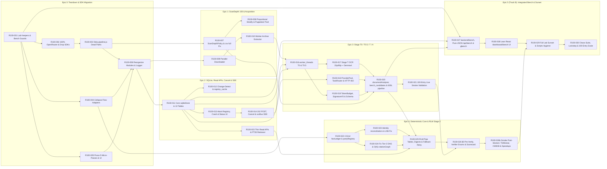

# Road to 100 Court Entries — Engineering Ticket Breakdown (`[R100-001]`–`[R100-030]`)

**Status:** Epics 0–3 (`[R100-001]`–`[R100-020]`) Complete & Verified · Next: `[R100-021]` → Epic 4 (`[R100-022]`–`[R100-026]`) → Epic 5 (`[R100-027]`–`[R100-030]`)  
**Date:** 2026-11-26  
**Authoritative Master Plan:** [road-to-100-entries-plan.md](file:///home/oxioxi/proj/our_chattie/docs/road-to-100-entries-plan.md)  
**Supporting References:**
- [road-to-100-entries-frontend-contract-review.md](file:///home/oxioxi/proj/our_chattie/docs/road-to-100-entries-frontend-contract-review.md) (FE / Design-Engineering read-side wire-contract review)
- [FINAL-BENCH-SYNTHESIS-AND-MIGRATION-REPORT.md](file:///home/oxioxi/proj/our_chattie/backend/data/pdf-engine-bench/FINAL-BENCH-SYNTHESIS-AND-MIGRATION-REPORT.md) (Phases 1–6.1 & Section 3.F Stage 0 sign-off)
- [EPIC3-PRODUCTION-MIGRATION-TICKET-BREAKDOWN.md](file:///home/oxioxi/proj/our_chattie/backend/data/pdf-engine-bench/EPIC3-PRODUCTION-MIGRATION-TICKET-BREAKDOWN.md) (Subsumed `[PROD-201]`–`[PROD-205]` extraction specs)
- [AGENTS.md](file:///home/oxioxi/proj/our_chattie/AGENTS.md) (Repository invariants, UI/WCAG AA & test-lane rules)

---

## Global Engineering Guardrails (Read Before Starting Any Ticket)

1. **Zero Broken Intermediate States:** Every ticket must leave `cd backend && npm run test:unit` (and `cd simple-chat && npm test && npm run build` whenever touching frontend files) green before merging.
2. **Core `AGENTS.md` Invariants:**
   - **"Never fail a run":** Every acquisition, OCR, extraction, reconciliation, and synthesis failure degrades per-item, preserves paid cache/partial state, and exposes explicit gaps rather than aborting.
   - **Backend owns query-type truth** (`queryClassifier.js`).
   - **SSE with polling fallback** (`useAnalysisRunDetail.js`), never a hard dependency on either.
   - **WCAG AA & Calm Status UI:** Status is always **glyph + label + color** (`StatusBadge.jsx`), never color alone; use Radix `Dialog`; keep `AnalysisReportAnnex` as the single canonical findings owner (no duplicated findings in prose).
   - **Offline `test:unit`:** Unit tests must never hit live e-Oglasna, Sudski registar, or OpenRouter endpoints.
3. **100% OpenRouter (`OPENROUTER_API_KEY` only):** After `[R100-002]`, zero Google or LangChain SDKs (`@google/genai`, `@langchain/google-genai`, `@langchain/core`) and zero `GOOGLE_API_KEY` fallbacks exist anywhere in the codebase.
4. **Do-Not-Delete Traps:**
   - **Keep `contextNode.js`:** [caseContextBuilder.js#L22](file:///home/oxioxi/proj/our_chattie/backend/court-analysis/reasoning/caseContextBuilder.js#L22) directly imports `createContextNode` and `validateContextGraph`. Only remove its unused `L15` import (`./analysisLab/evidenceIdentity`).
   - **Keep `propertyFlow.js#L58–391` lifecycle engine:** [reconciliation.js#L26](file:///home/oxioxi/proj/our_chattie/backend/court-analysis/reasoning/reconciliation.js#L26) directly imports `reconcileTrazbinaLifecycle` and `formatValue`. Delete only `moneyFlow.js` and the two legacy wrappers (`collectPropertyFlows`, `reconcilePropertyFlows`) + `prop-N` shims.
   - **Keep Bench Tests Green Through Phases 0–4:** Decouple `backend/scripts/lib/arms.js#L9` and `backend/scripts/fetch-real-document-fixtures.js#L30` in `[R100-001]` and update all 7 Bench/CLI script imports in `[R100-020]` so all 17 `pdf-benchmark-*.test.js` suites never break mid-migration.

---

## Master Execution Checklist & Rebuilt Dependency Tree

| ID | Epic | Title | Priority | Size | Track | Depends On |
|---|---|---|---|---|---|---|
| `[R100-001]` | Epic 0 | Extract Analysis Lab Keepers & Decouple Phase-0 Bench Guards | P0 | S | Track A | None |
| `[R100-002]` | Epic 0 | Remove Google/LangChain SDKs — Unified OpenRouter Client & 21 Test Mocks | P0 | L | Track A | `[R100-001]` |
| `[R100-003]` | Epic 0 | Strip Legacy `pipeline.js` Dead Paths (`automator`, `clusterExpansion`, `caseLimit`, `standard`) | P0 | M | Track A | `[R100-002]` |
| `[R100-004]` | Epic 0 | Collapse Triple Flow Adapters & Freeze Canonical `flows` Wire Contract | P0 | M | Track A | `[R100-001]` |
| `[R100-005]` | Epic 0 | Prune 5 Obsolete Reasoning LLM Passes, `nearDuplicateReview` & Dead Settings UI | P0 | M | Track A | `[R100-001]` |
| `[R100-006]` | Epic 0 | Reorganize Backend Module Boundaries (`routes/`, `http/`, `llm/`, `reasoning/*`) & `logger.js` | P0 | L | Track A | `[R100-003]`, `[R100-004]`, `[R100-005]` |
| `[R100-007]` | Epic 1 | Declarative `ScanDepthPolicy`, 3-Place Threading, `csv` `'full'` Fix & Modal Query Fix | P0 | M | Track A | `[R100-003]` |
| `[R100-008]` | Epic 1 | Proportional Stratification, Unified Puppeteer HTML Pool & Debug PNG Redirect | P0 | M | Track A | `[R100-007]` |
| `[R100-009]` | Epic 1 | Hardened Parallel Downloader (`acquisition/downloader.js`, `concurrency=5`) | P1 | S | Track A | `[R100-006]` |
| `[R100-010]` | Epic 1 | Worker-Thread Isolated Archive Extractor (`acquisition/archiveExtractor.js`) | P0 | M | Track A | `[R100-009]` |
| `[R100-011]` | Epic 2 | Core `sqliteStore.js`, Pragmas, FTS5 Triggers, 13-Table Schema & `< 500 KB` Artifacts | P0 | L | Track A | `[R100-006]` |
| `[R100-012]` | Epic 2 | Fold Change-Detection (`query_value` Indexed) & Sudski Registar `registry_cache` Into SQLite | P1 | M | Track A | `[R100-011]` |
| `[R100-013]` | Epic 2 | Per-Run Abort Registry, Crash Recovery, Shutdown Drain & 6-File Status UI Contract | P1 | M | Track A | `[R100-011]` |
| `[R100-014]` | Epic 2 | `202 Accepted` POST, `POST /cancel`, Lane-Scoped `runBus` SSE & `?afterSeq=N` Replay | P0 | M | Track A | `[R100-011]`, `[R100-013]` |
| `[R100-015]` | Epic 2 | Thin Read APIs (`/facts`, `/chunks`, `/traces`), Unbounded Chunks & FTS5 Retriever | P0 | M | Track A | `[R100-011]` |
| `[R100-016]` | Epic 3 | `node:worker_threads` Pool, Durable `Stage T0` (`preflight_json`) & `Stage T0.5` Fast-Path | P0 | L | Track A | `[R100-010]`, `[R100-011]`, `[R100-014]` |
| `[R100-017]` | Epic 3 | First-Principles `Stage T` OCR Router (`15p` Windows up to `60p` + `gemma-4-31b-it`) | P0 | L | Track A | `[R100-016]` |
| `[R100-018]` | Epic 3 | `ProviderPoolRegistry`, `<Task>` Router, Multi-Provider Pinning, 60s Watchdog & `HTTP 402` Latch | P0 | L | Track A | `[R100-011]` |
| `[R100-019]` | Epic 3 | `TokenBudgetPolicy`, Bisection, `EXTRACTION_SIGNATURE_V5`, `tableRows[]` & Schema Fixes | P0 | L | Track A | `[R100-016]` |
| `[R100-020]` | Epic 3 | Split `analysis-agent.js`, Structured `docId`/Coverage, `bench_candidates` & `<600L` `pipeline.js` | P0 | L | Track A | `[R100-007]`, `[R100-017]`, `[R100-018]`, `[R100-019]` |
| `[R100-021]` | Epic 3 | Pre-Smoke Telemetry Wiring & Controlled 100-Entry Live Smoke Validation | P1 | S | Track A | `[R100-020]` |
| `[R100-022]` | Epic 4 | 4-Kind `factLedger.js`, Persisted `partyRegistry` (`canonicalParties[]`), `decisionOutcome` Fix & `< 500 KB` `clusterEvidencePackage` | P0 | M | Track A | `[R100-004]` |
| `[R100-023]` | Epic 4 | Identity-Scoped `reconciliation.js` (`flowGroupKey`, `L236` Trap) & `propertyFlow`/`flow` Fixes | P0 | M | Track A | `[R100-022]` |
| `[R100-024]` | Epic 4 | Fix Tier-3 Cartesian DAG (`caseContextBuilder`), `O(N)` `citationGraph` & `findingProvenance` | P0 | M | Track A | `[R100-022]` |
| `[R100-025]` | Epic 4 | RLM Pipe Tables, Persisted Digests, `\$0` Fallback Report & `deterministic_fallback` Retry Fix | P0 | L | Track A | `[R100-015]`, `[R100-020]`, `[R100-023]`, `[R100-024]` |
| `[R100-026]` | Epic 4 | `\$0` Pre-Verify, Verifier Enums, Stage-Scoped `token_usage` / `partial_reason` & `docId` Coverage Keys | P0 | M | Track A | `[R100-021]`, `[R100-025]` |
| `[R100-026b]` | Epic 4 | Live Smoke Post-Mortem Hardening: Preflight/`or-mistral-ocr` Fix, `< 500 KB` Artifacts, Full OCR Traces & Speedups | P0 | M | Track A | `[R100-026]` |
| `[R100-027]` | Epic 5 | Decoupled `backend/bench/`, Pure-JSON/SSE `/api/bench` (`activeJobId`, `/models`, `ETag`) & `gbench` | P1 | L | Track B | `[R100-001]`, `[R100-011]`, `[R100-020]` |
| `[R100-028]` | Epic 5 | Lean Native React Bench UI (`/dashboard/bench`) Replacing `"Laboratorij"` | P1 | L | Track B | `[R100-027]` |
| `[R100-029]` | Epic 5 | Complete Analysis Lab Sunset, `kerum-lab.json` Relocation, `scripts/` (`33`) & `temp/` Cleanup | P1 | M | Track B | `[R100-026b]`, `[R100-028]` |
| `[R100-030]` | Epic 5 | Adversarial Chaos Suite, Wire-Contract/Lockstep Guards & 100-Entry Scale Benchmarks | P0 | L | Track B | `[R100-029]` |

---

## Epic 0 — Phase 0: Technical Debt Teardown, 100% OpenRouter SDK Migration & Module Reorganization

### `[R100-001]` Extract Analysis Lab Keepers & Decouple Phase-0 Bench Guards
- **Priority:** `P0` · **Size:** `S` · **Track:** `Track A` · **Depends on:** `None`
- **Goal:** Extract the three reusable primitives (`canonicalJson`, single-run `runScorecard`, `traceBounds`) out of `analysisLab/` into core services/ledger, and immediately decouple `scripts/` imports that would break when Phase 0 deletes `nativePdfDocument.js` and `agentLog.js`.
- **Files:**
  - **Create:** `backend/services/canonicalJson.js`, `backend/court-analysis/reasoning/runScorecard.js`, `backend/court-analysis/reasoning/traceBounds.js`
  - **Modify:** `backend/court-analysis/reasoning/contextNode.js` (remove unused `L15` import `./analysisLab/evidenceIdentity`), `backend/court-analysis/reasoning/analysisLab/{evidenceIdentity,scorecard,traceBounds}.js` (re-export from new locations until `[R100-029]`), `backend/scripts/lib/arms.js#L9` (inline `buildNativePdfTranscriptInstruction` prompt string), `backend/scripts/fetch-real-document-fixtures.js#L30` (replace `agentLog` with `logger` / `console`)
- **Implementation Details:**
  1. Move `stableStringify`, `evidencePackageDigest`, and `cloneEvidencePackage` from `analysisLab/evidenceIdentity.js` to `backend/services/canonicalJson.js`.
  2. Extract single-run quality scoring (`groundedSourceClaims`, `totalSourceClaims`, `criticalFailedDocuments`, `unresolvedLifecycleLinks`, `currencyConflicts`, `verificationStatus`, `elapsedMs`, `usage`, `costUsd`) into `runScorecard.js`.
  3. Extract `TRACE_BOUNDS` and `boundTrace` into `traceBounds.js`.
  4. Remove `const { stableStringify } = require('./analysisLab/evidenceIdentity');` from `contextNode.js#L15` (retaining `createContextNode` and `validateContextGraph` for `caseContextBuilder.js#L22`).
  5. Inline `buildNativePdfTranscriptInstruction` directly in `backend/scripts/lib/arms.js#L9` so `arms.js` no longer imports `backend/helpers/nativePdfDocument.js`, and decouple `fetch-real-document-fixtures.js#L30` from `agentLog.js`.
- **Acceptance Criteria:**
  - Zero production files import `analysisLab/*` directly for canonical JSON or trace bounds.
  - `arms.js` and `fetch-real-document-fixtures.js` have zero dependency on `nativePdfDocument.js` or `agentLog.js`.
- **Verification:** `cd backend && npm run test:unit`

---

### `[R100-002]` Remove Google/LangChain SDKs — Unified OpenRouter Client & 21 Test Mocks
- **Priority:** `P0` · **Size:** `L` · **Track:** `Track A` · **Depends on:** `[R100-001]`
- **Goal:** Eliminate `@google/genai`, `@langchain/google-genai`, and `@langchain/core`, drop `GOOGLE_API_KEY` completely, and standardize 100% of LLM/OCR configuration on OpenRouter (`OPENROUTER_API_KEY` only).
- **Files:**
  - **Create:** `backend/llm/openrouterClient.js`, `backend/llm/openrouterConfig.js`
  - **Modify:** `backend/package.json`, `backend/server.js#L9–15`, `backend/helpers/{geminiConfig,geminiUsage,geminiRetry}.js`, `backend/court-analysis/agents/{analysis-agent,download-agent,extract-tool}.js`, `backend/court-analysis/reasoning/{synthesizer,verifier,reportService}.js`, `backend/.env.example`, and all **21 test files** mocking `@langchain/google-genai` (plus `HumanMessage` in `synthesizer.test.js` and `@google/genai` in `document-extraction.test.js`)
  - **Delete:** `backend/helpers/nativePdfDocument.js`
- **Implementation Details:**
  1. Implement `createOpenRouterClient({ model, temperature, maxTokens, responseFormat, reasoning, provider })` returning `.invoke(messages, { signal })` with normalized `{ content, usage_metadata, response_metadata }` compatible with `trackUsageInvoke`.
  2. Implement `assertOpenRouterConfig()` validating `OPENROUTER_API_KEY` alone (`server.js#L9–15`); remove `GOOGLE_API_KEY`, `GEMINI_MODEL`, `contextNode` role, and `CONTEXT_NODE_PROMPT_VERSION` (updating `backend/tests/geminiConfig.test.js#L51`).
  3. Remove `@google/genai`, `@langchain/google-genai`, and `@langchain/core` from `backend/package.json`.
  4. Replace `DownloadDocumentsTool`, `ExtractArchiveTool`, and `AnalyzeDocumentsTool` (`extends Tool`) with plain async functions (`downloadClusterAttachments`, `extractArchiveFiles`, `analyzeClusterDocuments`) and plain OpenRouter message objects (no `new HumanMessage`).
  5. Update all 21 backend test files from `jest.mock('@langchain/google-genai', ...)` / `jest.mock('@google/genai', ...)` to mock `backend/llm/openrouterClient.js`.
- **Acceptance Criteria:**
  - `grep -rn "@google/genai\|@langchain/" backend/ --exclude-dir=node_modules` returns zero matches.
  - `assertOpenRouterConfig()` fails fast on missing `OPENROUTER_API_KEY` and never checks `GOOGLE_API_KEY`.
- **Verification:** `cd backend && npm run test:unit`

---

### `[R100-003]` Strip Legacy `pipeline.js` Dead Paths
- **Priority:** `P0` · **Size:** `M` · **Track:** `Track A` · **Depends on:** `[R100-002]`
- **Goal:** Remove `runCourtAnalysisWithExistingAutomator`, multi-pass Puppeteer `clusterExpansion`, `caseLimit` (1..10) clamping, single-iteration `for (let i = 0; i < totalCases; i++)` loops, and `'standard'` scan depth before scaling `pipeline.js`.
- **Files:**
  - **Modify:** `backend/court-analysis/pipeline.js`, `backend/helpers/courtAnalysisRequest.js`, `backend/server.js#L210–219`, `backend/tests/pipeline*.test.js`, `backend/tests/courtAnalysisRequest.test.js`
- **Implementation Details:**
  1. Delete `runCourtAnalysisWithExistingAutomator` (`pipeline.js#L1458+`) and remove `automator` parameter plumbing.
  2. Delete `resolveAutoExpansion`, `executeClusterExpansionSearches`, `applyConfiguredClusterExpansion`, and `options.clusterExpansion` coercion in `courtAnalysisRequest.js` (`L36–64`) & `server.js#L215`.
  3. Delete `caseLimit` coercion (`courtAnalysisRequest.js#L19–31`) and the multi-case `for (let i = 0; i < totalCases; i++)` loop in `pipeline.js` — reasoning strictly processes the selected primary cluster.
  4. Drop `'standard'` from `courtAnalysisRequest.js#L10` (`SCAN_DEPTHS = ['balanced', 'full']`, HTTP `400` otherwise).
- **Acceptance Criteria:**
  - `pipeline.js` has zero references to `clusterExpansion`, `caseLimit`, `runCourtAnalysisWithExistingAutomator`, or `'standard'` scan depth.
- **Verification:** `cd backend && npm run test:unit`

---

### `[R100-004]` Collapse Triple Flow Adapters & Freeze Canonical `flows` Wire Contract
- **Priority:** `P0` · **Size:** `M` · **Track:** `Track A` · **Depends on:** `[R100-001]`
- **Goal:** Standardize on one canonical `factLedger → flows → reconciliation` contract, freeze the FE wire shape for `flows`, and remove `moneyFlow.js` + legacy `prop-N` wrappers while keeping the active `propertyFlow.js#L58–391` lifecycle engine intact.
- **Files:**
  - **Modify:** `backend/court-analysis/reasoning/evidencePackage.js#L353–435`, `backend/court-analysis/reasoning/propertyFlow.js` (remove ONLY `collectPropertyFlows` `L50–53`, `reconcilePropertyFlows` `L406–415`, and `prop-N` ID shims; keep `L58–391`), `backend/court-analysis/reasoning/reconciliation.js#L26, L411`, `backend/court-analysis/utils/runSummary.js#L119–130`, `backend/scripts/eval-reasoning.js#L75`, `simple-chat/src/components/Dashboard/{AnalysisRunDetailPage,AnalysisFlowsSection}.jsx`, `simple-chat/src/components/ui/LifecycleTimeline.jsx`, affected tests (`moneyFlow.test.js` → `flow.test.js`, `propertyFlow.test.js`, `kerumGolden.test.js`, `runSummary.test.js`)
  - **Delete:** `backend/court-analysis/reasoning/moneyFlow.js` (44 lines)
- **Implementation Details:**
  1. Freeze the canonical `flows` wire contract for frontend consumers (`AnalysisFlowsSection.jsx`, `LifecycleTimeline.jsx`): `{ id, kind, canonicalPartyId, amountEur, sourceAmount, sourceCurrency, sourcePages, sourceChunkId, docId, grounded, crossCategoryFactId, valueChanges }`.
  2. Remove the triple conversion round-trip in `evidencePackage.js#L353–435` so `collectFlows` and `reconcileFlows` operate directly on canonical `factLedger` rows and expose canonical `pkg.flows` / `pkg.reconciliation`.
  3. Delete `moneyFlow.js` and migrate any tests importing it to `flow.js` / canonical `flows`.
  4. Delete `collectPropertyFlows`, `reconcilePropertyFlows`, and `prop-N` shims from `propertyFlow.js` (removing `reconcilePropertyFlows` re-export from `reconciliation.js#L411`), while keeping `reconcileTrazbinaLifecycle`, `resolveSupersedesTargetWithBasis`, `sharesLifecycleIdentifiers`, `buildValueChangeTimeline`, and `formatValue`.
  5. Update `AnalysisRunDetailPage.jsx#L171–181`, `AnalysisFlowsSection.jsx`, `LifecycleTimeline.jsx`, `runSummary.js`, and `eval-reasoning.js#L75` to read canonical `flows`/`reconciliation`.
- **Acceptance Criteria:**
  - `moneyFlow.js` is deleted; canonical `flows` fields are frozen and consumed cleanly; `kerumGolden.test.js` and `kerumReplay.test.js` pass.
- **Verification:** `cd backend && npm run test:unit && npx jest tests/replays/kerumReplay.test.js --runInBand && cd ../simple-chat && npm test`

---

### `[R100-005]` Prune 5 Obsolete Reasoning LLM Passes, `nearDuplicateReview` & Dead Settings UI
- **Priority:** `P0` · **Size:** `M` · **Track:** `Track A` · **Depends on:** `[R100-001]`
- **Goal:** Cut post-extraction reasoning from 8 LLM passes down to **Synthesize + Verify**, delete dead settings toggles and unused modules, and keep `SettingsPopover.jsx` restricted strictly to lawyer-facing preferences.
- **Files:**
  - **Delete:** `backend/court-analysis/reasoning/{queryPlanner,retrievalQueries,rerankerClient,reranker,claimJudge,significance,followUpVerification,nearDuplicateReview}.js`, `backend/helpers/reasoningSettings.js`, `simple-chat/src/components/Dashboard/ReasoningExperimentsPanel.jsx`, plus obsolete tests (`queryPlanner*`, `reranker*`, `claimJudge*`, `significance*`, `followUpVerification*`, `nearDuplicateReview.test.js`, `ReasoningSettings.test.jsx`)
  - **Modify:** `backend/court-analysis/reasoning/{reportService,retriever,scopeContract}.js`, `backend/services/localStore.js#L6–9, L76–93, L263–291`, `simple-chat/src/hooks/useSettings.js`, `simple-chat/src/components/Dashboard/{SettingsPopover,AnalysisRiskList,AnalysisReasoningTelemetry}.jsx`
- **Implementation Details:**
  1. Remove imports and invocations of `queryPlanner`, `rerankerClient`/`reranker`, `claimJudge`, `significance`, and `followUpVerification` from `reportService.js` and `retriever.js#L1`.
  2. Remove `rerank-fallback` branch from `scopeContract.js#L161–165`.
  3. Delete `reasoningSettings.js` and prune `reasoningRerankMode` / `reasoningPlanner` / `reasoningFollowUp` from `localStore.js`, `useSettings.js`, and `ReasoningExperimentsPanel.jsx`. Restrict `SettingsPopover.jsx` strictly to lawyer-facing preferences (`defaultScanDepth`, `uiPreferences`)—engineering `activeTaskRoutingOverrides` belong inside `/dashboard/bench` (`[R100-028]`).
  4. Remove dead `item?.claimJudge` / `item?.heuristicRank` reads in `AnalysisRiskList.jsx` and `conflict.followUp` / `rerankStatus` reads in `AnalysisReasoningTelemetry.jsx`.
- **Acceptance Criteria:**
  - `reportService.js` executes strictly **Synthesize** + **Verify** LLM passes; `SettingsPopover.jsx` has zero engineering routing knobs or dead reasoning toggles.
- **Verification:** `cd backend && npm run test:unit && cd ../simple-chat && npm test && npm run build`

---

### `[R100-006]` Reorganize Backend Module Boundaries & Unify `logger.js`
- **Priority:** `P0` · **Size:** `L` · **Track:** `Track A` · **Depends on:** `[R100-003]`, `[R100-004]`, `[R100-005]`
- **Goal:** Establish the clean target folder layout (`routes/`, `http/`, `llm/`, `reasoning/{schema,ledger,retrieval,synthesis}/`), shrink `server.js` to ~100 lines, and consolidate all logging onto `logger.js`.
- **Files:**
  - **Move / Refactor:**
    - `backend/routes/{courtAnalysis,analysisRuns,changeDetection}.js` (extracted from `server.js`)
    - `backend/http/{sse,analysisStreamHandler,analysisStream,pagination,sanitize,courtAnalysisRequest,courtAnalysisPayload,analysisReportRetry,friendlyAnalysisError,analysisStage}.js` + `backend/court-analysis/utils/rateLimiter.js` → `backend/http/rateLimiter.js`
    - `backend/llm/{openrouterClient,openrouterConfig,retry,usage}.js`
    - `backend/court-analysis/reasoning/schema/{extractionSchema,schema}.js`
    - `backend/court-analysis/reasoning/ledger/{factLedger,flow,propertyFlow,reconciliation,currencyConversion,claimRegistry,paymentRank,proceduralFlow,grounding,caseContextBuilder,contextNode,citationGraph,scopeContract,runScorecard,evidencePackage,coverageGuard}.js`
    - `backend/court-analysis/reasoning/retrieval/{chunker,indexer,retriever,findingProvenance}.js`
    - `backend/court-analysis/reasoning/synthesis/{synthesisInputBuilder,synthesizer,verifier,timelineBuilder,reportService,traceBounds}.js`
  - **Modify:** `backend/server.js` (~100-line bootstrapper), `backend/court-registry/enricher.js` (replace `console.log` with `logger.js`), all relative `require(...)` paths across `backend/` and `backend/tests/`
  - **Delete:** `backend/helpers/agentLog.js` (folded into `logger.js`)
- **Implementation Details:**
  1. Perform mechanical module moves with updated relative `require` paths across `backend/` and `backend/tests/` (`court-analysis/agents/*` moves in Phase 1/3 as `acquisition/` and `extraction/`).
  2. Extract Express route handlers out of `server.js` into `backend/routes/*`.
  3. Replace all `agentLog` and `enricher.js` `console.log` calls with structured `logger.js` (`trace`/`debug`/`info`/`warn`/`error` + `runId`).
- **Acceptance Criteria:**
  - `server.js` is `<= 120` lines; `agentLog.js` is deleted; zero broken relative `require(...)` paths exist across `backend/` or `backend/tests/`.
- **Verification:** `cd backend && npm run test:unit`

---

## Epic 1 — Phase 1: Declarative `ScanDepthPolicy` (`Uravnoteženo` = 100, `Sve`) & Acquisition Hardening

### `[R100-007]` Declarative `ScanDepthPolicy`, 3-Place Threading, `csv` `'full'` Fix & Modal Query Fix
- **Priority:** `P0` · **Size:** `M` · **Track:** `Track A` · **Depends on:** `[R100-003]`
- **Goal:** Replace `(scrapeLimit, maxPagesScanned, tailSample)` with declarative `SCAN_DEPTH_POLICIES` (`balanced = 100`, `full = all`), fix `scanDepth` being dropped in 3 places, fix `csvExportClient.js`'s `'full'` bug, update `ScanDepthSelect.jsx` to 2 modes, and align `NewAnalysisModal.jsx` validation with `queryClassifier.js`.
- **Files:**
  - **Modify:** `backend/court-analysis/utils/{scanDepth,runSummary}.js`, `backend/scraper/csvExportClient.js#L213–263`, `backend/court-analysis/pipeline.js#L1174–1185, L1398–1404`, `backend/routes/courtAnalysis.js` (or `server.js#L150–155`), `backend/services/localStore.js#L103–125`, `simple-chat/src/components/Dashboard/{ScanDepthSelect,NewAnalysisModal}.jsx`, `backend/tests/{scanDepth,csvExportClient,pipeline.runLogging,runSummary}.test.js`, `simple-chat/src/components/Dashboard/__tests__/{ScanDepthSelect,NewAnalysisModal}.test.jsx`
- **Implementation Details:**
  1. Export `SCAN_DEPTH_POLICIES` (`balanced`: `maxEntries: 100, allocation: 'stratified', poolCap: 400`; `full`: `maxEntries: null, allocation: 'all', poolCap: Number(process.env.ANALYSIS_FULL_MAX_ENTRIES) || 1000`) from `scanDepth.js`.
  2. Thread `scanDepth: parsedRequest.options.scanDepth` through `createAnalysisRun` (`runs.scan_depth`) → `runCourtAnalysis` → `processScrapedCases` (`pipeline.js#L1398`) → structured logs → `runSummary.js`.
  3. Fix `csvExportClient.js#L219–262`: decouple primary-case pool selection from `tailSample` so **both** `balanced` and `full` select the primary case cleanly (`full` returns the full primary pool up to `poolCap` with `allocation: 'all'`, recording secondary clusters in metadata; never falls through to global `applyBounding`).
  4. In `pipeline.js#L1174–1185`, skip stratified pruning when `allocation === 'all'` (`full`), while still computing `coverageLedger`.
  5. Update `ScanDepthSelect.jsx` to 2 options (`Uravnoteženo` and `Sve`), and replace hardcoded 11-digit OIB-only Zod regex in `NewAnalysisModal.jsx#L8–11` with validation accepting OIB, case number, or text aligned with `queryClassifier.js` (matching `DashboardPage.jsx#L103`).
- **Acceptance Criteria:**
  - `scanDepth` (`balanced` or `full`) is never `null` in persisted runs, summaries, or logs; `'full'` mode analyzes all primary-cluster entries without global 400-row truncation; `NewAnalysisModal` accepts OIB, case number, and text queries.
- **Verification:** `cd backend && npm run test:unit && cd ../simple-chat && npm test`

---

### `[R100-008]` Proportional Stratification, Unified Puppeteer HTML Pool & Debug PNG Redirect
- **Priority:** `P0` · **Size:** `M` · **Track:** `Track A` · **Depends on:** `[R100-007]`
- **Goal:** Scale `stratify.js` proportionally to 100 entries with stride-sampled `exploratory`, replace Puppeteer's broken `80 + 20` magic window with batched HTML pool harvesting feeding `stratifyClusterEntries`, and stop writing debug PNGs into `backend/` root.
- **Files:**
  - **Modify:** `backend/court-analysis/utils/stratify.js`, `backend/scraper/courtSearchPuppeteer.js#L43–44, L250–381, L793, L981–1023`, `backend/tests/{stratify,courtSearchPuppeteer*}.test.js`
  - **Delete:** stale `backend/error-parseSearchResults-*.png` files
- **Implementation Details:**
  1. Replace hardcoded constants in `stratify.js` with `computeStratificationQuotas(budget)` (`origin = 15`, `recent = 40`, `exploratory = 8`, `adminCap = 8` at `budget = 100`).
  2. Replace step 4 `[others[others.length - 1], others[0]]` with even stride sampling across `others` up to the `exploratory` quota.
  3. In `courtSearchPuppeteer.js`, remove `performTailSample` (all 6 verified bugs: bypassed `stratify.js`, global-oldest tail pollution, hardcoded `TAIL_SAMPLE_ENTRIES = 10`, intra-page reversal, `limit + tail = 120` double-count, pre-filter starvation) and replace with batched HTML search page harvesting (`maxPoolPages: 40`, `batchSize: 4`, or `FULL_SCAN_MAX_PAGES` for `full`) selecting the primary-case pool and setting `discoveryMetadata.selection` so `pipeline.js` runs `stratifyClusterEntries` identically to CSV.
  4. Redirect `courtSearchPuppeteer.js#L793` debug screenshots to `backend/data/debug/` and remove existing root PNGs.
- **Acceptance Criteria:**
  - `stratifyClusterEntries(pool300, { budget: 100 })` returns 100 entries (`15` origin, `40` recent, `8` stride-sampled exploratory, `<=8` admin, middle + spread).
  - Puppeteer fallback sets `selection.analysisBudget` and yields `coverageLedger` identically to CSV.
- **Verification:** `cd backend && npm run test:unit`

---

### `[R100-009]` Hardened Parallel Downloader (`acquisition/downloader.js`)
- **Priority:** `P1` · **Size:** `S` · **Track:** `Track A` · **Depends on:** `[R100-006]`
- **Goal:** Rename `download-agent.js` to `court-analysis/acquisition/downloader.js`, parallelize downloads (`DOWNLOAD_CONCURRENCY = 5`), eliminate `Date.now()` filename collisions, and guarantee clean cache commits.
- **Files:**
  - **Move / Modify:** `backend/court-analysis/agents/download-agent.js` → `backend/court-analysis/acquisition/downloader.js`, `backend/helpers/downloadCache.js` → `backend/court-analysis/acquisition/downloadCache.js`, `backend/court-analysis/pipeline.js`, `backend/tests/*download*.test.js`
- **Implementation Details:**
  1. Export `downloadClusterAttachments({ documentLinks, progressCallback, signal })` (plain async function supporting abort signal).
  2. Execute downloads with bounded concurrency (`DOWNLOAD_CONCURRENCY = 5`).
  3. Generate collision-proof working filenames: `` `${Date.now()}_${index}_${crypto.randomUUID().slice(0, 8)}_${safeName}` ``.
  4. Add per-link exponential retry with jitter on `429`/`5xx`/socket reset, validate `bytes > 0` before `pending.commit(...)`, log individual failures, and continue remaining links.
- **Acceptance Criteria:**
  - Firing 30 simultaneous cache hits with identical `link.text` (`Podnesak.pdf`) produces 30 distinct intact paths on disk; an aborted mid-stream link #47 leaves cache clean and lets 99/100 succeed.
- **Verification:** `cd backend && npm run test:unit`

---

### `[R100-010]` Worker-Thread Isolated Archive Extractor (`acquisition/archiveExtractor.js`)
- **Priority:** `P0` · **Size:** `M` · **Track:** `Track A` · **Depends on:** `[R100-009]`
- **Goal:** Fix shared `uploads/` ZIP overwrite collisions (`Podnesak.pdf` clobbering), offload synchronous `adm-zip` decompression off Node's event loop, guard against zip-bombs/nested ZIPs, and preserve parent entry metadata.
- **Files:**
  - **Move / Modify:** `backend/court-analysis/agents/extract-tool.js` → `backend/court-analysis/acquisition/archiveExtractor.js`, `backend/court-analysis/pipeline.js#L1694–1713`, `backend/tests/*extract*.test.js`
- **Implementation Details:**
  1. Extract each `.zip` into an **isolated directory** `path.join(uploadsDir, 'extracted', archiveUniqueId)` instead of shared `path.dirname(file.filePath)` (`pipeline.js#L1697`).
  2. Offload `AdmZip` decompression to a `node:worker_threads` worker so multi-MB archives never block SSE heartbeats.
  3. Enforce `sanitizeEntryName` zip-slip jail, max uncompressed total bytes (`MAX_ARCHIVE_UNCOMPRESSED_BYTES`), max entry count (`MAX_ARCHIVE_ENTRIES`), and clean handling of 1-level nested `.zip` archives.
  4. Propagate parent `.zip` metadata (`sourceEntryIndex`, `sourceDocumentLinkId`, `entryDate`) onto every extracted child file record.
- **Acceptance Criteria:**
  - Extracting 20 archives each containing `Podnesak.pdf` produces 20 distinct, uncorrupted files carrying distinct `sourceEntryIndex` / `sourceDocumentLinkId` / `entryDate`; zip-slip, zip-bomb, and corrupt ZIPs degrade cleanly.
- **Verification:** `cd backend && npm run test:unit`

---

## Epic 2 — Phase 2: Unified `better-sqlite3` Persistence, Read APIs, Cancel & `runBus` SSE

### `[R100-011]` Core `sqliteStore.js`, Pragmas, FTS5 Triggers, 13-Table Schema & `< 500 KB` Artifacts
- **Priority:** `P0` · **Size:** `L` · **Track:** `Track A` · **Depends on:** `[R100-006]`
- **Goal:** Replace `localStore.js` (`8.4 MB` `runs.json`) and `ocrPageStore.js` with one WAL-enabled `better-sqlite3` database (`backend/data/analysis/analysis.db`), enforce `foreign_keys = ON` and FTS5 sync triggers, add `preflight_json`/`partial_reason`/`canceled`, and keep initial run artifacts `< 500 KB`.
- **Files:**
  - **Create:** `backend/services/sqliteStore.js`, `backend/tests/sqliteStore.test.js`
  - **Modify:** `backend/package.json` (add `better-sqlite3`), `backend/server.js`, `backend/routes/{courtAnalysis,analysisRuns}.js`, `backend/http/{analysisReportRetry,courtAnalysisPayload}.js`, `backend/.env.example`
  - **Delete:** `backend/services/localStore.js`, `backend/helpers/ocrPageStore.js`, `backend/tests/localStore*.test.js`, `backend/tests/ocr-page-store.test.js`
- **Implementation Details:**
  1. Execute the mandatory PRAGMA block on every connection: `journal_mode = WAL`, `synchronous = NORMAL`, **`foreign_keys = ON`**, `busy_timeout = 5000`, `temp_store = MEMORY`, `cache_size = -64000`.
  2. Implement the complete 13-table schema from Section 4.3 of [road-to-100-entries-plan.md](file:///home/oxioxi/proj/our_chattie/docs/road-to-100-entries-plan.md): `runs` (including `scan_depth`, `preflight_json`, `partial_reason`, `summary_json`, `scorecard_json`, `token_usage_json`, `status IN ('queued','running','done','partial','error','interrupted','canceled')`), `run_artifacts`, `run_events`, pruned `settings` (`defaultScanDepth`, `uiPreferences`), `ocr_transcripts` (`task_type`, `provider_slug`), `segment_checkpoints`, `llm_traces`, `prompt_registry`, `bench_candidates`, `run_facts` (4 kinds + provenance/HRK/`canonical_party_id` columns), `run_chunks` + `run_chunks_fts` + **`run_chunks_ai` / `run_chunks_ad` / `run_chunks_au` sync triggers**, `registry_cache`, `model_pricing_cache`, `change_snapshots` / `change_diffs` (with `query_value` + index).
  3. Wrap multi-row `run_chunks` and `run_facts` inserts inside `db.transaction(...)`.
  4. Strip duplicate raw `processedCases[].analysis.individualAnalyses[].aiResult` from `buildCourtAnalysisPayload` / `run_artifacts.result_json` so initial `GET /api/analysis/runs/:id/full` stays `< 500 KB` (granular facts, chunks, and traces are served via `[R100-015]`).
- **Acceptance Criteria:**
  - Deleting a run cascades cleanly across all child tables AND removes `run_chunks_fts` rows via `run_chunks_ad` without `SQLITE_CORRUPT_VTAB`.
  - Initial `run_artifacts.result_json` does not duplicate `aiResult`; 1,000-event + 500-fact transaction commits in `< 25 ms`.
- **Verification:** `cd backend && npm run test:unit`

---

### `[R100-012]` Fold Change-Detection (`query_value` Indexed) & Sudski Registar `registry_cache` Into SQLite
- **Priority:** `P1` · **Size:** `M` · **Track:** `Track A` · **Depends on:** `[R100-011]`
- **Goal:** Eliminate `backend/data/change-detection/` JSON sprawl, make change history queryable by normalized `query_value` from any completed run, and back Sudski registar lookups with `registry_cache` (`24h` TTL).
- **Files:**
  - **Modify:** `backend/change-detection/{service,api}.js`, `backend/routes/changeDetection.js`, `backend/court-registry/enricher.js#L120–234`, `backend/tests/changeDetection*.test.js`, `backend/tests/enricher*.test.js`
  - **Delete:** `backend/change-detection/store.js`
- **Implementation Details:**
  1. Replace `change-detection/store.js` with `sqliteStore` `change_snapshots` / `change_diffs` methods, storing and indexing normalized `query_value` (OIB or case number) and adding `GET /api/change-detection/history?queryValue=...` (or query param support on existing history route) so the frontend can power *"Provjeri nove objave"* directly from any run.
  2. Wrap `enrichParticipants` in `enricher.js` with `sqliteStore` `registry_cache` (`24h` TTL) keyed by OIB or normalized company name, plus bounded lookup concurrency (`concurrency = 3`).
- **Acceptance Criteria:**
  - Second lookup of 40 legal entities within 24 hours fires zero HTTP calls; `change_snapshots`/`change_diffs` are queryable by normalized `query_value`; `change-detection/store.js` is deleted.
- **Verification:** `cd backend && npm run test:unit`

---

### `[R100-013]` Per-Run Abort Registry, Crash Recovery, Shutdown Drain & 6-File Status UI Contract
- **Priority:** `P1` · **Size:** `M` · **Track:** `Track A` · **Depends on:** `[R100-011]`
- **Goal:** Provide a shared per-run `AbortController` registry (powering both `SIGINT`/`SIGTERM` shutdown drain and `[R100-014]` user cancellation), reconcile stale runs on boot, sweep orphaned `uploads/`, and handle `partial`, `interrupted`, `canceled`, and `queued` across all 6 UI/hook files.
- **Files:**
  - **Create:** `backend/http/runAbortRegistry.js`
  - **Modify:** `backend/server.js`, `backend/services/sqliteStore.js`, `backend/http/analysisStream.js`, `simple-chat/src/components/ui/{StatusBadge,PipelinePhases,CoverageCell}.jsx`, `simple-chat/src/components/Dashboard/{RunStatusBadge,RunsTable}.jsx`, `simple-chat/src/hooks/useAnalysisRunDetail.js`, `backend/tests/*Stream*.test.js`, `simple-chat/src/components/**/__tests__/*`
- **Implementation Details:**
  1. Create `runAbortRegistry` mapping active `runId → AbortController` so both shutdown hooks and `POST /cancel` (`[R100-014]`) abort in-flight downloads, worker tasks, and OpenRouter requests cleanly.
  2. On boot, reconcile `'running'`/`'queued'` runs left from an unclean crash to `'interrupted'` and sweep orphaned files/dirs in `backend/uploads/` (leaving `.dl-cache` intact); on `SIGINT`/`SIGTERM`, abort active runs, mark them `'interrupted'`, and close SQLite.
  3. Update **all 6** frontend/stream status handlers for `partial`, `interrupted`, `canceled`, and `queued` (WCAG AA glyph + label + color): `StatusBadge.jsx`, `RunStatusBadge.jsx`, `useAnalysisRunDetail.js`, **`PipelinePhases.jsx#L78–84`**, **`CoverageCell.jsx#L24`**, and **`RunsTable.jsx#L72–73`**, plus `TERMINAL_STATUSES` in `analysisStream.js`.
- **Acceptance Criteria:**
  - Server restart during an active run marks it `'interrupted'`; `PipelinePhases`, `CoverageCell`, `RunsTable`, and `StatusBadge` render `partial`, `interrupted`, `canceled`, and `queued` accurately without falling through to `'U tijeku'`/`'Završeno'`.
- **Verification:** `cd backend && npm run test:unit && cd ../simple-chat && npm test && npm run build`

---

### `[R100-014]` `202 Accepted` POST, `POST /cancel`, Lane-Scoped `runBus` SSE & `?afterSeq=N` Replay
- **Priority:** `P0` · **Size:** `M` · **Track:** `Track A` · **Depends on:** `[R100-011]`, `[R100-013]`
- **Goal:** Replace `1.5s` DB polling and long-lived SSE on `POST /api/court-analysis` with a clean `202 Accepted` JSON handoff, `POST /api/analysis/runs/:id/cancel`, lane-scoped `runBus` SSE deltas, and `?afterSeq=N` reconnect replay.
- **Files:**
  - **Create:** `backend/http/runBus.js`, `backend/tests/runBus.test.js`
  - **Modify:** `backend/http/{analysisStreamHandler,analysisStage}.js`, `backend/routes/{courtAnalysis,analysisRuns}.js`, `simple-chat/src/hooks/{useCourtAnalysisStream,useAnalysisRunStream,useAnalysisRunDetail}.js`, `simple-chat/src/components/Dashboard/NewAnalysisModal.jsx`, `simple-chat/src/hooks/__tests__/useAnalysisRun*.test.jsx`
- **Implementation Details:**
  1. Change `POST /api/court-analysis` to enqueue the run, register it in `runAbortRegistry`, and immediately return **`202 Accepted` JSON (`{ analysisId, status: 'queued' }`)** (updating `useCourtAnalysisStream.js` & `NewAnalysisModal.jsx` to read JSON directly instead of parsing a 1-frame SSE stream).
  2. Add **`POST /api/analysis/runs/:id/cancel`**: aborts the run via `runAbortRegistry`, preserves all committed SQLite `ocr_transcripts` / `segment_checkpoints`, sets `status = 'canceled'`, and emits `run.terminal`.
  3. Add `preflight` and `ocr` to `analysisStage.js#L1–14` and emit lane-scoped progress counters (`lanes: { download, preflight, ocr, extract }`) in `stage.progress` so concurrent digital `Stage A` and `Stage T` OCR never make progress bars jump backwards.
  4. Rewrite `analysisStreamHandler.js` (`GET /api/analysis/runs/:id/stream`) to subscribe to `runBus`, support **`?afterSeq=N` / `Last-Event-ID`** delta replay from `run_events` on visibility reconnects, and close cleanly on `run.terminal`; `useAnalysisRunDetail.js` fetches `GET /api/analysis/runs/:id/full` once on terminal/reconnect while keeping backoff polling fallback.
- **Acceptance Criteria:**
  - `POST /api/court-analysis` returns `202` JSON with `analysisId`; `POST /cancel` aborts an active run and sets `'canceled'`; `?afterSeq=10` replays strictly `seq > 10` frames; SSE frames stay `< 2 KB`.
- **Verification:** `cd backend && npm run test:unit && cd ../simple-chat && npm test`

---

### `[R100-015]` Thin Read APIs (`/facts`, `/chunks`, `/traces`), Unbounded Chunks & FTS5 Retriever
- **Priority:** `P0` · **Size:** `M` · **Track:** `Track A` · **Depends on:** `[R100-011]`
- **Goal:** Expose the three thin SQLite read endpoints (`/facts`, `/chunks`, `/traces`) powering paginated/on-demand UI reads, remove the `RETRIEVAL_CHUNK_LIMIT = 8` truncation cap, and wire `retriever.js` to deterministic **ledger-driven FTS5 BM25 queries**.
- **Files:**
  - **Modify:** `backend/routes/analysisRuns.js`, `backend/services/sqliteStore.js`, `backend/court-analysis/reasoning/retrieval/{chunker,indexer,retriever}.js`, `backend/tests/{analysisRunsReadApi,reasoning/chunker,reasoning/indexer,reasoning/retriever}.test.js`
- **Implementation Details:**
  1. Add three read endpoints on `analysisRuns.js` backed by `sqliteStore.js`:
     - **`GET /api/analysis/runs/:id/facts`** (`kind`, `partyId`, `grounded`, `q`, `limit`, `offset` → `{ facts, total, limit, offset }`).
     - **`GET /api/analysis/runs/:id/chunks/:chunkId`** (single chunk `{ chunkId, docId, fileName, caseNumber, sourceEntryIndex, pageNumbers, startIndex, endIndex, text }`) and **`GET /api/analysis/runs/:id/chunks?q=...`** (FTS5 `bm25` search returning snippets, ranks, and page numbers).
     - **`GET /api/analysis/runs/:id/traces`** (summary list excluding `raw_response`) and **`GET /api/analysis/runs/:id/traces/:traceId`** (full raw forensic record).
  2. Remove `RETRIEVAL_CHUNK_LIMIT = 8` in `chunker.js` (and fix `limit === 1` division-by-zero at `L148–152` + unused `stride` at `L62`).
  3. In `indexer.js`, preserve 1–2 digit `redni broj` tokens and index `decisionOutcome`, `proceduralEvents`, `citedFilingReferences`, `claimRegistryNumber`, and `filingReference`.
  4. In `retriever.js`, generate targeted FTS5 queries deterministically from `factLedger` (party OIBs/names, `claimRegistryNumber`, sub-filings, unresolved conflicts), execute `bm25(run_chunks_fts)` (`< 25 ms`), apply exact OIB/filing-ref anchor boosts, and reuse precomputed `normalizedText`.
- **Acceptance Criteria:**
  - All three thin read endpoints enforce pagination/filtering and return exact shapes; a 40-page document indexes 100% of chunks; FTS5 BM25 retrieves exact OIB / `redni broj 98` chunks in `< 25 ms`.
- **Verification:** `cd backend && npm run test:unit`

---

## Epic 3 — Phase 3: Hardened `Stage T0` / `T0.5` / `T` / `A` Migration

### `[R100-016]` `node:worker_threads` Pool, Durable `Stage T0` (`preflight_json`) & `Stage T0.5` Fast-Path
- **Priority:** `P0` · **Size:** `L` · **Track:** `Track A` · **Depends on:** `[R100-010]`, `[R100-011]`, `[R100-014]`
- **Goal:** Replace 4× redundant reads/parses and main-thread `pdf.js` stalls with a `node:worker_threads` `Stage T0` preflight (persisting durable `runs.preflight_json` + emitting `preflight` lane progress) plus `Stage T0.5` deterministic admin extraction.
- **Files:**
  - **Create:** `backend/court-analysis/extraction/{workerPool,pdfPreflight,pdfText,adminFastPath}.js`, `backend/tests/{pdfPreflight,adminFastPath}.test.js`
- **Implementation Details:**
  1. Create a bounded `node:worker_threads` pool (`2–4` workers, `<= 4` multi-MB PDF buffers in RAM simultaneously, releasing buffers immediately; always calling `await pdf.destroy()` in `finally`).
  2. In `pdfPreflight.js`: read bytes once, sniff magic bytes (`%PDF-`, `PK\x03\x04`, `\xD0\xCF\x11\xE0`, UTF-8 text; reject `<html`/`<!DOCTYPE` masquerading as `.pdf`), compute `sha256` once, dedupe identical attachments upfront intra-run, and check SQLite `ocr_transcripts` / `segment_checkpoints`.
  3. In a single `pdf.js` pass, classify per-page into `digital_text | scanned_full | hybrid_mixed | empty_or_corrupt`, tag `table_dense` vs `prose`, and flag blank/low-entropy pages to skip.
  4. Persist the pre-flight manifest & cost ballpark (`{ estimatedMinUsd, estimatedExpectedUsd, cachedHits, ocrPages, digitalDocs, scannedDocs, hybridDocs }`) in **`runs.preflight_json`** AND emit `run.preflight` + `preflight` lane counters via `runBus`.
  5. Implement `Stage T0.5` (`adminFastPath.js`) for `< 1,000`-char `role === 'admin'` notices with zero currency regex matches (`!/\d+[.,]\d{2}/`) and zero cession cues (`!/ustup|cesij|ugovor/i`), extracting header metadata deterministically at `\$0`.
- **Acceptance Criteria:**
  - `runs.preflight_json` survives refresh/polling fallback; HTML-as-PDF fails fast; 12p `hybrid_mixed` (`3p digital + 9p scan`) isolates pages `4–12` for OCR; `Stage T0.5` skips LLM calls on routine admin notices.
- **Verification:** `cd backend && npm run test:unit`

---

### `[R100-017]` First-Principles `Stage T` OCR Router (`15p` Windows up to `60p` + `google/gemma-4-31b-it`)
- **Priority:** `P0` · **Size:** `L` · **Track:** `Track A` · **Depends on:** `[R100-016]`
- **Goal:** Replace the `OCR_MAX_PAGES = 20` cutoff and `RECITATION`-prone Gemini raster default with `15`-page `pdf-lib` batch windows across up to `60` pages routed to `or-mistral-ocr` → `google/gemma-4-31b-it` raster → `google/gemini-2.5-flash`.
- **Files:**
  - **Create:** `backend/court-analysis/extraction/ocrRouter.js`, `backend/tests/ocrRouter.test.js`
- **Implementation Details:**
  1. Separate `OCR_BATCH_WINDOW_PAGES = 15` from `MAX_DOC_OCR_PAGES = 60`. Slice `scanned_full` and scanned subsets of `hybrid_mixed` PDFs via `pdf-lib` into `<= 15`-page windows (`<= 5 MB`); on `> 60`-page annexes, transcribe head (`40p`) + tail (`20p`) and record `skippedPageRanges` (e.g. `[{ from: 41, to: 112 }]`).
  2. Route primary OCR through **`or-mistral-ocr`** (`\$0.002/page`); on failure/skip, render scanned pages inside `worker_threads` and fall back to **`google/gemma-4-31b-it`** vision raster, with `google/gemini-2.5-flash` as final escalation.
  3. Merge digital + OCR page transcripts in exact `1..N` page order, wrap `pdf.destroy()` in `finally`, emit `ocr` lane progress (`docsDone`, `docsTotal`, `pagesDone`, `pagesTotal`), and persist to SQLite `ocr_transcripts`.
- **Acceptance Criteria:**
  - A 36-page scan transcribes cleanly in `15 + 15 + 6` windows; an 80-page scan records explicit `skippedPageRanges`; `gemma-4-31b-it` salvages mocked `RECITATION` failures.
- **Verification:** `cd backend && npm run test:unit`

---

### `[R100-018]` `ProviderPoolRegistry`, `<Task>` Router, Multi-Provider Pinning, 60s Watchdog & `HTTP 402` Latch
- **Priority:** `P0` · **Size:** `L` · **Track:** `Track A` · **Depends on:** `[R100-011]`
- **Goal:** Eliminate the 12-call multiplicative concurrency storm and 300s `Z.AI` hangs with one global `ProviderPoolRegistry`, declarative `<Task>` routing, multi-provider `ignore` rotation, `60s` SSE idle watchdog, and graceful `HTTP 402` credit exhaustion handling.
- **Files:**
  - **Create:** `backend/llm/{providerPool,taskRouter,creditLatch}.js`, `backend/tests/{providerPool,taskRouter,openrouterClient,creditLatch}.test.js`
  - **Modify:** `backend/llm/{openrouterClient,openrouterConfig,retry,usage}.js`, `backend/services/sqliteStore.js`
- **Implementation Details:**
  1. Implement `ProviderPoolRegistry` (`openrouter:z-ai = 3`, `openrouter:mistral-ocr = 3`, `openrouter:gemma = 4`, `openrouter:gemini = 4`) respecting per-run `AbortSignal` from `runAbortRegistry`.
  2. Implement `taskRouter.js` mapping all 7 `<Task>` envelopes (`Preflight`, `TranscribePage`, `ExtractTableChunk`, `ExtractProseChunk`, `ExtractAdminNotice`, `SynthesizeCase`, `VerifyFindings`).
  3. In `openrouterClient.js`: use `stream: true` (`stream_options: { include_usage: true }`) with a **`60,000 ms` idle-chunk watchdog** + `240,000 ms` wall-clock cap; configure 2–3 pinned providers per model with `quantizations: ['bf16', 'fp16', 'fp8']`, `require_parameters: true`, `allow_fallbacks: true`, `data_collection: 'deny'`; push failed `actual_provider` into `ignore: [...]` on retry.
  4. Implement per-run circuit breaker (`>= 5` consecutive Z.AI failures → `google/gemini-2.5-flash`).
  5. Implement `CreditExhaustedLatch` on `HTTP 402`: never retry `402`, skip unstarted network calls while resolving `\$0` SQLite cache hits, mark unstarted docs `reasonCode: 'provider-credits-exhausted'`, set `runs.partial_reason = 'provider-credits-exhausted'`, and drop mid-run `MAX_RUN_COST_USD`/`MAX_RUN_OCR_PAGES` production cutoffs.
  6. Write every raw response to `llm_traces` **before** `JSON.parse`, capturing `ttft_ms`, `actual_provider`, `cached_tokens`, `reasoning_tokens`, `finish_reason`, and `cost_usd`.
- **Acceptance Criteria:**
  - Stalled SSE stream aborts in `60s` and rotates `ignore: ['Z.AI']` on retry; 5 consecutive failures trip circuit breaker; `HTTP 402` halts network calls cleanly while preserving cached work and setting `partial_reason`.
- **Verification:** `cd backend && npm run test:unit`

---

### `[R100-019]` `TokenBudgetPolicy`, Bisection, `EXTRACTION_SIGNATURE_V5`, `tableRows[]` & Schema Fixes
- **Priority:** `P0` · **Size:** `L` · **Track:** `Track A` · **Depends on:** `[R100-016]`
- **Goal:** Replace static `max_tokens` and drifted prompts with `TokenBudgetPolicy`, recursive UTF-8 bisection, compiled `EXTRACTION_SIGNATURE_V5` (static `system` prefix + `keyClaims[]` + `tableRows[]`), and fix verified schema/regex bugs.
- **Files:**
  - **Create:** `backend/llm/tokenBudgetPolicy.js`, `backend/court-analysis/extraction/prompts.js`, `backend/tests/{tokenBudgetPolicy,promptParity}.test.js`
  - **Modify:** `backend/court-analysis/reasoning/schema/extractionSchema.js`, `backend/tests/extractionSchema*.test.js`
- **Implementation Details:**
  1. Implement `tokenBudgetPolicy.js` separating `answerTokens` from `reasoningHeadroom`, emitting `reasoningRatio` and `truncationCause`.
  2. Lower chunk trigger (`25000 → 4000` chars OR `> 2` pages OR `table_dense`), size `table_dense` windows to `~2,200–2,800` chars on `\n`, and implement recursive UTF-8 bisection (`depth <= 2`, floor `800` chars) on `finish_reason === 'length'` / unclosed JSON.
  3. Create `EXTRACTION_SIGNATURE_V5` in `prompts.js` compiling `buildAnalysisPrompt`, `buildFieldRepairPrompt`, and `buildFullRepairPrompt` from one canonical rule block: remove `L1122` external check & `L1124` syntax typo, replace prose essay with `keyClaims[]` (`<=160` chars, `[]` on table continuations), split static `messages[0]: system` from dynamic `messages[1]: user` for prompt caching, add **`decisionOutcome` to `REPAIRABLE_FIELDS`/`FIELD_SPECS`**, restore `L1128` appellate tie-breaker parity, and add optional compact `tableRows[]` expanded deterministically in JS.
  4. Fix `extractionSchema.js#L67–74` (`asFiniteNumberOrNull`) to parse Croatian thousands separators (`"1.200.000,00"` → `1200000`), move/fix `hasUsableExtraction` to include `decisionOutcome`, and fix `potrazivin` → `potrazivan` in `hasReceivableAssignmentCue`.
- **Acceptance Criteria:**
  - `"1.200.000,00"` parses as `1200000`; `buildFieldRepairPrompt({ field: 'decisionOutcome' })` succeeds; prompt-repair parity tests pass; `tableRows[]` expands accurately into `documentParties[]` and `amounts[]`.
- **Verification:** `cd backend && npm run test:unit`

---

### `[R100-020]` Split `analysis-agent.js`, Structured `docId`/Coverage, `bench_candidates` & `<600L` `pipeline.js`
- **Priority:** `P0` · **Size:** `L` · **Track:** `Track A` · **Depends on:** `[R100-007]`, `[R100-017]`, `[R100-018]`, `[R100-019]`
- **Goal:** Retire `analysis-agent.js` into `extraction/{documentAnalyzer,chunkMerge}.js`, emit structured `docId`/`docClass`/`ocrEngine`/`reasonCode` metadata on documents and coverage arrays, capture `bench_candidates`, trim `pipeline.js` under `600` lines, and update all Bench script imports.
- **Files:**
  - **Create:** `backend/court-analysis/extraction/{documentAnalyzer,chunkMerge}.js`
  - **Modify:** `backend/court-analysis/pipeline.js` (`< 600` lines), `backend/scripts/{benchmark-pdf-engines,build-gold-template,fetch-real-document-fixtures,verify-live-ocr-batch,phase1-capture-failure}.js`, `backend/scripts/lib/{arms,bounded-analysis}.js`, `backend/.env.example`, `backend/tests/analysis-agent*.test.js`
  - **Delete:** `backend/court-analysis/agents/analysis-agent.js` (and `backend/court-analysis/agents/` dir)
- **Implementation Details:**
  1. Implement `chunkMerge.js`: anchor overlap quote matching to `[Math.max(0, segment.startIndex - OVERLAP), segment.endIndex]`, deduplicate overlap facts by `(kind, value, currency, normalizedQuoteSpan || claimRegistryNumber)`, cap `keyClaims[]`, and resolve `decisionDate` across chunks by header/closing-signature priority.
  2. Implement `documentAnalyzer.js`: decouple `digital_text` dispatch (`t ≈ 2s`) from `Stage T` OCR jobs; evaluate Segment 1 first on multi-chunk docs and inject Page-1 party roster into `knownParties` for parallel Segments `2..N`; persist valid 0-gap segments in `segment_checkpoints`; run extraction-time `total-vs-parts` arithmetic closure check; harvest `$0` anomalies into `bench_candidates`; emit `extract` lane progress counters via `runBus`.
  3. Attach structured provenance on `sourceDocuments[]`, `coverage.failedFiles[]`, and `coverage.partialFiles[]`: stable **`docId`** (never relying on bare `fileName`), `sourceEntryIndex`, `entryDisplayId`, `entryDate`, `entryTitle`, `pageCount`, `docClass` (`digital_text | scanned_full | hybrid_mixed | empty_or_corrupt`), `ocrEngine`, `fromCache`, `adminFastPath`, `skippedPageRanges`, enum **`reasonCode`**, and Croatian `reason`.
  4. Refactor `pipeline.js` into a `< 600`-line explicit `State -> StageReducer -> NextState` workflow; update all 7 `backend/scripts/` imports and `backend/.env.example`.
- **Acceptance Criteria:**
  - `analysis-agent.js` is retired; `pipeline.js` is `< 600` lines; `sourceDocuments[]`, `failedFiles[]`, and `partialFiles[]` carry `docId` and enum `reasonCode`; all `pdf-benchmark-*.test.js` suites pass.
- **Verification:** `cd backend && npm run test:unit`

---

### `[R100-021]` Pre-Smoke Telemetry Wiring & Controlled 100-Entry Live Smoke Validation
- **Priority:** `P1` · **Size:** `S` · **Track:** `Track A` · **Depends on:** `[R100-020]`
- **Goal:** Finish pre-smoke usage/registry telemetry wiring (`stream_options: { include_usage: true }` and `prompt_registry` upsert), execute one controlled live 100-entry (`Uravnoteženo`) smoke run on a multi-filing bankruptcy query (`66124057408`), verify real cold/warm cost (`~\$0.40–\$1.50` cold), and inspect `llm_traces`, `prompt_registry`, & `bench_candidates`.
- **Files:**
  - **Modify:** `backend/llm/openrouterClient.js`, `backend/court-analysis/extraction/documentAnalyzer.js`, `backend/tests/openrouterClient.test.js`, `backend/llm/openrouterConfig.js` / `backend/.env.example` (if concurrency/provider tuning is needed)
- **Implementation Details:**
  1. In `openrouterClient.js`, send `stream_options: { include_usage: true }` whenever `stream: true` is active so OpenAI-compatible open-weight providers (`DeepInfra`, `Novita`, `Together`, `Parasail`) always emit trailing SSE `usage` and `cost`; record `upsertPromptRegistry` for `EXTRACTION_SIGNATURE_V5` in `documentAnalyzer.js` so `llm_traces.prompt_hash` joins cleanly to `prompt_registry`.
  2. Run one live 100-entry `Uravnoteženo` analysis + immediate warm rerun.
  3. Inspect SQLite `runs` (`preflight_json`, `< 500 KB` `run_artifacts`), `ocr_transcripts`, `segment_checkpoints`, `llm_traces`, `prompt_registry`, and `bench_candidates`.
  4. Capture any non-sensitive failure patterns as deterministic replay/chaos fixtures for Epic 5.
- **Acceptance Criteria:**
  - Streaming SSE requests send `stream_options: { include_usage: true }`; `prompt_registry` persists `extraction_v5`; 100-entry cold run completes cleanly with `scanDepth: 'balanced'`, `total <= 100` entries (all attachments), zero unhandled errors, and warm rerun hits SQLite caches.
- **Verification:** Manual live smoke log & SQLite inspection (`runs`, `llm_traces`, `prompt_registry`, `bench_candidates`) + `cd backend && npm run test:unit`

---

## Epic 4 — Phase 4: Deterministic Core, RLM Symbolic Case Environment & Stage-2 Synthesis Hardening

### `[R100-022]` 4-Kind `factLedger.js`, Persisted `partyRegistry` (`canonicalParties[]`), `decisionOutcome` Fix & `< 500 KB` `clusterEvidencePackage`
- **Priority:** `P0` · **Size:** `M` · **Track:** `Track A` · **Depends on:** `[R100-004]`
- **Goal:** Upgrade `factLedger.js` to 4 canonical fact kinds with deterministic `row.id`s and full provenance, add canonical party resolution (`partyRegistry.js`) persisted on the run artifact, stop `evidencePackage.js#L333` from dropping `decisionOutcome`, and slim `clusterEvidencePackage` inside `courtAnalysisPayload.js` so 100-entry `run_artifacts.result_json` stays strictly `< 500 KB`.
- **Files:**
  - **Create:** `backend/court-analysis/reasoning/ledger/partyRegistry.js`, `backend/tests/reasoning/partyRegistry.test.js`
  - **Modify:** `backend/court-analysis/reasoning/ledger/{factLedger,evidencePackage}.js`, `backend/http/courtAnalysisPayload.js`, `backend/tests/reasoning/{factLedger,evidencePackage}.test.js`, `backend/tests/courtAnalysisPayload.test.js`
- **Implementation Details:**
  1. In `factLedger.js`, support `'amount' | 'property' | 'party' | 'procedural_outcome'`, assign deterministic content-hashed `row.id`s, preserve `sourcePages`, `sourceChunkId`, `sourceStartIndex`, `sourceEndIndex`, `docId`, `amountHrk`, `valueHrk`, `transferorOib`, and `transfereeOib`, add identity fields to `ledgerRowKey` (`L179–197`), and align `filingRef` with `flow.js#L485`.
  2. Implement `partyRegistry.js` resolving name/OIB variants onto `canonicalPartyId`s (`oib:<11-digit>` or normalized name key), and persist **`canonicalParties[]`** directly on the run artifact (`run_artifacts.result_json`) so the frontend can build an Entities & Creditors view without scanning 80+ repeated per-doc lists.
  3. In `evidencePackage.js#L333`, add `decisionOutcome: item.aiResult.decisionOutcome ?? null`.
  4. In `courtAnalysisPayload.js` (`mapClusterEvidencePackage`), slim `clusterEvidencePackage.analyses[]` to per-document provenance and summaries (`id`/`docId`, `fileName`, `caseNumber`, `decisionDate`, `decisionOutcome`, `entryDate`, `sourceEntryIndex`, `sourceDocumentLinkId`, `extraction`, `summary`) — stripping duplicate raw `amounts[]`/`propertyFlow[]`/`documentParties[]`/`proceduralEvents[]`/`parties[]` arrays plus raw `factLedger[]` from `run_artifacts.result_json` (since `run_facts` in SQLite serves `/facts` and rehydrates `POST /report`).
- **Acceptance Criteria:**
  - `factLedger` rows carry non-null `id`, `docId`, `sourcePages`, `amountHrk`, and `canonicalPartyId`; `canonicalParties[]` is persisted on the run artifact; `evidencePackage` retains `decisionOutcome`; 100-entry serialized `run_artifacts.result_json` stays `< 500 KB`.
- **Verification:** `cd backend && npm run test:unit`

---

### `[R100-023]` Identity-Scoped `reconciliation.js` (`flowGroupKey`, `L236` Trap) & `propertyFlow`/`flow` Fixes
- **Priority:** `P0` · **Size:** `M` · **Track:** `Track A` · **Depends on:** `[R100-022]`
- **Goal:** Prevent 168 creditors in `Diobeni popis.pdf` from colliding into false numeric conflicts in `reconciliation.js`, fix the `groupKey.split('::')[0]` currency bug, and clean up `propertyFlow.js` / `flow.js` defects.
- **Files:**
  - **Modify:** `backend/court-analysis/reasoning/ledger/{reconciliation,propertyFlow,flow}.js`, `backend/tests/reasoning/{reconciliation,propertyFlow,flow}.test.js`
- **Implementation Details:**
  1. Scope `flowGroupKey` (`reconciliation.js#L105–110`) by `(scale | claimRegistryNumber | canonicalPartyId | assetType | amountRole | descriptionKey)` so distinct creditors never collide under generic labels.
  2. Fix `reconciliation.js#L236` (`groupKey.split('::')[0]`): read currency/scale from the group record `{ scale, currency }` directly instead of parsing `groupKey` token 0, and guard `values.length === 0` / `min === 0` (`L238–242`).
  3. Localize `propertyFlow.js#L225–228` English `comparisonReason` strings to Croatian, fix `L318–320` double `${assetType}::` prefix, and remove unused `rank` (`flow.js#L400`).
- **Acceptance Criteria:**
  - A 168-creditor `Diobeni popis` fixture produces zero cross-creditor conflict collisions and never renders an OIB or `redni broj` as a currency string.
- **Verification:** `cd backend && npm run test:unit`

---

### `[R100-024]` Fix Tier-3 Cartesian DAG (`caseContextBuilder`), `O(N)` `citationGraph` & `findingProvenance`
- **Priority:** `P0` · **Size:** `M` · **Track:** `Track A` · **Depends on:** `[R100-022]`
- **Goal:** Eliminate the `194,100`-link Tier-3 Cartesian explosion in `caseContextBuilder.js`, replace `O(N^2)` unnormalized `citationGraph.js` loops with linear `O(N)` grouping, and fix `findingProvenance.js` cross-linking.
- **Files:**
  - **Modify:** `backend/court-analysis/reasoning/ledger/{caseContextBuilder,citationGraph}.js`, `backend/court-analysis/reasoning/retrieval/findingProvenance.js`, `backend/tests/reasoning/{caseContextBuilder,citationGraph,findingProvenance}.test.js`
- **Implementation Details:**
  1. In `caseContextBuilder.js`: strip bare root case numbers (`pkg.clusterId` / `pkg.primaryCaseNumber`) from **both** Tier-1 `groups` AND Tier-2/3 `filingIndex` (`L228–236`); stop logging rejected cross-kind (`amount` vs `property`) pairs into `traceLinks` (`L198–200`); eliminate the Tier-3 all-pairs fact-to-fact Cartesian product across document citation edges (`L267–274`); fix `L321` hardcoded `groundedClaims: 0`; avoid `/` splitting sub-filing tokens (`L128–138`); hoist `analysisById` outside inner loops (`L349–352`).
  2. In `citationGraph.js`: normalize `refOwners` keys, fix root-case first-owner-wins (`L60–62`), guard self-edges (`L82–87`), prevent `sourceEntryNodes` multi-attachment overwrites (`L59`), and replace `findCitationLinkedPairs` `O(N^2)` loop with `O(N)` indexed grouping.
  3. In `findingProvenance.js`: join citations to retrieval matches by `docId` / `sourceEntryIndex` rather than bare `fileName` (`Podnesak.pdf`).
- **Acceptance Criteria:**
  - A 500-fact root-case fixture constructs its context graph in `< 20 ms` with `< 1,000` links (zero mega-threads, zero rejected cross-kind link bloat).
- **Verification:** `cd backend && npm run test:unit`

---

### `[R100-025]` RLM Pipe Tables, Persisted Digests, `\$0` Fallback Report & `deterministic_fallback` Retry Fix
- **Priority:** `P0` · **Size:** `L` · **Track:** `Track A` · **Depends on:** `[R100-015]`, `[R100-020]`, `[R100-023]`, `[R100-024]`
- **Goal:** Upgrade Stage-2 synthesis to the RLM Symbolic Case Environment wired through `TaskRouter`/`AbortSignal`/`llm_traces`, persist deterministic `creditorDigest` + `proceduralOutcomes` on the run artifact, build a `\$0` deterministic fallback report, and fix `POST /report` `409 Conflict`, SQLite FTS5 chunk recovery, and `status` transitions so fallback reports can be upgraded to LLM reports after credit top-up.
- **Files:**
  - **Create:** `backend/court-analysis/reasoning/synthesis/fallbackReportBuilder.js`, `backend/tests/reasoning/fallbackReportBuilder.test.js`
  - **Modify:** `backend/court-analysis/reasoning/synthesis/{synthesisInputBuilder,synthesizer,reportService}.js`, `backend/court-analysis/pipeline.js`, `backend/http/analysisReportRetry.js#L37–48`, `backend/services/sqliteStore.js`, `simple-chat/src/components/Dashboard/AnalysisRunDetailPage.jsx#L210–211`, `backend/tests/reasoning/{synthesisInputBuilder,synthesizer,reportService}.test.js`, `backend/tests/analysisReportRetry.test.js`
- **Implementation Details:**
  1. In `synthesisInputBuilder.js`: drop mechanical `document-*` inventory items (`L131`), emit `procedural-*`, `outcome-*`, and deduped `party-*` summary claims plus pre-aggregated `creditorDigest` / `proceduralOutcomes`, enforce a `64,000`-char budget with a **25% protected ledger-driven FTS5 BM25 floor** (never evicted), **35%** thread rollups + conflicts + outcomes/parties, **25%** chronological unthreaded claims (`spreadItems`), **15%** milestone `timeline`, fix `isClaimCited` bare `fileName` matching (`L82`), and include wrappers in `totalChars()`.
  2. In `synthesizer.js` & `reportService.js`: format Stage-2 inputs as **Markdown Pipe Tables** + **Tagged Source Excerpt Blocks (`### [C80] Diobeni popis.pdf (str. 4)`)** preserving `[C<N>]` handles; enforce `response_format: { type: 'json_object' }`; pipe pre-computed `reconciliation.conflicts` / `openQuestions` upfront; route `SynthesizeCase` through `TaskRouter` + `ProviderPoolRegistry` + `CreditExhaustedLatch` + threaded `AbortSignal` (`pipeline.js` → `reportService.js` → `synthesizer.js`), recording `prompt_registry` and raw `llm_traces`; persist **`creditorDigest`** and **`proceduralOutcomes`** on `run_artifacts.result_json`; fix `L562` hardcoded `grounded: true`, localize `'Undated'`/`'Unknown'`/`'Untitled Finding'`, stop duplicating raw claims on `finalReport.claims` (`L233`), and stamp `report.generationMode = 'llm'`.
  3. Implement `fallbackReportBuilder.js`: on `HTTP 402` (`CreditExhaustedLatch`) or terminal Stage-2 failure, compose a `\$0` deterministic Croatian report with `report.generationMode = 'deterministic_fallback'` and `report.fallbackReason` (`status: 'partial'`, `runs.partial_reason`).
  4. Fix `analysisReportRetry.js`, `sqliteStore.js` (`updateAnalysisRunReport`), and `AnalysisRunDetailPage.jsx#L210–211`: allow `POST /api/analysis/runs/:id/report` when `stored.report?.generationMode === 'deterministic_fallback'` (rejecting `409` only when an `'llm'` report already exists); pass `analysisStore: store` (and rehydrate `factLedger` from `listRunFacts` when slimmed out of `result_json`) into `regenerate(...)` so `retrieveEvidence` reads `run_chunks_fts` instead of running with zero BM25 chunks; and have `updateAnalysisRunReport` transition `runs.status` from `'partial'` → `'done'`, clear `runs.partial_reason`, and refresh `runs.summary_json` / `runs.scorecard_json` on success.
- **Acceptance Criteria:**
  - 25% of synthesis input remains BM25 chunks (including on `POST /report` retries); `SynthesizeCase` logs `llm_traces` and honors `AbortSignal`; `creditorDigest` and `proceduralOutcomes` persist on `run_artifacts`; `POST /report` successfully upgrades a `deterministic_fallback` report (`partial` → `done`) with refreshed summary/scorecard.
- **Verification:** `cd backend && npm run test:unit && npx jest tests/replays/kerumReplay.test.js --runInBand && cd ../simple-chat && npm test`

---

### `[R100-026]` `\$0` Pre-Verify, Verifier Enums, Stage-Scoped `token_usage` / `partial_reason` & `docId` Coverage Keys
- **Priority:** `P0` · **Size:** `M` · **Track:** `Track A` · **Depends on:** `[R100-021]`, `[R100-025]`
- **Goal:** Verify ledger-backed findings deterministically at `\$0`, route LLM verification through `TaskRouter`/`llm_traces`, expose explicit `verificationStatus` enums + structured citation IDs, enrich `token_usage` (`byStage`, real `costUsd`) & `runs.summary_json`, standardize canonical `'provider-credits-exhausted'` `partial_reason`, persist `runScorecard`, and fix `Podnesak.pdf` React key collisions in `AnalysisCoverageBanner.jsx`.
- **Files:**
  - **Modify:** `backend/court-analysis/reasoning/synthesis/{verifier,reportService}.js`, `backend/court-analysis/utils/runSummary.js`, `backend/court-analysis/pipeline.js`, `backend/llm/{creditLatch,usage}.js`, `backend/court-analysis/extraction/documentAnalyzer.js`, `backend/services/sqliteStore.js`, `simple-chat/src/components/Dashboard/{AnalysisRunDetailPage,AnalysisCoverageBanner,AnalysisReportAnnex,AnalysisUsageSummary}.jsx`, `backend/tests/reasoning/{verifier,verifier.budget}.test.js`, `backend/tests/runSummary.test.js`, `simple-chat/src/components/Dashboard/__tests__/*`
- **Implementation Details:**
  1. In `verifier.js`: verify findings backed directly by `grounded: true` ledger rows matching verbatim numeric value, OIB, and party at `\$0` (`verificationStatus: 'verified_deterministic'`); route remaining narrative/multi-hop findings through `TaskRouter` (`VerifyReport` / `google/gemma-4-31b-it` → `google/gemini-2.5-flash`) with `AbortSignal`, `CreditExhaustedLatch`, `prompt_registry`, and `llm_traces` under `{"verdicts": [...]}` `json_object`, packing cited snippets + ledger proof first.
  2. Fix `isVerifiableFinding` (`L35–44`) after `resolveFindingCitations` strips `metadata`; stop pushing synthetic `'verification-pass'` entries into `finding.citations`; emit explicit **`verificationStatus`** (`'verified_deterministic' | 'verified_llm' | 'unverified' | 'not_checked'`) + Croatian **`verificationNote`** on every finding, and include `docId`, `chunkId`, `sourcePages[]`, `sourceEntryIndex`, and `url` on every citation.
  3. Enrich `token_usage` (`costUsd`, `byStage: { ocr, extraction, synthesis, verify }`, `cachedTokens`, `reasoningTokens`, `cacheHitDocs`, `adminFastPathDocs`, `modelsUsed[]`) by combining `usageTracker.detailedSnapshot()` + per-stage `llm_traces` aggregation (so `runs.token_usage_json` never drops cost/cached/reasoning counts), and project `scanDepth`, `costUsd`, `partialReason`, and key `scorecard` fields (`criticalFailedDocuments`, `verificationStatus`) into `runs.summary_json` (`runSummary.js`).
  4. Standardize `partial_reason` / `reasonCode` on kebab-case `'provider-credits-exhausted'` across `creditLatch.js`, `documentAnalyzer.js`, `pipeline.js`, `runSummary.js`, and UI consumers (accepting legacy `'provider_credits_exhausted'` on read).
  5. Persist `runScorecard` (`runs.scorecard_json`) and key `AnalysisCoverageBanner.jsx#L91, #L113` `failedFiles` / `partialFiles` by `docId` (with index fallback for legacy fixtures), rendering `entryDate` / `entryDisplayId` next to generic filenames.
- **Acceptance Criteria:**
  - Every finding carries a valid `verificationStatus` enum; zero silent finding deletion; `VerifyReport` records `llm_traces`; `token_usage` and `summary_json` include stage-scoped cost/scorecard projections; `partial_reason` uses canonical `'provider-credits-exhausted'`; `AnalysisCoverageBanner` produces zero duplicate React key warnings on repeated `Podnesak.pdf`.
- **Verification:** `cd backend && npm run test:unit && cd ../simple-chat && npm test && npm run build`

---

### `[R100-026b]` Live Smoke Post-Mortem Hardening: Preflight/`or-mistral-ocr` Fix, `< 500 KB` Artifacts, Full OCR Traces & Speedups
- **Priority:** `P0` · **Size:** `M` · **Track:** `Track A` · **Depends on:** `[R100-026]`
- **Goal:** Fix all concrete bugs, trace blind spots, `96.4 MB` artifact bloat, and latency bottlenecks uncovered during the 100-entry Kerum cold (`1f9e5857`) + warm (`43ff642a`) live smoke runs before entering Epic 5.
- **Files:**
  - **Modify:** `backend/court-analysis/extraction/{documentAnalyzer,ocrRouter}.js`, `backend/llm/{providerPool,openrouterConfig,tokenBudgetPolicy}.js`, `backend/http/courtAnalysisPayload.js`, `backend/court-analysis/reasoning/synthesis/{reportService,verifier}.js`, `backend/court-analysis/reasoning/ledger/reconciliation.js`, `backend/court-analysis/pipeline.js`, `backend/court-analysis/reasoning/ledger/runScorecard.js`, `backend/tests/*`
- **Implementation Details:**
  1. **Restore `Stage T0`, `Stage T0.5`, and `or-mistral-ocr` (fix `documentAnalyzer.js#L32`):** Import `preflightClusterDocuments` (replacing non-existent `runPdfPreflight` that threw `TypeError: runPdfPreflight is not a function`, caused `Stage T0` / `Stage T0.5` / `preflight_json` / `transcribeDocumentViaStageT` to be bypassed on every run, and routed all `230` OCR pages through legacy `gemma-4-31b-it` raster). Add a regression test verifying `Stage T0` never falls back with `TypeError` against real `pdfPreflight.js`.
  2. **Enforce `< 500 KB` `run_artifacts.result_json` (fix `96.4 MB` bloat):** Strip duplicated `clusterEvidencePackage` / `proceduralFlow` (`33.1 MB`) / `flows` (`9.4 MB`) payloads inside `report.meta` (`46.8 MB`) and slim `proceduralFlow` / `flows.entries` / `reconciliation` summaries in `courtAnalysisPayload.js` + `reportService.js` (granular rows are queried via SQLite `/facts`, `/chunks`, `/traces`), keeping a 100-entry `run_artifacts.result_json` strictly `< 500 KB`.
  3. **Close 100% of Trace Blind Spots (`ocrRouter.js` + `stageTimings` waterfall):** Pass `traceStore: sqliteStore`, `runId`, `docHash`, `taskType: 'TranscribePage'`, and `usageTracker` (`stage: 'ocr'`) into every OpenRouter call inside `ocrRouter.js` (`or-mistral-ocr`, `gemma-4-31b-it`, `gemini-2.5-flash`) so zero OCR calls escape `llm_traces` or `token_usage.byStage.ocr`. Persist a `stageTimings` waterfall (`discoveryMs`, `downloadMs`, `archiveMs`, `preflightMs`, `ocrMs`, `stageAMs`, `reasoningMs`, `stage2Ms`, `verifyMs` + cache hit/miss counters) in `runs.scorecard_json`.
  4. **Eliminate `2h 40m` cold / `54 min` warm Latency:** Raise default concurrency (`openrouter:z-ai`: `3 → 10`, `ANALYSIS_FILE_CONCURRENCY`: `4 → 8`), configure `z-ai/glm-5.3-flash` provider routing with faster providers (`Novita`, `8.1s` avg vs `22.6s` on `Z.AI`) / throughput sorting, persist usable repaired segments in `segment_checkpoints` (`repaired: true`, `gapCount`) so warm reruns stop re-executing 63 table chunks + 24 Gemini repairs, and increase `table_dense` target chunk size (`~3,500` chars) where `tableRows[]` stays safely under `16,384` tokens.
  5. **Calibrate Conflicts (`382`) & `\$0` Pre-Verify (`0` hits):** Audit why `2.62%` diffs (`808.98 vs 788.31`, Kerum's `1.23%` vs `1.20%` distribution list revision) triggered `reconciliation.js` below the `5%` (`1.05`) divergence threshold, and loosen `verifier.js` `\$0` deterministic matching so grounded single-fact date/party/amount findings verify at `\$0`.
- **Acceptance Criteria:**
  - `Stage T0` executes `preflightClusterDocuments` cleanly (`adminFastPathDocs > 0`, `runs.preflight_json` populated with cost ballpark, `transcribeDocumentViaStageT` routes scanned docs to `or-mistral-ocr`).
  - Both `or-mistral-ocr` and `gemma-4-31b-it` fallback write `TranscribePage` rows into `llm_traces` and `token_usage.byStage.ocr`.
  - Re-running against `temp/r100-021-smoke-data/analysis.db` produces `artifactBytes < 512000`, `stageTimings` in `scorecard_json`, and `< 2 min` warm rerun duration.
- **Verification:** `cd backend && npm run test:unit && npx jest tests/replays/kerumReplay.test.js --runInBand`

---

## Epic 5 (Track B) — Phase 5: Integrated `Bench` App Route, `gbench` Gates, Analysis Lab Sunset & Chaos Suite

### `[R100-027]` Decoupled `backend/bench/`, Pure-JSON/SSE `/api/bench` (`activeJobId`, `/models`, `ETag`) & `gbench`
- **Priority:** `P1` · **Size:** `L` · **Track:** `Track B` · **Depends on:** `[R100-001]`, `[R100-011]`, `[R100-020]`
- **Goal:** Extract `serve-pdf-bench-lab.js` and `scripts/lib/*` into `backend/bench/` sharing the pure extraction/scoring kernel, mount `/api/bench` as 100% structured JSON + typed SSE (zero HTML), and add `bench_candidates` micro-benching, Stage-2 Report Bench, and `gbench` capabilities.
- **Files:**
  - **Create:** `backend/bench/{corpus,runner,goldEditor,review,metrics,gbench,reportBench}.js`, `backend/routes/bench.js`, `backend/tests/benchRouter.test.js`
  - **Modify:** `backend/server.js`, `backend/scripts/{benchmark-pdf-engines,build-gold-template,score-gold,score-review,judge-review}.js` (thin CLI wrappers), `backend/scripts/lib/capabilities.js`
  - **Delete:** `backend/scripts/serve-pdf-bench-lab.js` (after parity verified)
- **Implementation Details:**
  1. Extract reusable Bench services into `backend/bench/` sharing the pure kernel (`prompts`, `extractionSchema`, `chunkMerge`, `grounding`, `runScorecard`).
  2. Mount `/api/bench` as **100% pure JSON + typed SSE (zero HTML responses like `review.html`)**:
     - Path-traversal allowlists, `OPENROUTER_API_KEY` redaction (`48k` tail cap), `approved: true`, strict `maxCost > 0` on non-dry runs.
     - **`409 Conflict` returning `{ activeJobId }`** on single active live job lock so the UI can attach directly to the stream.
     - Structured SSE events on `GET /api/bench/jobs/:id/stream` (`job.progress { done, total, currentDoc, currentModel, costSoFarUsd }`, `job.log`, `job.done`, `job.error`) + `POST /api/bench/jobs/:id/cancel`.
     - JSON blinded review endpoints (`GET /api/bench/runs/:runId/review`, `POST /api/bench/runs/:runId/review`).
     - **`GET /api/bench/models`** backed by `model_pricing_cache` + `gbench` smoke-gate status, plus **`ETag` / `Cache-Control` / `X-Total-Pages`** headers on `GET /api/bench/gold/page`.
  3. Add `bench_candidates` queue + reference-free micro-benching (seeding real Kerum smoke candidates: `Završni račun.pdf:table-21/32/35`, `Ugovor o ustupu:table-8`, `Diobeni popis.pdf`, `Prigovor.pdf`), Stage-2 Report Bench, and `gbench` upgrades (`< \$0.002` Croatian legal smoke gate, concurrency tail-latency profiler, `/api/v1/models` sync).
- **Acceptance Criteria:**
  - `/api/bench` serves zero HTML, returns `409` with `{ activeJobId }`, streams structured `job.progress` SSE events, exposes `/api/bench/models` and JSON blinded review, and keeps `npm run bench:dry-run` green.
- **Verification:** `cd backend && npm run test:unit && npm run bench:dry-run`

---

### `[R100-028]` Lean Native React Bench UI (`/dashboard/bench`) Replacing `"Laboratorij"`
- **Priority:** `P1` · **Size:** `L` · **Track:** `Track B` · **Depends on:** `[R100-027]`
- **Goal:** Build the lean, functional React Bench workspace at `/dashboard/bench` using existing `DashboardShell`, `Dialog`, `StatusBadge`, and `Callout` primitives (ahead of the dedicated FE design sprint), replacing `"Laboratorij"` in `DashboardHeader.jsx` and retiring `pdf-bench-*.html`/`.css`.
- **Files:**
  - **Create:** `simple-chat/src/components/Bench/{BenchPage,BenchRunDetailPage,BenchGoldEditorPage,BenchBlindedReviewPanel,BenchCandidatesPanel}.jsx`, `simple-chat/src/hooks/useBench*.js`, `simple-chat/src/components/Bench/__tests__/*.test.jsx`
  - **Modify:** `simple-chat/src/components/Dashboard/DashboardHeader.jsx#L32–34` (`"Laboratorij"` → `"Bench"`, `/dashboard/bench`), `simple-chat/src/App.jsx`, `simple-chat/src/lib/apiClient.js`
  - **Delete:** `backend/scripts/{pdf-bench-lab.html,pdf-bench-gold.html,pdf-bench-lab.css}`
- **Implementation Details:**
  1. Build `/dashboard/bench` using existing UI primitives (`DashboardShell`, `Dialog`, `StatusBadge`, `Callout`) and `GET /api/bench/models`: corpus + `bench_candidates` selector, `activeTaskRoutingOverrides` panel, dry-run estimator, explicit `approved` + `maxCost > 0` gate, live structured SSE console (`{ activeJobId }` re-attach) + cancel button, and run history.
  2. Build `/dashboard/bench/runs/:runId`: 7-bucket recall/precision tables, Stage T provenance, per-doc diff vs gold, raw `llm_traces` modal, and JSON Blinded Review panel.
  3. Build `/dashboard/bench/gold`: side-by-side PDF page preview (`X-Total-Pages` / `ETag`), structured category editor, AI draft assist (`approved: true`), and completeness gate.
- **Acceptance Criteria:**
  - Full WCAG AA compliance (keyboard focus, Radix dialogs, glyph+label+color badges); functional parity with `pdf-bench-lab.html` / `pdf-bench-gold.html` without throwaway custom CSS.
- **Verification:** `cd simple-chat && npm test && npm run build`

---

### `[R100-029]` Complete Analysis Lab Sunset, `kerum-lab.json` Relocation, `scripts/` (`33`) & `temp/` Cleanup
- **Priority:** `P1` · **Size:** `M` · **Track:** `Track B` · **Depends on:** `[R100-026b]`, `[R100-028]`
- **Goal:** Execute the verified Analysis Lab deletion checklist cleanly (preserving `contextNode.js` and relocating `kerum-lab.json` for `runSummary.test.js`), delete the duplicate report mirror in `backend/scripts/`, retire the last legacy `backend/helpers/` wrapper and unused `p-queue` dependency, add bounded `llm_traces` retention, and clear `backend/temp/` clutter.
- **Files:**
  - **Move:** `backend/tests/fixtures/replays/analysis-lab/kerum-lab.json` → `backend/tests/fixtures/replays/kerum-lab.json` (update `backend/tests/runSummary.test.js#L26`), `backend/helpers/jsonExtract.js` → `backend/llm/jsonExtract.js` (update imports & remove empty `backend/helpers/`)
  - **Modify:** `backend/package.json` (drop unused ESM-only `"p-queue"`), `backend/services/sqliteStore.js` (add bounded `pruneOldLlmTraces`), `backend/court-analysis/reasoning/synthesis/reportService.js#L13, L204–227`, `backend/court-analysis/reasoning/synthesis/synthesisInputBuilder.js#L204–214`, `backend/server.js`, `simple-chat/src/App.jsx`, `simple-chat/src/lib/apiClient.js#L98–112`
  - **Delete:** `backend/court-analysis/reasoning/analysisLab/`, `backend/court-analysis/reasoning/contextReportAdapter.js`, `backend/services/analysisLabStore.js`, `backend/tests/{analysisLabApi,analysisLabGuards,analysisLabStore}.test.js`, `backend/tests/reasoning/analysisLab/`, `backend/tests/reasoning/{contextNodeSummary,contextReportAdapter,reportServiceContextProfile,moneyFlow}.test.js`, `backend/tests/replays/analysisLabKerumReplay.test.js`, `backend/tests/fixtures/replays/analysis-lab/`, `simple-chat/src/components/Dashboard/AnalysisLab/`, `simple-chat/src/hooks/{useCreateLabExperiment,useLabExperimentDetail,useLabExperiments,useLabPackages}.js`, `simple-chat/src/hooks/__tests__/useAnalysisLab.test.jsx`, `backend/data/analysis/experiments.json` (`427 MB`), `backend/data/analysis/experiments/` (`9.4 MiB`), `backend/scripts/FINAL-BENCH-SYNTHESIS-AND-MIGRATION-REPORT.md`, superseded `backend/scripts/phase*-RESULTS.md` / `pdf-bench-*.md`, and `backend/temp/`
- **Implementation Details:**
  1. Relocate `kerum-lab.json` and update `runSummary.test.js#L26` **before** deleting `fixtures/replays/analysis-lab/`.
  2. Delete all backend and frontend Analysis Lab files, hooks, API client functions (`apiClient.js#L98–112`), routes, and tests (including `analysisLabKerumReplay.test.js` and residual `tests/reasoning/moneyFlow.test.js`).
  3. Move `backend/helpers/jsonExtract.js` to `backend/llm/jsonExtract.js`, drop unused `"p-queue"` from `backend/package.json`, add bounded `pruneOldLlmTraces({ retentionDays })` on `sqliteStore.js`, delete `experiments.json` + `experiments/` (`~436 MB`), delete the duplicate `FINAL-BENCH-SYNTHESIS-AND-MIGRATION-REPORT.md` in `backend/scripts/`, prune superseded phase docs (`33` items), and clean `backend/temp/`.
- **Acceptance Criteria:**
  - Zero references to `analysisLab`, `AnalysisLab`, `moneyFlow`, `/dashboard/lab`, or `backend/helpers/` remain; `runSummary.test.js` passes cleanly.
- **Verification:** `cd backend && npm run test:unit && cd ../simple-chat && npm test && npm run build`

---

### `[R100-030]` Adversarial Chaos Suite, Wire-Contract/Lockstep Guards & 100-Entry Scale Benchmarks
- **Priority:** `P0` · **Size:** `L` · **Track:** `Track B` · **Depends on:** `[R100-029]`
- **Goal:** Lock in permanent regression protection covering every Section 6 failure mode, FE read-side wire contracts, prompt–schema–repair–scorer parity, `canonicalJson` immutability, secret redaction, real Kerum smoke regression cases, and synthetic 100-entry scale latency bounds — completely offline.
- **Files:**
  - **Create:** `backend/tests/resilience/{discoveryFallback,downloadCollision,archiveIsolation,preflightHybrid,ocrWindowAndFallback,openrouterResilience,creditExhaustion402,sqliteCascadeAndCrash,overlapDedup,reconciliationAndDag,rlmSynthesisAndVerifier,runBusAndReadContracts,scale100Entries}.test.js`, `backend/tests/promptLockstep.test.js`
- **Implementation Details:**
  1. Implement deterministic offline chaos tests for every row of **Section 6** in [road-to-100-entries-plan.md](file:///home/oxioxi/proj/our_chattie/docs/road-to-100-entries-plan.md), explicitly covering the FE read/SSE contracts + real Kerum smoke failure modes:
     - `POST /api/court-analysis` `202 Accepted`, `POST /cancel`, `?afterSeq=N` SSE replay, `< 2 KB` frames, durable `preflight_json`,
     - `/facts`, `/chunks`, `/traces` pagination/search and **`< 500 KB` initial `run_artifacts.result_json` size** on a 100-entry/382-conflict package (preventing the `96.4 MB` `proceduralFlow`/`report.meta` bloat regression),
     - `POST /report` retrying a `deterministic_fallback` report (`partial` → `done`),
     - unique `docId` on repeated `Podnesak.pdf` across `sourceDocuments[]`, `failedFiles[]`, and `partialFiles[]`,
     - real Kerum smoke failure replays (`Završni račun.pdf:table-21/32/35` & `Ugovor o ustupu:table-8` `16,384`-token truncations, `Kerum oglas Sl Dalm 16052025.pdf` OCR timeout degradation, `Diobeni popis.pdf` / `Prigovor.pdf` `total-parts-mismatch`, and `Stage T0` `preflightClusterDocuments` wiring so `runPdfPreflight` `TypeError` never recurs).
  2. Implement `promptLockstep.test.js` asserting all keys/enums in `extractionSchema.js` (including `decisionOutcome` in `REPAIRABLE_FIELDS`) match `EXTRACTION_SIGNATURE_V5` and `gold.js`.
  3. Implement `scale100Entries.test.js` asserting 100-entry SQLite transaction batching, FTS5 query latency (`< 25 ms`), `citationGraph`, and `caseContextBuilder` stay linear and non-blocking.
- **Acceptance Criteria:**
  - Entire `backend/tests/resilience/`, `promptLockstep.test.js`, `kerumGolden.test.js`, `kerumReplay.test.js`, and `pdf-benchmark-*.test.js` pass with zero live network/LLM calls.
- **Verification:** `cd backend && npm run test:unit && npx jest tests/replays/kerumReplay.test.js --runInBand && cd ../simple-chat && npm test && npm run build`

---

## Recommended Team Parallelization (Sprint Rollout)

- **Sprint 1 (Foundation — 2 Engineers):**
  - *Engineer 1:* `[R100-001]` → `[R100-002]` → `[R100-003]` → `[R100-006]` (SDK removal, `pipeline.js` strip, folder layout).
  - *Engineer 2:* `[R100-004]` + `[R100-005]` right after `[R100-001]` (canonical `flows` wire contract + pruning 5 micro-passes & dead settings UI).
- **Sprint 2 (Acquisition & SQLite/API Spine — 2 Engineers):**
  - *Engineer 1:* `[R100-007]` → `[R100-008]` → `[R100-009]` → `[R100-010]` (Epic 1: 100-entry `ScanDepthPolicy`, modal query alignment, Puppeteer pool, parallel downloader, worker unzip).
  - *Engineer 2:* `[R100-011]` → `[R100-012]` + `[R100-013]` + `[R100-015]` → `[R100-014]` (Epic 2: SQLite + `< 500 KB` artifacts, thin `/facts`/`/chunks`/`/traces` APIs, `query_value` change-detect, per-run abort registry + 6-file status UI, `202` POST + `POST /cancel` + `?afterSeq=N` `runBus` SSE).
- **Sprint 3 (Stage T0/T/A — 2 Engineers):**
  - *Engineer 1:* `[R100-016]` → `[R100-017]` → `[R100-019]` (`worker_threads` `Stage T0` + durable `preflight_json` + `Stage T0.5`, `15p`/`60p` OCR + `gemma-4-31b-it`, `TokenBudgetPolicy` + `EXTRACTION_SIGNATURE_V5`).
  - *Engineer 2:* `[R100-018]` → `[R100-020]` → `[R100-021]` (`ProviderPoolRegistry`, `HTTP 402` latch, structured `docId`/coverage, `<600L` `pipeline.js`, live 100-entry smoke).
- **Sprint 4 (Deterministic Core, RLM Stage 2, Integrated Bench & Sunset — 3 Engineers):**
  - *Engineer 1:* `[R100-022]` → `[R100-023]` + `[R100-024]` (4-kind `factLedger`, persisted `canonicalParties[]`, `reconciliation`, Tier-3 DAG fix).
  - *Engineer 2:* `[R100-025]` → `[R100-026]` (RLM pipe tables, persisted digests, `deterministic_fallback` retry fix, `\$0` pre-verify, `verificationStatus` enums, enriched `token_usage`/`summary_json`, `docId` banner keys).
  - *Engineer 3 (Track B — starts `[R100-027]` as soon as `[R100-020]` lands):* `[R100-027]` → `[R100-028]` → `[R100-029]` → `[R100-030]` (pure-JSON/SSE `/api/bench`, lean React `/dashboard/bench`, Lab sunset, chaos/wire-contract/scale suite — setting up the dedicated FE design sprint cleanly).
