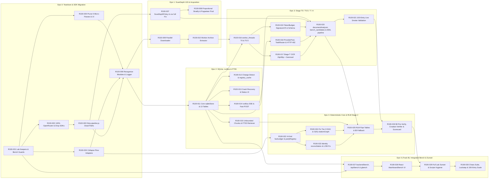

# Road to 100 Court Entries — Engineering Ticket Breakdown (`[R100-001]`–`[R100-030]`)

**Status:** Team Handoff Ready (Epics 0–5 / 30 Tickets)  
**Date:** 2026-11-24  
**Authoritative Master Plan:** [road-to-100-entries-plan.md](file:///home/oxioxi/proj/our_chattie/docs/road-to-100-entries-plan.md)  
**Supporting References:**
- [FINAL-BENCH-SYNTHESIS-AND-MIGRATION-REPORT.md](file:///home/oxioxi/proj/our_chattie/backend/data/pdf-engine-bench/FINAL-BENCH-SYNTHESIS-AND-MIGRATION-REPORT.md) (Phases 1–6.1 & Section 3.F Stage 0 sign-off)
- [EPIC3-PRODUCTION-MIGRATION-TICKET-BREAKDOWN.md](file:///home/oxioxi/proj/our_chattie/backend/data/pdf-engine-bench/EPIC3-PRODUCTION-MIGRATION-TICKET-BREAKDOWN.md) (Subsumed `[PROD-201]`–`[PROD-205]` extraction specs)
- [AGENTS.md](file:///home/oxioxi/proj/our_chattie/AGENTS.md) (Repository invariants, UI/WCAG AA & test-lane rules)

---

## Global Engineering Guardrails (Read Before Starting Any Ticket)

1. **Zero Broken Intermediate States:** Every ticket must leave `cd backend && npm run test:unit` (and `cd simple-chat && npm test && npm run build` whenever touching frontend files) green before merging.
2. **Core `AGENTS.md` Invariants:**
   - **"Never fail a run":** Every acquisition, OCR, extraction, reconciliation, and synthesis failure degrades per-item, preserves paid cache/partial state, and exposes explicit gaps rather than aborting.
   - **Backend owns query-type truth** (`queryClassifier.js`).
   - **SSE with polling fallback** (`useAnalysisRunDetail.js`), never a hard dependency on either.
   - **WCAG AA & Calm Status UI:** Status is always **glyph + label + color** (`StatusBadge.jsx`), never color alone; use Radix `Dialog`; keep `AnalysisReportAnnex` as the single canonical findings owner (no duplicated findings in prose).
   - **Offline `test:unit`:** Unit tests must never hit live e-Oglasna, Sudski registar, or OpenRouter endpoints.
3. **100% OpenRouter (`OPENROUTER_API_KEY` only):** After `[R100-002]`, zero Google or LangChain SDKs (`@google/genai`, `@langchain/google-genai`, `@langchain/core`) and zero `GOOGLE_API_KEY` fallbacks exist anywhere in the codebase.
4. **Do-Not-Delete Traps:**
   - **Keep `contextNode.js`:** [caseContextBuilder.js#L22](file:///home/oxioxi/proj/our_chattie/backend/court-analysis/reasoning/caseContextBuilder.js#L22) directly imports `createContextNode` and `validateContextGraph`. Only remove its unused `L15` import (`./analysisLab/evidenceIdentity`).
   - **Keep `propertyFlow.js#L58–391` lifecycle engine:** [reconciliation.js#L26](file:///home/oxioxi/proj/our_chattie/backend/court-analysis/reasoning/reconciliation.js#L26) directly imports `reconcileTrazbinaLifecycle` and `formatValue`. Delete only `moneyFlow.js` and the two legacy wrappers (`collectPropertyFlows`, `reconcilePropertyFlows`) + `prop-N` shims.
   - **Keep Bench Tests Green Through Phases 0–4:** Decouple `backend/scripts/lib/arms.js#L9` and `backend/scripts/fetch-real-document-fixtures.js#L30` in `[R100-001]` and update all 7 Bench/CLI script imports in `[R100-020]` so all 17 `pdf-benchmark-*.test.js` suites never break mid-migration.

---

## Master Execution Checklist & Dependency Graph

| ID | Epic | Title | Priority | Size | Track | Depends On |
|---|---|---|---|---|---|---|
| `[R100-001]` | Epic 0 | Extract Analysis Lab Keepers & Decouple Phase-0 Bench Guards | P0 | S | Track A | None |
| `[R100-002]` | Epic 0 | Remove Google/LangChain SDKs — Unified OpenRouter Client & 21 Test Mocks | P0 | L | Track A | `[R100-001]` |
| `[R100-003]` | Epic 0 | Strip Legacy `pipeline.js` Dead Paths (`automator`, `clusterExpansion`, `caseLimit`, `standard`) | P0 | M | Track A | `[R100-002]` |
| `[R100-004]` | Epic 0 | Collapse Triple Flow/Reconciliation Adapter Chain (Keep `propertyFlow` Lifecycle) | P0 | M | Track A | `[R100-001]` |
| `[R100-005]` | Epic 0 | Prune 5 Obsolete Reasoning LLM Micro-Passes, `nearDuplicateReview` & Dead Settings UI | P0 | M | Track A | `[R100-001]` |
| `[R100-006]` | Epic 0 | Reorganize Backend Module Boundaries (`routes/`, `http/`, `llm/`, `reasoning/*`) & `logger.js` | P0 | L | Track A | `[R100-003]`, `[R100-004]`, `[R100-005]` |
| `[R100-007]` | Epic 1 | Declarative `ScanDepthPolicy` (`Uravnoteženo`=100, `Sve`), 3-Place Threading & `csv` `'full'` Fix | P0 | M | Track A | `[R100-003]` |
| `[R100-008]` | Epic 1 | Proportional Stratification, Unified Puppeteer HTML Pool & Debug PNG Redirect | P0 | M | Track A | `[R100-007]` |
| `[R100-009]` | Epic 1 | Hardened Parallel Downloader (`acquisition/downloader.js`, `concurrency=5`) | P1 | S | Track A | `[R100-006]` |
| `[R100-010]` | Epic 1 | Worker-Thread Isolated Archive Extractor (`acquisition/archiveExtractor.js`) | P0 | M | Track A | `[R100-009]` |
| `[R100-011]` | Epic 2 | Core `better-sqlite3` Store (`sqliteStore.js`), Pragmas, FTS5 Triggers & 13-Table Schema | P0 | L | Track A | `[R100-006]` |
| `[R100-012]` | Epic 2 | Fold Change-Detection Store & Sudski Registar `registry_cache` (`24h` TTL) Into SQLite | P1 | M | Track A | `[R100-011]` |
| `[R100-013]` | Epic 2 | Startup Crash Recovery (`running -> interrupted`), Temp Sweep & `partial`/`interrupted` UI | P1 | M | Track A | `[R100-011]` |
| `[R100-014]` | Epic 2 | Lightweight `runBus` SSE Deltas on `/api/analysis/runs/:id/stream` & Fast `POST` Handoff | P0 | M | Track A | `[R100-011]` |
| `[R100-015]` | Epic 2 | Unbounded Document Chunking (`chunker.js`) & Ledger-Driven FTS5 BM25 Retriever | P0 | M | Track A | `[R100-011]` |
| `[R100-016]` | Epic 3 | `node:worker_threads` Pool & Single-Pass `Stage T0` Preflight + `Stage T0.5` Fast-Path | P0 | L | Track A | `[R100-010]`, `[R100-011]` |
| `[R100-017]` | Epic 3 | First-Principles `Stage T` OCR Router (`15p` Windows up to `60p` + `gemma-4-31b-it`) | P0 | L | Track A | `[R100-016]` |
| `[R100-018]` | Epic 3 | `ProviderPoolRegistry`, `<Task>` Router, Multi-Provider Pinning, 60s Watchdog & `HTTP 402` Latch | P0 | L | Track A | `[R100-011]` |
| `[R100-019]` | Epic 3 | `TokenBudgetPolicy`, Bisection, `EXTRACTION_SIGNATURE_V5`, `tableRows[]` & Schema Bug Fixes | P0 | L | Track A | `[R100-016]` |
| `[R100-020]` | Epic 3 | Split `analysis-agent.js`, Page-1 Roster, Closure Check, `bench_candidates` & `<600L` `pipeline.js` | P0 | L | Track A | `[R100-007]`, `[R100-014]`, `[R100-017]`, `[R100-018]`, `[R100-019]` |
| `[R100-021]` | Epic 3 | Controlled 100-Entry Live Smoke Validation & Cost/Latency Calibration | P1 | S | Track A | `[R100-020]` |
| `[R100-022]` | Epic 4 | 4-Kind `factLedger.js` (`row.id`, `sourcePages`, HRK), `partyRegistry.js` & `decisionOutcome` Fix | P0 | M | Track A | `[R100-004]` |
| `[R100-023]` | Epic 4 | Identity-Scoped `reconciliation.js` (`flowGroupKey`, `L236` Trap) & `propertyFlow`/`flow` Fixes | P0 | M | Track A | `[R100-022]` |
| `[R100-024]` | Epic 4 | Fix Tier-3 Cartesian DAG (`caseContextBuilder`), `O(N)` `citationGraph` & `findingProvenance` | P0 | M | Track A | `[R100-022]` |
| `[R100-025]` | Epic 4 | RLM Symbolic Case Environment (Pipe Tables + `[C<N>]` + 25% BM25 Floor) & `\$0` Fallback Report | P0 | L | Track A | `[R100-015]`, `[R100-020]`, `[R100-023]`, `[R100-024]` |
| `[R100-026]` | Epic 4 | `\$0` Pre-Verification, Hardened Croatian `verifier.js` & Persisted `runScorecard` UI | P0 | M | Track A | `[R100-021]`, `[R100-025]` |
| `[R100-027]` | Epic 5 | Decoupled `backend/bench/` Services, `/api/bench` Router & `gbench` Capability/Latency Gates | P1 | L | Track B | `[R100-001]`, `[R100-011]` |
| `[R100-028]` | Epic 5 | Native React Bench UI (`/dashboard/bench`) Replacing `"Laboratorij"` | P1 | L | Track B | `[R100-027]` |
| `[R100-029]` | Epic 5 | Complete Analysis Lab Sunset, `kerum-lab.json` Relocation, `scripts/` (`33`) & `temp/` Cleanup | P1 | M | Track B | `[R100-026]`, `[R100-028]` |
| `[R100-030]` | Epic 5 | Adversarial Chaos Suite (`backend/tests/resilience/`), Lockstep Guards & 100-Entry Scale Suite | P0 | L | Track B | `[R100-029]` |

---

## Epic 0 — Phase 0: Technical Debt Teardown, 100% OpenRouter SDK Migration & Module Reorganization

### `[R100-001]` Extract Analysis Lab Keepers & Decouple Phase-0 Bench Guards
- **Priority:** `P0` · **Size:** `S` · **Track:** `Track A` · **Depends on:** `None`
- **Goal:** Extract the three reusable primitives (`canonicalJson`, single-run `runScorecard`, `traceBounds`) out of `analysisLab/` into core services/ledger, and immediately decouple `scripts/` imports that would break when Phase 0 deletes `nativePdfDocument.js` and `agentLog.js`.
- **Files:**
  - **Create:** `backend/services/canonicalJson.js`, `backend/court-analysis/reasoning/runScorecard.js`, `backend/court-analysis/reasoning/traceBounds.js`
  - **Modify:** `backend/court-analysis/reasoning/contextNode.js` (remove unused `L15` import `./analysisLab/evidenceIdentity`), `backend/court-analysis/reasoning/analysisLab/{evidenceIdentity,scorecard,traceBounds}.js` (re-export from new locations until `[R100-029]`), `backend/scripts/lib/arms.js#L9` (inline `buildNativePdfTranscriptInstruction` prompt string), `backend/scripts/fetch-real-document-fixtures.js#L30` (replace `agentLog` with `logger` / `console`)
- **Implementation Details:**
  1. Move `stableStringify`, `evidencePackageDigest`, and `cloneEvidencePackage` from `analysisLab/evidenceIdentity.js` to `backend/services/canonicalJson.js`.
  2. Extract single-run quality scoring (`groundedSourceClaims`, `totalSourceClaims`, `criticalFailedDocuments`, `unresolvedLifecycleLinks`, `currencyConflicts`, `verificationStatus`, `elapsedMs`, `usage`, `costUsd`) into `runScorecard.js`.
  3. Extract `TRACE_BOUNDS` and `boundTrace` into `traceBounds.js`.
  4. Remove `const { stableStringify } = require('./analysisLab/evidenceIdentity');` from `contextNode.js#L15` (retaining `createContextNode` and `validateContextGraph` for `caseContextBuilder.js#L22`).
  5. Inline `buildNativePdfTranscriptInstruction` directly in `backend/scripts/lib/arms.js#L9` so `arms.js` no longer imports `backend/helpers/nativePdfDocument.js`, and decouple `fetch-real-document-fixtures.js#L30` from `agentLog.js`.
- **Acceptance Criteria:**
  - Zero production files import `analysisLab/*` directly for canonical JSON or trace bounds.
  - `arms.js` and `fetch-real-document-fixtures.js` have zero dependency on `nativePdfDocument.js` or `agentLog.js`.
- **Verification:** `cd backend && npm run test:unit`

---

### `[R100-002]` Remove Google/LangChain SDKs — Unified OpenRouter Client & 21 Test Mocks
- **Priority:** `P0` · **Size:** `L` · **Track:** `Track A` · **Depends on:** `[R100-001]`
- **Goal:** Eliminate `@google/genai`, `@langchain/google-genai`, and `@langchain/core`, drop `GOOGLE_API_KEY` completely, and standardize 100% of LLM/OCR configuration on OpenRouter (`OPENROUTER_API_KEY` only).
- **Files:**
  - **Create:** `backend/llm/openrouterClient.js`, `backend/llm/openrouterConfig.js`
  - **Modify:** `backend/package.json`, `backend/server.js#L9–15`, `backend/helpers/{geminiConfig,geminiUsage,geminiRetry}.js` (migrate/wrap into OpenRouter config), `backend/court-analysis/agents/{analysis-agent,download-agent,extract-tool}.js` (replace `Tool` / `HumanMessage` with plain async functions + `{ role, content }` messages), `backend/court-analysis/reasoning/{synthesizer,verifier,reportService}.js`, `backend/.env.example`, and all **21 test files** mocking `@langchain/google-genai` (plus `HumanMessage` in `synthesizer.test.js` and `@google/genai` in `document-extraction.test.js`)
  - **Delete:** `backend/helpers/nativePdfDocument.js`, `backend/tests/nativePdfDocument*.test.js` (if any dedicated unit file)
- **Implementation Details:**
  1. Implement `createOpenRouterClient({ model, temperature, maxTokens, responseFormat, reasoning, provider })` returning `.invoke(messages, { signal })` with normalized `{ content, usage_metadata, response_metadata }` compatible with `trackUsageInvoke` (`geminiUsage.js`).
  2. Implement `assertOpenRouterConfig()` validating `OPENROUTER_API_KEY` alone (`server.js#L9–15`); remove `GOOGLE_API_KEY`, `GEMINI_MODEL`, `contextNode` role, and `CONTEXT_NODE_PROMPT_VERSION` from `geminiConfig.js` / `openrouterConfig.js` (updating `backend/tests/geminiConfig.test.js#L51`).
  3. Uninstall/remove `@google/genai`, `@langchain/google-genai`, and `@langchain/core` from `backend/package.json` (`npm install --package-lock-only` or update lockfile cleanly).
  4. Replace `DownloadDocumentsTool`, `ExtractArchiveTool`, and `AnalyzeDocumentsTool` (`extends Tool`) with plain async functions (`downloadClusterAttachments`, `extractArchiveFiles`, `analyzeClusterDocuments`) and plain OpenRouter message objects (no `new HumanMessage`).
  5. Update all 21 backend test files from `jest.mock('@langchain/google-genai', ...)` / `jest.mock('@google/genai', ...)` to mock `backend/llm/openrouterClient.js`.
- **Acceptance Criteria:**
  - `grep -rn "@google/genai\|@langchain/" backend/ --exclude-dir=node_modules` returns zero matches.
  - `assertOpenRouterConfig()` fails fast on missing `OPENROUTER_API_KEY` and never checks `GOOGLE_API_KEY`.
- **Verification:** `cd backend && npm run test:unit`

---

### `[R100-003]` Strip Legacy `pipeline.js` Dead Paths
- **Priority:** `P0` · **Size:** `M` · **Track:** `Track A` · **Depends on:** `[R100-002]`
- **Goal:** Remove `runCourtAnalysisWithExistingAutomator`, multi-pass Puppeteer `clusterExpansion`, `caseLimit` (1..10) clamping, single-iteration `for (let i = 0; i < totalCases; i++)` loops, and `'standard'` scan depth before scaling `pipeline.js`.
- **Files:**
  - **Modify:** `backend/court-analysis/pipeline.js`, `backend/helpers/courtAnalysisRequest.js`, `backend/server.js#L210–219`, `backend/tests/pipeline*.test.js`, `backend/tests/courtAnalysisRequest.test.js`
- **Implementation Details:**
  1. Delete `runCourtAnalysisWithExistingAutomator` (`pipeline.js#L1458+`) and remove `automator` parameter plumbing.
  2. Delete `resolveAutoExpansion`, `executeClusterExpansionSearches`, `applyConfiguredClusterExpansion`, and `options.clusterExpansion` coercion in `courtAnalysisRequest.js` (`L36–64`) & `server.js#L215`.
  3. Delete `caseLimit` coercion (`courtAnalysisRequest.js#L19–31`) and the multi-case `for (let i = 0; i < totalCases; i++)` loop in `pipeline.js` — reasoning strictly processes the selected primary cluster.
  4. Drop `'standard'` from `courtAnalysisRequest.js#L10` (`SCAN_DEPTHS = ['balanced', 'full']`, HTTP `400` otherwise).
- **Acceptance Criteria:**
  - `pipeline.js` has zero references to `clusterExpansion`, `caseLimit`, `runCourtAnalysisWithExistingAutomator`, or `'standard'` scan depth.
- **Verification:** `cd backend && npm run test:unit`

---

### `[R100-004]` Collapse Triple Flow/Reconciliation Adapter Chain (Preserve `propertyFlow.js` Lifecycle)
- **Priority:** `P0` · **Size:** `M` · **Track:** `Track A` · **Depends on:** `[R100-001]`
- **Goal:** Standardize on one canonical `factLedger → flows → reconciliation` contract, removing `moneyFlow.js` and legacy `prop-N` wrappers while keeping the active `propertyFlow.js#L58–391` lifecycle engine intact.
- **Files:**
  - **Modify:** `backend/court-analysis/reasoning/evidencePackage.js#L353–435`, `backend/court-analysis/reasoning/propertyFlow.js` (remove ONLY `collectPropertyFlows` `L50–53`, `reconcilePropertyFlows` `L406–415`, and `prop-N` ID shims; keep `L58–391`), `backend/court-analysis/reasoning/reconciliation.js#L26, L411`, `backend/court-analysis/utils/runSummary.js#L119–130`, `backend/scripts/eval-reasoning.js#L75`, `simple-chat/src/components/Dashboard/{AnalysisRunDetailPage,AnalysisFlowsSection}.jsx`, affected tests (`moneyFlow.test.js` → `flow.test.js`, `propertyFlow.test.js`, `kerumGolden.test.js`, `runSummary.test.js`)
  - **Delete:** `backend/court-analysis/reasoning/moneyFlow.js` (44 lines)
- **Implementation Details:**
  1. Remove the triple conversion round-trip in `evidencePackage.js#L353–435` so `collectFlows` and `reconcileFlows` operate directly on canonical `factLedger` rows and expose canonical `pkg.flows` / `pkg.reconciliation` (with clean UI shapes for `AnalysisFlowsSection.jsx` and `runSummary.js`).
  2. Delete `moneyFlow.js` and migrate any tests importing it to `flow.js` / canonical `flows`.
  3. Delete `collectPropertyFlows`, `reconcilePropertyFlows`, and `prop-N` shims from `propertyFlow.js` (removing `reconcilePropertyFlows` re-export from `reconciliation.js#L411`), while keeping `reconcileTrazbinaLifecycle`, `resolveSupersedesTargetWithBasis`, `sharesLifecycleIdentifiers`, `buildValueChangeTimeline`, and `formatValue`.
  4. Update `AnalysisRunDetailPage.jsx#L171–181`, `AnalysisFlowsSection.jsx`, `runSummary.js`, and `eval-reasoning.js#L75` to read canonical `flows`/`reconciliation`.
- **Acceptance Criteria:**
  - `moneyFlow.js` is deleted; `kerumGolden.test.js` and `kerumReplay.test.js` pass against canonical `flows`/`reconciliation`.
- **Verification:** `cd backend && npm run test:unit && npx jest tests/replays/kerumReplay.test.js --runInBand && cd ../simple-chat && npm test`

---

### `[R100-005]` Prune 5 Obsolete Reasoning LLM Micro-Passes, `nearDuplicateReview` & Dead Settings UI
- **Priority:** `P0` · **Size:** `M` · **Track:** `Track A` · **Depends on:** `[R100-001]`
- **Goal:** Cut post-extraction reasoning from 8 LLM passes down to **Synthesize + Verify** backed by deterministic retrieval/reconciliation, and delete dead settings toggles and unused modules cleanly.
- **Files:**
  - **Delete:** `backend/court-analysis/reasoning/{queryPlanner,retrievalQueries,rerankerClient,reranker,claimJudge,significance,followUpVerification,nearDuplicateReview}.js`, `backend/helpers/reasoningSettings.js`, `simple-chat/src/components/Dashboard/ReasoningExperimentsPanel.jsx`, plus obsolete tests (`queryPlanner*`, `reranker*`, `claimJudge*`, `significance*`, `followUpVerification*`, `nearDuplicateReview.test.js`, `ReasoningSettings.test.jsx`, `SettingsPopover.test.jsx` if popover removed)
  - **Modify:** `backend/court-analysis/reasoning/{reportService,retriever,scopeContract}.js`, `backend/services/localStore.js#L6–9, L76–93, L263–291`, `simple-chat/src/hooks/useSettings.js`, `simple-chat/src/components/Dashboard/{SettingsPopover,DashboardHeader,AnalysisRiskList,AnalysisReasoningTelemetry}.jsx`
- **Implementation Details:**
  1. Remove imports and invocations of `queryPlanner`, `rerankerClient`/`reranker`, `claimJudge`, `significance`, and `followUpVerification` from `reportService.js` and `retriever.js#L1` (replacing `createRetrievalQueries` fallback with a simple deterministic stub until `[R100-015]` wires FTS5).
  2. Remove `rerank-fallback` branch from `scopeContract.js#L161–165`.
  3. Delete `reasoningSettings.js` and prune `reasoningRerankMode` / `reasoningPlanner` / `reasoningFollowUp` from `localStore.js`, `useSettings.js`, `ReasoningExperimentsPanel.jsx`, and `SettingsPopover.jsx` (keep `SettingsPopover` only if housing active `defaultScanDepth` or remove cleanly from `DashboardHeader.jsx`).
  4. Remove dead `item?.claimJudge` / `item?.heuristicRank` reads in `AnalysisRiskList.jsx` and `conflict.followUp` / `rerankStatus` reads in `AnalysisReasoningTelemetry.jsx`.
- **Acceptance Criteria:**
  - `reportService.js` executes strictly **Synthesize** + **Verify** LLM passes; zero dead settings toggles remain in UI or backend.
- **Verification:** `cd backend && npm run test:unit && cd ../simple-chat && npm test && npm run build`

---

### `[R100-006]` Reorganize Backend Module Boundaries & Unify `logger.js`
- **Priority:** `P0` · **Size:** `L` · **Track:** `Track A` · **Depends on:** `[R100-003]`, `[R100-004]`, `[R100-005]`
- **Goal:** Establish the clean target folder layout (`routes/`, `http/`, `llm/`, `acquisition/`, `extraction/`, `reasoning/{schema,ledger,retrieval,synthesis}/`), shrink `server.js` to ~100 lines, and consolidate all logging onto `logger.js`.
- **Files:**
  - **Move / Refactor:**
    - `backend/routes/{courtAnalysis,analysisRuns,changeDetection}.js` (extracted from `server.js`)
    - `backend/http/{sse,analysisStreamHandler,analysisStream,pagination,sanitize,courtAnalysisRequest,courtAnalysisPayload,analysisReportRetry,friendlyAnalysisError,analysisStage}.js` + `backend/court-analysis/utils/rateLimiter.js` → `backend/http/rateLimiter.js`
    - `backend/llm/{openrouterClient,openrouterConfig,retry,usage}.js`
    - `backend/court-analysis/reasoning/schema/{extractionSchema,schema}.js`
    - `backend/court-analysis/reasoning/ledger/{factLedger,flow,propertyFlow,reconciliation,currencyConversion,claimRegistry,paymentRank,proceduralFlow,grounding,caseContextBuilder,contextNode,citationGraph,scopeContract,runScorecard,evidencePackage,coverageGuard}.js`
    - `backend/court-analysis/reasoning/retrieval/{chunker,indexer,retriever,findingProvenance}.js`
    - `backend/court-analysis/reasoning/synthesis/{synthesisInputBuilder,synthesizer,verifier,timelineBuilder,reportService,traceBounds}.js`
  - **Modify:** `backend/server.js` (~100-line bootstrapper), `backend/court-registry/enricher.js` (replace `console.log` with `logger.js`), all relative `require(...)` paths across `backend/` and `backend/tests/`
  - **Delete:** `backend/helpers/agentLog.js` (folded into `logger.js`)
- **Implementation Details:**
  1. Perform mechanical module moves with updated relative `require` paths across `backend/` and `backend/tests/` (`court-analysis/agents/*` moves in Phase 1/3 as `acquisition/` and `extraction/`).
  2. Extract Express route handlers out of `server.js` into `backend/routes/*` so `server.js` handles only env validation, store init, middleware, router mounts, listen, and shutdown hooks.
  3. Replace all `agentLog` and `enricher.js` `console.log` calls with structured `logger.js` (`trace`/`debug`/`info`/`warn`/`error` + `runId`).
- **Acceptance Criteria:**
  - `server.js` is `<= 120` lines; `agentLog.js` is deleted; zero broken relative `require(...)` paths exist across `backend/` or `backend/tests/`.
- **Verification:** `cd backend && npm run test:unit`

---

## Epic 1 — Phase 1: Declarative `ScanDepthPolicy` (`Uravnoteženo` = 100, `Sve`) & Acquisition Hardening

### `[R100-007]` Declarative `ScanDepthPolicy`, 3-Place `scanDepth` Threading & `csv` `'full'` Fix
- **Priority:** `P0` · **Size:** `M` · **Track:** `Track A` · **Depends on:** `[R100-003]`
- **Goal:** Replace `(scrapeLimit, maxPagesScanned, tailSample)` with declarative `SCAN_DEPTH_POLICIES` (`balanced = 100`, `full = all`), fix `scanDepth` being dropped in 3 places, fix `csvExportClient.js`'s `'full'` bug, and update `ScanDepthSelect.jsx` to 2 modes.
- **Files:**
  - **Modify:** `backend/court-analysis/utils/{scanDepth,runSummary}.js`, `backend/scraper/csvExportClient.js#L213–263`, `backend/court-analysis/pipeline.js#L1174–1185, L1398–1404`, `backend/routes/courtAnalysis.js` (or `server.js#L150–155`), `backend/services/localStore.js#L103–125`, `simple-chat/src/components/Dashboard/ScanDepthSelect.jsx`, `backend/tests/{scanDepth,csvExportClient,pipeline.runLogging,runSummary}.test.js`, `simple-chat/src/components/Dashboard/__tests__/ScanDepthSelect.test.jsx`
- **Implementation Details:**
  1. Export `SCAN_DEPTH_POLICIES` (`balanced`: `maxEntries: 100, allocation: 'stratified', poolCap: 400`; `full`: `maxEntries: null, allocation: 'all', poolCap: Number(process.env.ANALYSIS_FULL_MAX_ENTRIES) || 1000`) from `scanDepth.js`.
  2. Thread `scanDepth: parsedRequest.options.scanDepth` through `createAnalysisRun` (`runs.scan_depth`) → `runCourtAnalysis` → `processScrapedCases` (`pipeline.js#L1398`) → structured logs → `runSummary.js`.
  3. Fix `csvExportClient.js#L219–262`: decouple primary-case pool selection from `tailSample` so **both** `balanced` and `full` select the primary case cleanly (`full` returns the full primary pool up to `poolCap` with `allocation: 'all'`, while recording secondary clusters in metadata; never falls through to `applyBounding` across all global cases).
  4. In `pipeline.js#L1174–1185`, skip stratified pruning when `allocation === 'all'` (`full`), while still computing `coverageLedger` so full runs report honest role/year coverage.
  5. Update `ScanDepthSelect.jsx` to 2 options: `Uravnoteženo` (*"Do 100 ključnih objava (svi priloženi dokumenti)"*) and `Sve` (*"Sve dostupne objave"*).
- **Acceptance Criteria:**
  - `scanDepth` (`balanced` or `full`) is never `null` in persisted runs, summaries, or logs; `'full'` mode analyzes all primary-cluster entries without global 400-row truncation.
- **Verification:** `cd backend && npm run test:unit && cd ../simple-chat && npm test`

---

### `[R100-008]` Proportional Stratification, Unified Puppeteer HTML Pool & Debug PNG Redirect
- **Priority:** `P0` · **Size:** `M` · **Track:** `Track A` · **Depends on:** `[R100-007]`
- **Goal:** Scale `stratify.js` proportionally to 100 entries with stride-sampled `exploratory`, replace Puppeteer's broken `80 + 20` magic window with batched HTML pool harvesting feeding `stratifyClusterEntries`, and stop writing debug PNGs into `backend/` root.
- **Files:**
  - **Modify:** `backend/court-analysis/utils/stratify.js`, `backend/scraper/courtSearchPuppeteer.js#L43–44, L250–381, L793, L981–1023`, `backend/tests/{stratify,courtSearchPuppeteer*}.test.js`
  - **Delete:** stale `backend/error-parseSearchResults-*.png` files
- **Implementation Details:**
  1. Replace hardcoded constants in `stratify.js` with `computeStratificationQuotas(budget)` (`origin = max(8, round(0.15 * budget))` = 15; `recent = max(22, round(0.40 * budget))` = 40; `exploratory = max(2, round(0.08 * budget))` = 8; `adminCap = max(4, round(0.08 * budget))` = 8 at `budget = 100`).
  2. Replace step 4 `[others[others.length - 1], others[0]]` with even stride sampling across `others` up to the `exploratory` quota.
  3. In `courtSearchPuppeteer.js`, remove `performTailSample` (`global-oldest` tail pollution, intra-page reversal, `TAIL_SAMPLE_ENTRIES = 10`, `limit + tail = 120` double-count, pre-filter starvation) and replace with batched HTML search page harvesting (`maxPoolPages: 40`, `batchSize: 4`, or `FULL_SCAN_MAX_PAGES` for `full`; images/styles/fonts blocked) selecting the primary-case pool and setting `discoveryMetadata.selection` (`analysisBudget`, `allocation`) so `pipeline.js` runs the **exact same `stratifyClusterEntries`** allocator used by CSV.
  4. Redirect `courtSearchPuppeteer.js#L793` debug screenshots to `backend/data/debug/` (`fs.mkdirSync(..., { recursive: true })`) and remove existing root PNGs.
- **Acceptance Criteria:**
  - `stratifyClusterEntries(pool300, { budget: 100 })` returns 100 entries (`15` origin, `40` recent, `8` stride-sampled exploratory, `<=8` admin, middle round-robin + spread).
  - Puppeteer fallback sets `selection.analysisBudget` and yields `coverageLedger` identically to CSV.
- **Verification:** `cd backend && npm run test:unit`

---

### `[R100-009]` Hardened Parallel Downloader (`acquisition/downloader.js`)
- **Priority:** `P1` · **Size:** `S` · **Track:** `Track A` · **Depends on:** `[R100-006]`
- **Goal:** Rename `download-agent.js` to `court-analysis/acquisition/downloader.js`, parallelize downloads (`DOWNLOAD_CONCURRENCY = 5`), eliminate `Date.now()` filename collisions, and guarantee clean cache commits.
- **Files:**
  - **Move / Modify:** `backend/court-analysis/agents/download-agent.js` → `backend/court-analysis/acquisition/downloader.js`, `backend/helpers/downloadCache.js` → `backend/court-analysis/acquisition/downloadCache.js`, `backend/court-analysis/pipeline.js`, `backend/tests/*download*.test.js`
- **Implementation Details:**
  1. Export `downloadClusterAttachments({ documentLinks, progressCallback })` (plain async function, zero `@langchain/core`).
  2. Execute downloads with bounded `p-queue` / worker concurrency (`DOWNLOAD_CONCURRENCY = 5`, env-configurable).
  3. Generate collision-proof working filenames: `` `${Date.now()}_${index}_${crypto.randomUUID().slice(0, 8)}_${safeName}` `` so 30 same-ms cache hits never overwrite each other.
  4. Add per-link exponential retry with jitter on `429`/`5xx`/socket reset, validate `bytes > 0` before `pending.commit(...)` (aborting staged temp file on mid-stream truncation), log individual download failures, and continue remaining links (`"Never fail a run"`).
- **Acceptance Criteria:**
  - Firing 30 simultaneous cache hits with identical `link.text` (`Podnesak.pdf`) produces 30 distinct intact paths on disk; an aborted mid-stream link #47 leaves cache clean and lets 99/100 succeed.
- **Verification:** `cd backend && npm run test:unit`

---

### `[R100-010]` Worker-Thread Isolated Archive Extractor (`acquisition/archiveExtractor.js`)
- **Priority:** `P0` · **Size:** `M` · **Track:** `Track A` · **Depends on:** `[R100-009]`
- **Goal:** Fix shared `uploads/` ZIP overwrite collisions (`Podnesak.pdf` clobbering), offload synchronous `adm-zip` decompression off Node's event loop, guard against zip-bombs/nested ZIPs, and preserve parent entry metadata.
- **Files:**
  - **Move / Modify:** `backend/court-analysis/agents/extract-tool.js` → `backend/court-analysis/acquisition/archiveExtractor.js`, `backend/court-analysis/pipeline.js#L1694–1713`, `backend/tests/*extract*.test.js`
- **Implementation Details:**
  1. Extract each `.zip` into an **isolated directory** `path.join(uploadsDir, 'extracted', archiveUniqueId)` instead of shared `path.dirname(file.filePath)` (`pipeline.js#L1697`).
  2. Offload `AdmZip` entry decompression to a `node:worker_threads` worker (or bounded worker pool shared with `[R100-016]`) so multi-MB archives never block SSE heartbeats.
  3. Enforce `sanitizeEntryName` zip-slip jail, max uncompressed total bytes (`MAX_ARCHIVE_UNCOMPRESSED_BYTES`, e.g., `250 MB`), max entry count (`MAX_ARCHIVE_ENTRIES`, e.g., `200`), and clean handling of 1-level nested `.zip` archives.
  4. Propagate parent `.zip` metadata (`sourceEntryIndex`, `sourceDocumentLinkId`, `entryDate`) onto every extracted child file record so `factLedger.js` and `evidencePackage.js` never confuse identical child filenames from different court entries.
- **Acceptance Criteria:**
  - Extracting 20 archives each containing `Podnesak.pdf` produces 20 distinct, uncorrupted files carrying distinct `sourceEntryIndex` / `sourceDocumentLinkId` / `entryDate`; zip-slip, zip-bomb, and corrupt ZIPs degrade cleanly without crashing the batch.
- **Verification:** `cd backend && npm run test:unit`

---

## Epic 2 — Phase 2: Unified `better-sqlite3` Persistence, `runBus` SSE, Registry Cache & FTS5 Engine

### `[R100-011]` Core `better-sqlite3` Store (`sqliteStore.js`), Pragmas, FTS5 Sync Triggers & 13-Table Schema
- **Priority:** `P0` · **Size:** `L` · **Track:** `Track A` · **Depends on:** `[R100-006]`
- **Goal:** Replace `localStore.js` (`8.4 MB` `runs.json` blocking overwrites) and `ocrPageStore.js` loose files with one WAL-enabled `better-sqlite3` database (`backend/data/analysis/analysis.db`) with foreign-key enforcement, FTS5 sync triggers, and separated forensic trace tables.
- **Files:**
  - **Create:** `backend/services/sqliteStore.js`, `backend/tests/sqliteStore.test.js`
  - **Modify:** `backend/package.json` (add `better-sqlite3`), `backend/server.js`, `backend/routes/{courtAnalysis,analysisRuns}.js`, `backend/http/analysisReportRetry.js`, `backend/.env.example`
  - **Delete:** `backend/services/localStore.js`, `backend/helpers/ocrPageStore.js`, `backend/tests/localStore*.test.js`, `backend/tests/ocr-page-store.test.js` (migrated to `sqliteStore.test.js`)
- **Implementation Details:**
  1. On every connection open in `sqliteStore.js`, execute the mandatory PRAGMA block: `journal_mode = WAL`, `synchronous = NORMAL`, **`foreign_keys = ON`**, `busy_timeout = 5000`, `temp_store = MEMORY`, `cache_size = -64000`.
  2. Implement the complete 13-table schema from Section 4.3 of [road-to-100-entries-plan.md](file:///home/oxioxi/proj/our_chattie/docs/road-to-100-entries-plan.md): `runs` (with `scan_depth`, `summary_json`, `scorecard_json`, `status IN ('queued','running','done','partial','error','interrupted')`), `run_artifacts`, `run_events`, pruned `settings` (`defaultScanDepth`, `activeTaskRoutingOverrides`, `uiPreferences`), `ocr_transcripts` (with `task_type`, `provider_slug`), `segment_checkpoints` (valid gap-free cache only), `llm_traces` (append-only raw forensic flight recorder), `prompt_registry`, `bench_candidates`, `run_facts` (4 kinds + provenance/HRK/`canonical_party_id` columns + indexes), `run_chunks` + `run_chunks_fts` + **`run_chunks_ai` / `run_chunks_ad` / `run_chunks_au` FTS5 triggers**, `registry_cache`, `model_pricing_cache`, `change_snapshots`, `change_diffs`.
  3. Wrap multi-row `run_chunks` and `run_facts` inserts inside `db.transaction(...)`.
  4. Separate lightweight `listAnalysisRuns` (reads `runs` only) from `getAnalysisRunFull` (joins `run_artifacts` + `run_events`).
- **Acceptance Criteria:**
  - Deleting a run from `runs` cascades cleanly across `run_artifacts`, `run_events`, `run_facts`, and `run_chunks` AND cleanly removes `run_chunks_fts` entries via `run_chunks_ad` without `SQLITE_CORRUPT_VTAB`.
  - 1,000-event + 500-fact transaction benchmark commits in `< 25 ms`.
- **Verification:** `cd backend && npm run test:unit`

---

### `[R100-012]` Fold Change-Detection Store & Sudski Registar `registry_cache` Into SQLite
- **Priority:** `P1` · **Size:** `M` · **Track:** `Track A` · **Depends on:** `[R100-011]`
- **Goal:** Eliminate `backend/data/change-detection/` JSON sprawl and repeated sequential Sudski registar HTTP stalls during multi-creditor runs by wiring both into `sqliteStore.js`.
- **Files:**
  - **Modify:** `backend/change-detection/{service,api}.js`, `backend/court-registry/enricher.js#L120–234`, `backend/tests/changeDetection*.test.js`, `backend/tests/enricher*.test.js`
  - **Delete:** `backend/change-detection/store.js`
- **Implementation Details:**
  1. Replace `change-detection/store.js` reads/writes with `sqliteStore` `change_snapshots` / `change_diffs` methods while preserving the never-fail contract (`{ ok, error }`).
  2. Wrap `enrichParticipants` in `enricher.js` with `sqliteStore` `registry_cache` (`24h` TTL) keyed by OIB or normalized company name, plus bounded lookup concurrency (`concurrency = 3`).
- **Acceptance Criteria:**
  - Second lookup of 40 legal entities within 24 hours fires zero HTTP calls to Sudski registar; `change-detection/store.js` is deleted.
- **Verification:** `cd backend && npm run test:unit`

---

### `[R100-013]` Startup Crash Recovery, Temp Sweep, Graceful Shutdown & `partial`/`interrupted` UI Contract
- **Priority:** `P1` · **Size:** `M` · **Track:** `Track A` · **Depends on:** `[R100-011]`
- **Goal:** Reconcile stale `'running'` runs cleanly on server boot, sweep orphaned `uploads/` temp files, drain streams on `SIGINT`/`SIGTERM`, and surface `'partial'` and `'interrupted'` cleanly in UI badges and polling hooks.
- **Files:**
  - **Modify:** `backend/server.js`, `backend/services/sqliteStore.js`, `backend/http/analysisStream.js`, `simple-chat/src/components/ui/StatusBadge.jsx`, `simple-chat/src/components/Dashboard/RunStatusBadge.jsx`, `simple-chat/src/hooks/useAnalysisRunDetail.js`, `backend/tests/*Stream*.test.js`, `simple-chat/src/components/**/__tests__/*Status*.test.jsx`
- **Implementation Details:**
  1. On `server.js` startup, reconcile any `runs` rows stuck in `status = 'running'` or `'queued'` to `'interrupted'` and sweep stale files/dirs in `backend/uploads/` (leaving `.dl-cache` intact).
  2. Register `SIGINT`/`SIGTERM` handlers to abort active LLM streams, mark in-flight runs `'interrupted'`, close SQLite cleanly, and exit.
  3. Add `'partial'` (`Djelomično`, glyph + warning/neutral tone) and `'interrupted'` (`Prekinuto`, glyph + neutral/warning tone) to `TERMINAL_STATUSES` (`analysisStream.js`, `useAnalysisRunDetail.js`) and `STATUS_MAP` (`StatusBadge.jsx`, `RunStatusBadge.jsx`) following WCAG AA glyph+label+color rules.
- **Acceptance Criteria:**
  - Server restart during an active run marks it `'interrupted'`; UI badges render `'partial'` and `'interrupted'` distinctly without falling through to `'U tijeku'`.
- **Verification:** `cd backend && npm run test:unit && cd ../simple-chat && npm test && npm run build`

---

### `[R100-014]` Lightweight `runBus` SSE Deltas on `/api/analysis/runs/:id/stream` & Fast `POST` Handoff
- **Priority:** `P0` · **Size:** `M` · **Track:** `Track A` · **Depends on:** `[R100-011]`
- **Goal:** Eliminate `1.5s` `getAnalysisRunFull` polling and 10-minute `POST /api/court-analysis` multi-MB blob holds using an in-process `runBus` `EventEmitter` streaming tiny deltas over `GET /api/analysis/runs/:id/stream`.
- **Files:**
  - **Create:** `backend/http/runBus.js`, `backend/tests/runBus.test.js`
  - **Modify:** `backend/http/analysisStreamHandler.js`, `backend/routes/{courtAnalysis,analysisRuns}.js`, `simple-chat/src/hooks/{useCourtAnalysisStream,useAnalysisRunStream,useAnalysisRunDetail}.js`, `simple-chat/src/hooks/__tests__/useAnalysisRun*.test.jsx`
- **Implementation Details:**
  1. Create `runBus` (`EventEmitter` keyed by `runId`) emitting small (`< 2 KB`) typed delta events: `run.preflight`, `stage.progress`, `document.status`, `usage.delta`, `run.terminal`.
  2. Update `POST /api/court-analysis` to enqueue the job, emit `queued` with `analysisId` immediately, and close cleanly without holding the connection open for `finalPayload`.
  3. Rewrite `analysisStreamHandler.js` (`GET /api/analysis/runs/:id/stream`) to subscribe to `runBus` (sending initial `snapshot` without multi-MB `result_json` if running, streaming deltas + 25s heartbeats, and closing on `run.terminal`) while `useAnalysisRunDetail.js` fetches `GET /api/analysis/runs/:id/full` once on terminal/reconnect and retains its existing backoff polling fallback (`AGENTS.md`).
- **Acceptance Criteria:**
  - Emitting 200 progress events on a `10 MB` mock run keeps every SSE frame `< 2 KB` delta-only with zero `getAnalysisRunFull` DB polling ticks.
- **Verification:** `cd backend && npm run test:unit && cd ../simple-chat && npm test`

---

### `[R100-015]` Unbounded Document Chunking (`chunker.js`) & Ledger-Driven FTS5 BM25 Retriever
- **Priority:** `P0` · **Size:** `M` · **Track:** `Track A` · **Depends on:** `[R100-011]`
- **Goal:** Remove the `RETRIEVAL_CHUNK_LIMIT = 8` truncation cap so 100% of document chunks index into SQLite `run_chunks_fts`, and wire `retriever.js` to execute deterministic **ledger-driven FTS5 BM25 queries**.
- **Files:**
  - **Modify:** `backend/court-analysis/reasoning/retrieval/{chunker,indexer,retriever}.js`, `backend/tests/reasoning/{chunker,indexer,retriever}.test.js`
- **Implementation Details:**
  1. Remove `RETRIEVAL_CHUNK_LIMIT = 8` in `chunker.js` (and fix `limit === 1` division-by-zero at `L148–152` + unused `stride` at `L62`).
  2. In `indexer.js`, preserve 1–2 digit `redni broj` tokens (do not drop `<3`-char numeric tokens) and index `decisionOutcome`, `proceduralEvents`, `citedFilingReferences`, `claimRegistryNumber`, and `filingReference`.
  3. In `retriever.js`, generate targeted FTS5 queries deterministically from `factLedger` (extracted party OIBs/names, `claimRegistryNumber`, sub-filings, unresolved `reconciliation.conflicts`), execute `bm25(run_chunks_fts)` against `sqliteStore` (`< 25 ms`), apply exact OIB/filing-ref anchor boosts, and reuse precomputed `normalizedText` instead of recomputing per query.
- **Acceptance Criteria:**
  - A 40-page document indexes all chunks (zero 8-chunk truncation); FTS5 BM25 retrieves exact OIB / `redni broj 98` / sub-filing chunks in `< 25 ms`.
- **Verification:** `cd backend && npm run test:unit`

---

## Epic 3 — Phase 3: Hardened `Stage T0` / `T0.5` / `T` / `A` Migration

### `[R100-016]` `node:worker_threads` Pool & Single-Pass `Stage T0` Preflight + `Stage T0.5` Admin Fast-Path
- **Priority:** `P0` · **Size:** `L` · **Track:** `Track A` · **Depends on:** `[R100-010]`, `[R100-011]`
- **Goal:** Replace 4× redundant reads/parses and main-thread `pdf.js` stalls with a single-pass `node:worker_threads` `Stage T0` preflight (magic bytes, upfront `sha256` dedup, per-page `hybrid_mixed` classification, blank-page skip, `table_dense` tagging, cost ballpark) plus `Stage T0.5` deterministic admin extraction.
- **Files:**
  - **Create:** `backend/court-analysis/extraction/{workerPool,pdfPreflight,pdfText,adminFastPath}.js`, `backend/tests/{pdfPreflight,adminFastPath}.test.js`
- **Implementation Details:**
  1. Create a bounded `node:worker_threads` pool (`2–4` workers, `<= 4` multi-MB PDF buffers in RAM simultaneously, releasing buffers immediately after extraction; always calling `await pdf.destroy()` in `finally`).
  2. In `pdfPreflight.js`: read bytes once, sniff magic bytes (`%PDF-`, `PK\x03\x04`, `\xD0\xCF\x11\xE0`, UTF-8 text; reject `<html` / `<!DOCTYPE` masquerading as `.pdf` fast), compute `sha256` once, dedupe identical attachments upfront intra-run, and check SQLite `ocr_transcripts` / `segment_checkpoints`.
  3. In a single `pdf.js` pass, inspect per-page `nonWsChars` (`>=20` total, `>=12`/page multi-page), `\uFFFD` + PUA (`U+E000–U+F8FF`) ratio (`<20%`), `OPS.paintImageXObject`, and `item.transform` (`x, y`) geometry to classify into `digital_text | scanned_full | hybrid_mixed | empty_or_corrupt`, tag `table_dense` vs `prose`, and flag blank/low-entropy pages to skip.
  4. Emit upfront `run.preflight` manifest + cost ballpark (`{ estimatedMinUsd, estimatedExpectedUsd, cachedHits, ocrPages, segments }`) via `runBus`.
  5. Implement `Stage T0.5` (`adminFastPath.js`) for `< 1,000`-char `role === 'admin'` notices with zero currency regex matches (`!/\d+[.,]\d{2}/`) and zero cession cues (`!/ustup|cesij|ugovor/i`), extracting header metadata/parties deterministically at `\$0`.
- **Acceptance Criteria:**
  - HTML-as-PDF fails fast at `Stage T0`; 12p `hybrid_mixed` (`3p digital + 9p scan`) isolates only pages `4–12` for OCR; 6-char 4p stray-token scans trigger OCR while `38`-char 1p mocks remain `digital_text`; `Stage T0.5` skips LLM calls on routine admin notices.
- **Verification:** `cd backend && npm run test:unit`

---

### `[R100-017]` First-Principles `Stage T` OCR Router (`15p` Windows up to `60p` + `google/gemma-4-31b-it`)
- **Priority:** `P0` · **Size:** `L` · **Track:** `Track A` · **Depends on:** `[R100-016]`
- **Goal:** Replace the `OCR_MAX_PAGES = 20` cutoff and `RECITATION`-prone Gemini raster default with `15`-page `pdf-lib` batch windows across up to `60` pages routed to `or-mistral-ocr` → `google/gemma-4-31b-it` raster → `google/gemini-2.5-flash`.
- **Files:**
  - **Create:** `backend/court-analysis/extraction/ocrRouter.js`, `backend/tests/ocrRouter.test.js`
- **Implementation Details:**
  1. Separate `OCR_BATCH_WINDOW_PAGES = 15` from `MAX_DOC_OCR_PAGES = 60`. Slice `scanned_full` and scanned subsets of `hybrid_mixed` PDFs via `pdf-lib` into `<= 15`-page windows (never exceeding `5 MB` per payload); on `> 60`-page annexes, transcribe head (`40p`) + tail (`20p`) and record the skipped middle span explicitly as partial coverage.
  2. Route primary OCR through **`or-mistral-ocr`** (`\$0.002/page`) via OpenRouter; on Mistral failure/skip, render scanned pages inside `worker_threads` and fall back to **`google/gemma-4-31b-it`** vision raster (immune to Google AI Studio `RECITATION` blocks), with `google/gemini-2.5-flash` as final escalation.
  3. Merge digital + OCR page transcripts in exact `1..N` page order, wrap `pdf.destroy()` in `finally`, and persist to SQLite `ocr_transcripts` (tagging `engine`, `task_type`, `provider_slug`, `cost_usd`).
- **Acceptance Criteria:**
  - A 36-page scan transcribes cleanly in `15 + 15 + 6` windows without cutting off at page 20; a 12p `hybrid_mixed` PDF merges digital `1–3` + OCR `4–12` in exact page order; `gemma-4-31b-it` salvages mocked `RECITATION` failures.
- **Verification:** `cd backend && npm run test:unit`

---

### `[R100-018]` `ProviderPoolRegistry`, `<Task>` Router, Multi-Provider Pinning, 60s Watchdog & `HTTP 402` Latch
- **Priority:** `P0` · **Size:** `L` · **Track:** `Track A` · **Depends on:** `[R100-011]`
- **Goal:** Eliminate the 12-call multiplicative concurrency storm and 300s `Z.AI` hangs with one global `ProviderPoolRegistry`, declarative `<Task>` routing, multi-provider `ignore` rotation, `60s` SSE idle watchdog, and graceful `HTTP 402` credit exhaustion handling.
- **Files:**
  - **Create:** `backend/llm/{providerPool,taskRouter,creditLatch}.js`, `backend/tests/{providerPool,taskRouter,openrouterClient,creditLatch}.test.js`
  - **Modify:** `backend/llm/{openrouterClient,openrouterConfig,retry,usage}.js`, `backend/services/sqliteStore.js`
- **Implementation Details:**
  1. Implement `ProviderPoolRegistry` (`openrouter:z-ai = 3`, `openrouter:mistral-ocr = 3`, `openrouter:gemma = 4`, `openrouter:gemini = 4`).
  2. Implement `taskRouter.js` mapping all 7 `<Task>` envelopes (`Preflight`, `TranscribePage`, `ExtractTableChunk`, `ExtractProseChunk`, `ExtractAdminNotice`, `SynthesizeCase`, `VerifyFindings`).
  3. In `openrouterClient.js`: use `stream: true` (`stream_options: { include_usage: true }`) with a **`60,000 ms` idle-chunk watchdog** + `240,000 ms` wall-clock cap; configure 2–3 pinned providers per model (`z-ai/glm-5.3-flash`: `['Z.AI', 'Parasail', 'Fireworks', 'Together']`, `quantizations: ['bf16', 'fp16', 'fp8']`; `google/gemma-4-31b-it`: `['DeepInfra', 'Parasail', 'Together']`, `quantizations: ['bf16', 'fp16', 'fp8']`; `google/gemini-2.5-flash`: `['Google AI Studio', 'Google Vertex']`) with `require_parameters: true`, `allow_fallbacks: true`, `data_collection: 'deny'`; push failed `actual_provider` into `ignore: [...]` on retry.
  4. Implement per-run circuit breaker (`>= 5` consecutive Z.AI failures → fail over remaining segments to `google/gemini-2.5-flash`).
  5. Implement `CreditExhaustedLatch` on `HTTP 402`: never retry `402`, skip unstarted network calls while still resolving `\$0` SQLite cache hits, mark unstarted docs `reasonCode: 'provider-credits-exhausted'`, and drop mid-run `MAX_RUN_COST_USD`/`MAX_RUN_OCR_PAGES` production cutoffs.
  6. Write every raw response to `llm_traces` **before** `JSON.parse`, capturing `ttft_ms`, `actual_provider`, `cached_tokens`, `reasoning_tokens`, `finish_reason`, and `cost_usd`.
- **Acceptance Criteria:**
  - Stalled SSE stream aborts in `60s` and rotates `ignore: ['Z.AI']` on retry; 5 consecutive failures trip circuit breaker; `HTTP 402` halts network calls with zero retries while preserving cached work.
- **Verification:** `cd backend && npm run test:unit`

---

### `[R100-019]` `TokenBudgetPolicy`, Bisection, `EXTRACTION_SIGNATURE_V5`, `tableRows[]` & Schema Fixes
- **Priority:** `P0` · **Size:** `L` · **Track:** `Track A` · **Depends on:** `[R100-016]`
- **Goal:** Replace static `max_tokens` and drifted prompts with `TokenBudgetPolicy`, recursive UTF-8 bisection, compiled `EXTRACTION_SIGNATURE_V5` (static `system` prefix + `keyClaims[]` + `tableRows[]`), and fix verified schema/regex bugs.
- **Files:**
  - **Create:** `backend/llm/tokenBudgetPolicy.js`, `backend/court-analysis/extraction/prompts.js`, `backend/tests/{tokenBudgetPolicy,promptParity}.test.js`
  - **Modify:** `backend/court-analysis/reasoning/schema/extractionSchema.js`, `backend/tests/extractionSchema*.test.js`
- **Implementation Details:**
  1. Implement `tokenBudgetPolicy.js`: `estimateSegmentProfile(text)` (`prose` vs `table_dense`), `resolveTokenBudget` separating `answerTokens` (`6,144` prose, `12,288` table, `16,384` synthesis, `4,096` verify) from `reasoningHeadroom`, emitting `reasoningRatio` and `truncationCause` (`reasoning_starvation` vs `answer_overflow`).
  2. Lower chunk trigger (`25000 → 4000` chars OR `> 2` pages OR `table_dense`), size `table_dense` windows to `~2,200–2,800` chars aligned on `\n`, and implement recursive UTF-8 bisection (`depth <= 2`, floor `800` chars) on `finish_reason === 'length'` / unclosed JSON.
  3. Create `EXTRACTION_SIGNATURE_V5` in `prompts.js` compiling `buildAnalysisPrompt`, `buildFieldRepairPrompt`, and `buildFullRepairPrompt` from one canonical rule block: remove `L1122` external check & `L1124` syntax typo, replace prose essay with `keyClaims[]` (`<=160` chars, `[]` on table continuations), split static `messages[0]: system` from dynamic `messages[1]: user` for prompt caching, add **`decisionOutcome` to `REPAIRABLE_FIELDS`/`FIELD_SPECS`**, restore `L1128` appellate tie-breaker parity, and add optional compact `tableRows[]` expanded deterministically in JS.
  4. Fix `extractionSchema.js#L67–74` (`asFiniteNumberOrNull`) to parse Croatian thousands separators (`"1.200.000,00"` → `1200000`), move/fix `hasUsableExtraction` to include `decisionOutcome`, and fix `potrazivin` → `potrazivan` in `hasReceivableAssignmentCue`.
- **Acceptance Criteria:**
  - `"1.200.000,00"` parses as `1200000`, not `null`; `buildFieldRepairPrompt({ field: 'decisionOutcome' })` succeeds; prompt-repair parity tests pass; `tableRows[]` expands accurately into `documentParties[]` and `amounts[]`.
- **Verification:** `cd backend && npm run test:unit`

---

### `[R100-020]` Decompose `analysis-agent.js`, Page-1 Roster, Closure Check, `bench_candidates` & `<600L` `pipeline.js`
- **Priority:** `P0` · **Size:** `L` · **Track:** `Track A` · **Depends on:** `[R100-007]`, `[R100-014]`, `[R100-017]`, `[R100-018]`, `[R100-019]`
- **Goal:** Retire the `1,619`-line `analysis-agent.js` monolith into `extraction/{documentAnalyzer,chunkMerge}.js`, decouple `Stage T` / `Stage A` dispatch, trim `pipeline.js` under `600` lines, and update all Bench script imports.
- **Files:**
  - **Create:** `backend/court-analysis/extraction/{documentAnalyzer,chunkMerge}.js`
  - **Modify:** `backend/court-analysis/pipeline.js` (`< 600` lines), `backend/scripts/{benchmark-pdf-engines,build-gold-template,fetch-real-document-fixtures,verify-live-ocr-batch,phase1-capture-failure}.js`, `backend/scripts/lib/{arms,bounded-analysis}.js`, `backend/.env.example`, `backend/tests/analysis-agent*.test.js`
  - **Delete:** `backend/court-analysis/agents/analysis-agent.js` (and `backend/court-analysis/agents/` dir)
- **Implementation Details:**
  1. Implement `chunkMerge.js`: anchor overlap quote matching to `[Math.max(0, segment.startIndex - OVERLAP), segment.endIndex]`, deduplicate overlap facts by `(kind, value, currency, normalizedQuoteSpan || claimRegistryNumber)`, cap `keyClaims[]`, and resolve `decisionDate` across chunks by header/closing-signature priority instead of `chunk[0]`.
  2. Implement `documentAnalyzer.js`: decouple `digital_text` dispatch (`t ≈ 2s`) from `Stage T` OCR jobs; evaluate Segment 1 first on multi-chunk docs and inject Page-1 party roster (`Name | OIB | Role`) into `knownParties` for parallel Segments `2..N`; cache valid 0-gap segments in SQLite `segment_checkpoints`; run extraction-time `total-vs-parts` arithmetic closure check; harvest `$0` anomalies (`grounded < 0.85`, bisection `depth >= 1`, arithmetic mismatch, `assignmentCueGap`, `reasoningRatio > 0.65`, stray-char/partial OCR) into `bench_candidates`.
  3. Refactor `pipeline.js` into a `< 600`-line explicit `State -> StageReducer -> NextState` workflow (`discoverAndStratify` → `acquireAndExtractArchives` → `preflightDocumentsStageT0` → `transcribeAndExtractStageTA` → `reconcileAndSynthesizeStage2`).
  4. Update imports across all 7 `backend/scripts/` files and update `backend/.env.example` to document `OPENROUTER_API_KEY` and new worker/OCR/concurrency envs.
- **Acceptance Criteria:**
  - `analysis-agent.js` is retired; `pipeline.js` is `< 600` lines; all `pdf-benchmark-*.test.js` and extraction unit tests pass.
- **Verification:** `cd backend && npm run test:unit`

---

### `[R100-021]` Controlled 100-Entry Live Smoke Validation & Cost/Latency Calibration
- **Priority:** `P1` · **Size:** `S` · **Track:** `Track A` · **Depends on:** `[R100-020]`
- **Goal:** Execute one controlled live 100-entry (`Uravnoteženo`) smoke run on a multi-filing bankruptcy query (e.g., `66124057408`) to calibrate concurrency, verify real cold/warm cost (`~\$0.40–\$1.50` cold), and inspect `llm_traces` & `bench_candidates`.
- **Files:**
  - **Modify:** `backend/llm/openrouterConfig.js` / `backend/.env.example` (if default concurrency or provider `order` tuning is needed based on `llm_traces`)
- **Implementation Details:**
  1. Run one live 100-entry `Uravnoteženo` analysis + immediate warm rerun.
  2. Inspect SQLite `runs`, `ocr_transcripts`, `segment_checkpoints`, `llm_traces`, and `bench_candidates`: verify `hybrid_mixed` slicing, `15p`/`60p` Mistral OCR windows, `tableRows[]` token savings on `Diobeni popis.pdf`, zero hung sockets, and warm `\$0` cache replay.
  3. Capture any non-sensitive failure patterns as deterministic replay/chaos fixtures for Epic 5.
- **Acceptance Criteria:**
  - 100-entry cold run completes cleanly with `scanDepth: 'balanced'`, `total <= 100` entries (all attachments), zero unhandled errors, and warm rerun hits SQLite caches.
- **Verification:** Manual live smoke log & SQLite inspection (`runs`, `llm_traces`, `bench_candidates`) + `cd backend && npm run test:unit`

---

## Epic 4 — Phase 4: Deterministic Core, RLM Symbolic Case Environment & Stage-2 Synthesis Hardening

### `[R100-022]` 4-Kind `factLedger.js`, `partyRegistry.js` & `evidencePackage.js#L333` `decisionOutcome` Fix
- **Priority:** `P0` · **Size:** `M` · **Track:** `Track A` · **Depends on:** `[R100-004]`
- **Goal:** Upgrade `factLedger.js` to 4 canonical fact kinds with deterministic `row.id`s and full provenance, add canonical party resolution (`partyRegistry.js`), and stop `evidencePackage.js#L333` from dropping `decisionOutcome`.
- **Files:**
  - **Create:** `backend/court-analysis/reasoning/ledger/partyRegistry.js`, `backend/tests/reasoning/partyRegistry.test.js`
  - **Modify:** `backend/court-analysis/reasoning/ledger/{factLedger,evidencePackage}.js`, `backend/tests/reasoning/{factLedger,evidencePackage}.test.js`
- **Implementation Details:**
  1. In `factLedger.js`, support `'amount' | 'property' | 'party' | 'procedural_outcome'`, assign deterministic content-hashed `row.id`s, stop hardcoding `page: null` (`L94, L132`) by preserving `sourcePages`, `sourceChunkId`, `sourceStartIndex`, `sourceEndIndex`, `amountHrk`, `valueHrk`, `transferorOib`, and `transfereeOib`, add `parties`/`identifier`/`isplatniRed`/`supersedes` to `ledgerRowKey` (`L179–197`), and align `filingRef` (`analysisId` / `sourceId`) with `flow.js#L485`.
  2. Implement `partyRegistry.js` resolving name/OIB variants across `documentParties`, `caseInfo.participants`, and `registry_cache` onto canonical `canonicalPartyId`s (`oib:<11-digit>` or normalized name key).
  3. In `evidencePackage.js#L333`, add `decisionOutcome: item.aiResult.decisionOutcome ?? null` and strip `buildEntryDateLookup` (`L42–87`) fallback ambiguity where explicit parent provenance is now preserved.
- **Acceptance Criteria:**
  - `factLedger` rows carry non-null `id`, `sourcePages`, `amountHrk`, and `canonicalPartyId`; `evidencePackage` retains `decisionOutcome`.
- **Verification:** `cd backend && npm run test:unit`

---

### `[R100-023]` Identity-Scoped `reconciliation.js` (`flowGroupKey`, `L236` Trap) & `propertyFlow`/`flow` Fixes
- **Priority:** `P0` · **Size:** `M` · **Track:** `Track A` · **Depends on:** `[R100-022]`
- **Goal:** Prevent 168 creditors in `Diobeni popis.pdf` from colliding into false numeric conflicts in `reconciliation.js`, fix the `groupKey.split('::')[0]` currency bug, and clean up `propertyFlow.js` / `flow.js` defects.
- **Files:**
  - **Modify:** `backend/court-analysis/reasoning/ledger/{reconciliation,propertyFlow,flow}.js`, `backend/tests/reasoning/{reconciliation,propertyFlow,flow}.test.js`
- **Implementation Details:**
  1. Scope `flowGroupKey` (`reconciliation.js#L105–110`) by `(scale | claimRegistryNumber | canonicalPartyId | assetType | amountRole | descriptionKey)` so distinct creditors never collide under generic labels (`"tražbina radnika"`, `"trošak postupka"`).
  2. Fix `reconciliation.js#L236` (`groupKey.split('::')[0]`): read currency/scale from the group record `{ scale, currency }` directly instead of parsing `groupKey` token 0, and guard `values.length === 0` / `min === 0` (`L238–242`).
  3. Fix `propertyFlow.js#L225–228` English `comparisonReason` strings (localize to Croatian), fix `L318–320` double `${assetType}::` prefix, and remove unused `rank` (`flow.js#L400`) or include `normalizePaymentRank` explicitly where intended.
- **Acceptance Criteria:**
  - A 168-creditor `Diobeni popis` fixture produces zero cross-creditor conflict collisions and never renders an OIB or `redni broj` as a currency string.
- **Verification:** `cd backend && npm run test:unit`

---

### `[R100-024]` Fix Tier-3 Cartesian DAG (`caseContextBuilder`), `O(N)` `citationGraph` & `findingProvenance`
- **Priority:** `P0` · **Size:** `M` · **Track:** `Track A` · **Depends on:** `[R100-022]`
- **Goal:** Eliminate the `194,100`-link Tier-3 Cartesian explosion in `caseContextBuilder.js`, replace `O(N^2)` unnormalized `citationGraph.js` loops with linear `O(N)` grouping, and fix `findingProvenance.js` cross-linking.
- **Files:**
  - **Modify:** `backend/court-analysis/reasoning/ledger/{caseContextBuilder,citationGraph}.js`, `backend/court-analysis/reasoning/retrieval/findingProvenance.js`, `backend/tests/reasoning/{caseContextBuilder,citationGraph,findingProvenance}.test.js`
- **Implementation Details:**
  1. In `caseContextBuilder.js`: strip bare root case numbers (`pkg.clusterId` / `pkg.primaryCaseNumber`) from **both** Tier-1 `groups` AND Tier-2/3 `filingIndex` (`L228–236`); stop logging rejected cross-kind (`amount` vs `property`) pairs into `traceLinks` (`L198–200`); eliminate the Tier-3 all-pairs fact-to-fact Cartesian product across document citation edges (`L267–274`); fix `L321` hardcoded `groundedClaims: 0`; avoid `/` splitting sub-filing tokens (`L128–138`); hoist `analysisById` outside inner loops (`L349–352`).
  2. In `citationGraph.js`: normalize `refOwners` keys (`trim()` + collapse whitespace + canonical case), fix root-case first-owner-wins (`L60–62`), guard self-edges (`L82–87`), prevent `sourceEntryNodes` multi-attachment overwrites (`L59`), and replace `findCitationLinkedPairs` `O(N^2)` loop with `O(N)` indexed grouping.
  3. In `findingProvenance.js`: join citations to retrieval matches by `docId` / `sourceEntryIndex` rather than bare `fileName` (`Podnesak.pdf`).
- **Acceptance Criteria:**
  - A 500-fact root-case fixture constructs its context graph in `< 20 ms` with `< 1,000` links (zero mega-threads, zero rejected cross-kind link bloat).
- **Verification:** `cd backend && npm run test:unit`

---

### `[R100-025]` RLM Symbolic Case Environment (`synthesizer.js`) & `\$0` Deterministic Fallback Report
- **Priority:** `P0` · **Size:** `L` · **Track:** `Track A` · **Depends on:** `[R100-015]`, `[R100-020]`, `[R100-023]`, `[R100-024]`
- **Goal:** Upgrade Stage-2 synthesis to consume the RLM Symbolic Case Environment (pre-aggregated digests, Markdown Pipe Tables, Tagged `[C<N>]` Excerpts, 25% protected BM25 floor, upfront conflicts/outcomes) and add a `\$0` deterministic fallback report for `HTTP 402` / provider failures.
- **Files:**
  - **Create:** `backend/court-analysis/reasoning/synthesis/fallbackReportBuilder.js`, `backend/tests/reasoning/fallbackReportBuilder.test.js`
  - **Modify:** `backend/court-analysis/reasoning/synthesis/{synthesisInputBuilder,synthesizer,reportService}.js`, `backend/tests/reasoning/{synthesisInputBuilder,synthesizer,reportService}.test.js`
- **Implementation Details:**
  1. In `synthesisInputBuilder.js`: drop mechanical `document-*` inventory items (`L131`), emit `procedural-*`, `outcome-*`, and deduped `party-*` summary claims plus pre-aggregated creditor/asset digests, enforce a `64,000`-char budget with a **25% protected ledger-driven FTS5 BM25 floor** (never evicted), **35%** thread rollups + pre-computed conflicts + outcomes/parties, **25%** chronological unthreaded claims (`spreadItems`), **15%** milestone `timeline`, fix `isClaimCited` bare `fileName` matching (`L82`), and compute `totalChars()` including wrappers.
  2. In `synthesizer.js`: format Stage-2 inputs as **Markdown Pipe Tables** + **Tagged Source Excerpt Blocks (`### [C80] Diobeni popis.pdf (str. 4)`)** preserving `[C<N>]` handles; enforce `response_format: { type: 'json_object' }`; pipe pre-computed `reconciliation.conflicts` / `openQuestions` upfront before narrative generation; fix `L562` hardcoded `grounded: true` on `propertyValueChangeClaims`; localize `'Undated'`/`'Unknown'`/`'Untitled Finding'`; stop duplicating raw claims on `finalReport.claims` (`L233`).
  3. Implement `fallbackReportBuilder.js`: if Stage 2 hits `HTTP 402` (`CreditExhaustedLatch`) or terminal failure, compose a structured `\$0` deterministic Croatian report (`status: 'partial'`) from `factLedger`, `flows`, `reconciliation`, `timeline`, and `scopeContract`.
- **Acceptance Criteria:**
  - Under a 100-entry / 400-flow fixture, 25% of synthesis input remains BM25 ground-truth chunks; `decisionOutcome`, `proceduralFlow`, and `reconciliation.conflicts` reach Stage 2; `HTTP 402` in Stage 2 yields a valid `partial` deterministic report.
- **Verification:** `cd backend && npm run test:unit && npx jest tests/replays/kerumReplay.test.js --runInBand`

---

### `[R100-026]` Deterministic `\$0` Pre-Verification, Hardened Croatian `verifier.js` & `runScorecard` UI
- **Priority:** `P0` · **Size:** `M` · **Track:** `Track A` · **Depends on:** `[R100-021]`, `[R100-025]`
- **Goal:** Verify direct ledger-backed findings in deterministic code at `\$0`, fix `verifier.js` evidence starvation, silent finding deletion, and English leakage, and persist/surface `runScorecard` on the UI.
- **Files:**
  - **Modify:** `backend/court-analysis/reasoning/synthesis/{verifier,reportService}.js`, `backend/court-analysis/pipeline.js`, `backend/services/sqliteStore.js`, `simple-chat/src/components/Dashboard/{AnalysisRunDetailPage,AnalysisCoverageBanner,AnalysisReportAnnex}.jsx`, `backend/tests/reasoning/{verifier,verifier.budget}.test.js`, `simple-chat/src/components/Dashboard/__tests__/*`
- **Implementation Details:**
  1. In `verifier.js`: run deterministic `\$0` pre-verification for findings backed directly by `grounded: true` ledger rows whose numeric value, OIB, and party match verbatim; route remaining findings to `google/gemma-4-31b-it` (or `google/gemini-2.5-flash`) under `{"verdicts": [...]}` `json_object`.
  2. Fix `selectEvidenceForBatch` (`L125–191`) to pack each finding's own cited source excerpts + ledger proof **first** before residual `timelineLines`; fix `isVerifiableFinding` (`L35–44`) after `resolveFindingCitations` strips `metadata`; stop pushing synthetic `'verification-pass'` entries into `finding.citations` (`L305, L317`); retain unsupported findings visibly flagged `verificationStatus: 'unverified'` (never silent deletion) with Croatian gap messages.
  3. Compute and persist `runScorecard` (`runs.scorecard_json`) on every completed/partial run and render coverage/scorecard indicators calmly (recessed unverified styling, glyph + label per `AGENTS.md`) in the run detail UI.
- **Acceptance Criteria:**
  - Zero findings are silently deleted when `verifier` marks `'unsupported'`; zero English `'Unverified finding:'` strings appear; `scorecard_json` is populated and visible on `/dashboard/runs/:id`.
- **Verification:** `cd backend && npm run test:unit && cd ../simple-chat && npm test && npm run build`

---

## Epic 5 (Track B) — Phase 5: Integrated `Bench` App Route, `gbench` Gates, Analysis Lab Sunset & Chaos Suite

### `[R100-027]` Decoupled `backend/bench/` Services, `/api/bench` Router & `gbench` Gates
- **Priority:** `P1` · **Size:** `L` · **Track:** `Track B` · **Depends on:** `[R100-001]`, `[R100-011]`
- **Goal:** Extract `serve-pdf-bench-lab.js` and `scripts/lib/*` into reusable `backend/bench/` services, mount `/api/bench` in `server.js` with SSE streaming & strict spend/lock guards, and add `bench_candidates` micro-benching, Stage-2 Report Bench, and `gbench` capabilities.
- **Files:**
  - **Create:** `backend/bench/{corpus,runner,goldEditor,review,metrics,gbench,reportBench}.js`, `backend/routes/bench.js`, `backend/tests/benchRouter.test.js`
  - **Modify:** `backend/server.js`, `backend/scripts/{benchmark-pdf-engines,build-gold-template,score-gold,score-review,judge-review}.js` (thin CLI wrappers importing `backend/bench/`), `backend/scripts/lib/capabilities.js`
  - **Delete:** `backend/scripts/serve-pdf-bench-lab.js` (after parity verified)
- **Implementation Details:**
  1. Refactor `serve-pdf-bench-lab.js` + `scripts/lib/*` into `backend/bench/` sharing the pure extraction/scoring kernel (`prompts`, `extractionSchema`, `chunkMerge`, `grounding`, `runScorecard`).
  2. Mount `/api/bench` in `server.js` with hardened safety guards: allowlist/path-traversal validation, `OPENROUTER_API_KEY` redaction (`48k` tail cap), **`409 Conflict` consistently on single active live job lock** (fixing `createJob`'s current `400`), `approved: true`, strict **`maxCost > 0`** on non-dry runs, SSE job stream (`GET /api/bench/jobs/:id/stream`), and cancel (`POST /api/bench/jobs/:id/cancel`).
  3. Add `bench_candidates` queue + reference-free micro-benching (`metrics.js` anchors + `grounding.js` + `total-vs-parts` closure) and Stage-2 Report Bench evaluating synthesis prompts/models on frozen SQLite `run_facts`.
  4. Add `gbench` upgrades: `< \$0.002` Croatian legal smoke gate (`json_object`, `čćžšđ`, 1 OIB + EUR figure), concurrency tail-latency profiler (`ttftMs`, `tokensPerSec`, p50/p95, `actualProvider`), and `/api/v1/models` sync into `model_pricing_cache`.
- **Acceptance Criteria:**
  - `/api/bench` enforces `409 Conflict`, `approved: true`, and `maxCost > 0`; SSE streams job progress and cancels cleanly; CLI `npm run bench:dry-run` works via thin wrapper.
- **Verification:** `cd backend && npm run test:unit && npm run bench:dry-run`

---

### `[R100-028]` Native React Bench UI (`/dashboard/bench`) Replacing `"Laboratorij"`
- **Priority:** `P1` · **Size:** `L` · **Track:** `Track B` · **Depends on:** `[R100-027]`
- **Goal:** Build the native React Bench workspace at `/dashboard/bench`, replacing `"Laboratorij"` in `DashboardHeader.jsx` and retiring standalone `pdf-bench-*.html`/`.css`.
- **Files:**
  - **Create:** `simple-chat/src/components/Bench/{BenchPage,BenchRunDetailPage,BenchGoldEditorPage,BenchBlindedReviewPanel,BenchCandidatesPanel}.jsx`, `simple-chat/src/hooks/useBench*.js`, `simple-chat/src/components/Bench/__tests__/*.test.jsx`
  - **Modify:** `simple-chat/src/components/Dashboard/DashboardHeader.jsx#L32–34` (`"Laboratorij"` → `"Bench"`, `/dashboard/bench`), `simple-chat/src/App.jsx`, `simple-chat/src/lib/apiClient.js`
  - **Delete:** `backend/scripts/{pdf-bench-lab.html,pdf-bench-gold.html,pdf-bench-lab.css}`
- **Implementation Details:**
  1. Build `/dashboard/bench`: corpus + `bench_candidates` selector, model/mode/condition controls, dry-run estimator, explicit `approved` + `maxCost > 0` guard, live SSE console + cancel button, and run history.
  2. Build `/dashboard/bench/runs/:runId`: 7-bucket recall/precision tables (`layer_*`, `type_*`, `case_*`), Stage T provenance badges, per-doc diff vs gold, raw `llm_traces` modal (Radix `Dialog`), and integrated Blinded Review panel.
  3. Build `/dashboard/bench/gold`: side-by-side PDF page preview (`GET /api/bench/gold/page`), structured category editor, AI draft assist (`approved: true`), and completeness gate.
- **Acceptance Criteria:**
  - Full WCAG AA compliance (keyboard focus, Radix dialogs, glyph+label+color badges); React UI reaches parity with `pdf-bench-lab.html` / `pdf-bench-gold.html`.
- **Verification:** `cd simple-chat && npm test && npm run build`

---

### `[R100-029]` Complete Analysis Lab Sunset, `kerum-lab.json` Relocation, `scripts/` (`33`) & `temp/` Cleanup
- **Priority:** `P1` · **Size:** `M` · **Track:** `Track B` · **Depends on:** `[R100-026]`, `[R100-028]`
- **Goal:** Execute the verified Analysis Lab deletion checklist cleanly (preserving `contextNode.js` and relocating `kerum-lab.json` for `runSummary.test.js`), delete the duplicate report mirror in `backend/scripts/`, and clear `backend/temp/` clutter.
- **Files:**
  - **Move:** `backend/tests/fixtures/replays/analysis-lab/kerum-lab.json` → `backend/tests/fixtures/replays/kerum-lab.json` (update `backend/tests/runSummary.test.js#L26`)
  - **Modify:** `backend/court-analysis/reasoning/synthesis/reportService.js#L13, L204–227` (remove `contextReportAdapter` & `labProfile`), `backend/court-analysis/reasoning/synthesis/synthesisInputBuilder.js#L204–214` (remove `appendContextClaims`), `backend/server.js` (remove `/api/analysis-lab` & `analysisLabStore`), `simple-chat/src/App.jsx` (remove `/dashboard/lab*`), `simple-chat/src/lib/apiClient.js#L98–112` (remove 4 Lab helpers)
  - **Delete:** `backend/court-analysis/reasoning/analysisLab/`, `backend/court-analysis/reasoning/contextReportAdapter.js`, `backend/services/analysisLabStore.js`, `backend/tests/{analysisLabApi,analysisLabGuards,analysisLabStore}.test.js`, `backend/tests/reasoning/analysisLab/`, `backend/tests/reasoning/{contextNodeSummary,contextReportAdapter,reportServiceContextProfile}.test.js`, `backend/tests/replays/analysisLabKerumReplay.test.js`, `backend/tests/fixtures/replays/analysis-lab/`, `simple-chat/src/components/Dashboard/AnalysisLab/`, `simple-chat/src/hooks/{useCreateLabExperiment,useLabExperimentDetail,useLabExperiments,useLabPackages}.js`, `simple-chat/src/hooks/__tests__/useAnalysisLab.test.jsx`, `backend/data/analysis/experiments.json` (`427 MB`), `backend/data/analysis/experiments/` (`9.4 MiB`), `backend/scripts/FINAL-BENCH-SYNTHESIS-AND-MIGRATION-REPORT.md` (duplicate copy), superseded `backend/scripts/phase*-RESULTS.md` / `pdf-bench-*.md`, and `backend/temp/` untracked scratch files
- **Implementation Details:**
  1. Relocate `kerum-lab.json` and update `runSummary.test.js#L26` **before** deleting `fixtures/replays/analysis-lab/`.
  2. Delete all backend and frontend Analysis Lab files, hooks, API client functions (`apiClient.js#L98–112`), routes, and tests (including `analysisLabKerumReplay.test.js`).
  3. Reclaim `~436 MB` by deleting legacy `experiments.json` + `experiments/`, delete the duplicate `FINAL-BENCH-SYNTHESIS-AND-MIGRATION-REPORT.md` in `backend/scripts/`, archive/prune superseded phase docs in `backend/scripts/` (`33` items), and clean `backend/temp/`.
- **Acceptance Criteria:**
  - Zero references to `analysisLab`, `AnalysisLab`, or `/dashboard/lab` remain in `backend/` or `simple-chat/`; `runSummary.test.js` passes cleanly.
- **Verification:** `cd backend && npm run test:unit && cd ../simple-chat && npm test && npm run build`

---

### `[R100-030]` Adversarial Chaos Suite (`backend/tests/resilience/`), Lockstep Guards & 100-Entry Scale Suite
- **Priority:** `P0` · **Size:** `L` · **Track:** `Track B` · **Depends on:** `[R100-029]`
- **Goal:** Lock in permanent regression protection covering every Section 6 failure mode, prompt–schema–repair–scorer parity, `canonicalJson` immutability, secret redaction, and synthetic 100-entry scale latency bounds — completely offline.
- **Files:**
  - **Create:** `backend/tests/resilience/{discoveryFallback,downloadCollision,archiveIsolation,preflightHybrid,ocrWindowAndFallback,openrouterResilience,creditExhaustion402,sqliteCascadeAndCrash,overlapDedup,reconciliationAndDag,rlmSynthesisAndVerifier,runBusDelta,scale100Entries}.test.js`, `backend/tests/promptLockstep.test.js`
- **Implementation Details:**
  1. Implement deterministic offline chaos tests for every row of **Section 6** in [road-to-100-entries-plan.md](file:///home/oxioxi/proj/our_chattie/docs/road-to-100-entries-plan.md) (truncated CSV → Puppeteer pool, 30 same-ms `Podnesak.pdf` collisions, 20-archive ZIP isolation + zip-bomb/nested-zip, HTML-as-PDF, broken-CMap PUA, 12p `hybrid_mixed`, `15p`/`60p` OCR + `RECITATION` → `gemma-4-31b-it`, 60s stalled SSE + `ignore` rotation + circuit breaker, `HTTP 402` latch + `\$0` fallback report, `finish_reason === 'length'` bisection, `"1.200.000,00"` + `"potraživanje"` parsing, crash at 77/100 + FTS5 delete cascade, overlap span dedup, 168-creditor `flowGroupKey` + `L236`, 500-fact root-case DAG, protected 25% BM25 synthesis + non-dropping Croatian `verifier`, `< 2 KB` `runBus` SSE frames).
  2. Implement `promptLockstep.test.js` asserting all keys/enums in `extractionSchema.js` (including `decisionOutcome` in `REPAIRABLE_FIELDS`) match `EXTRACTION_SIGNATURE_V5` and `gold.js`.
  3. Implement `scale100Entries.test.js` asserting 100-entry SQLite transaction batching, FTS5 query latency (`< 25 ms`), `citationGraph`, and `caseContextBuilder` stay linear and non-blocking.
- **Acceptance Criteria:**
  - Entire `backend/tests/resilience/`, `promptLockstep.test.js`, `kerumGolden.test.js`, `kerumReplay.test.js`, and `pdf-benchmark-*.test.js` pass with zero live network/LLM calls.
- **Verification:** `cd backend && npm run test:unit && npx jest tests/replays/kerumReplay.test.js --runInBand && cd ../simple-chat && npm test && npm run build`

---

## Recommended Team Parallelization (Sprint Rollout)

- **Sprint 1 (Foundation — 2 Engineers):**
  - *Engineer 1:* `[R100-001]` → `[R100-002]` → `[R100-003]` → `[R100-006]` (SDK removal, `pipeline.js` strip, folder layout).
  - *Engineer 2 (immediately after `[R100-001]`):* `[R100-004]` + `[R100-005]` (flow collapse + pruning 5 micro-passes & dead UI), then starts `[R100-027]` (`backend/bench/` on Track B in parallel once `[R100-011]` lands).
- **Sprint 2 (Acquisition & SQLite Spine — 2 Engineers):**
  - *Engineer 1:* `[R100-007]` → `[R100-008]` → `[R100-009]` → `[R100-010]` (Epic 1: 100-entry `ScanDepthPolicy`, Puppeteer pool, parallel downloader, worker unzip).
  - *Engineer 2:* `[R100-011]` → `[R100-012]` + `[R100-013]` + `[R100-014]` + `[R100-015]` (Epic 2: SQLite + FTS5 + `runBus` SSE + crash recovery).
- **Sprint 3 (Stage T0/T/A & Bench Backend — 2–3 Engineers):**
  - *Engineer 1:* `[R100-016]` → `[R100-017]` → `[R100-019]` (`worker_threads` `Stage T0`/`T0.5`, `15p`/`60p` OCR + `gemma-4-31b-it`, `TokenBudgetPolicy` + `EXTRACTION_SIGNATURE_V5`).
  - *Engineer 2:* `[R100-018]` → `[R100-020]` → `[R100-021]` (`ProviderPoolRegistry`, `HTTP 402` latch, `<600L` `pipeline.js`, live 100-entry smoke).
  - *Engineer 3 (Track B):* `[R100-027]` → `[R100-028]` (`/api/bench` + React `/dashboard/bench`).
- **Sprint 4 (Deterministic Core, RLM Stage 2, Sunset & Chaos Gate — 2–3 Engineers):**
  - *Engineer 1:* `[R100-022]` → `[R100-023]` + `[R100-024]` (4-kind `factLedger`, `partyRegistry`, `reconciliation`, Tier-3 DAG fix).
  - *Engineer 2:* `[R100-025]` → `[R100-026]` (RLM pipe tables, `\$0` fallback report, `\$0` pre-verify, Croatian `verifier`, `runScorecard` UI).
  - *Engineer 3 (Track B):* `[R100-029]` → `[R100-030]` (Lab sunset + `scripts/` cleanup + full chaos/lockstep/scale suite).
